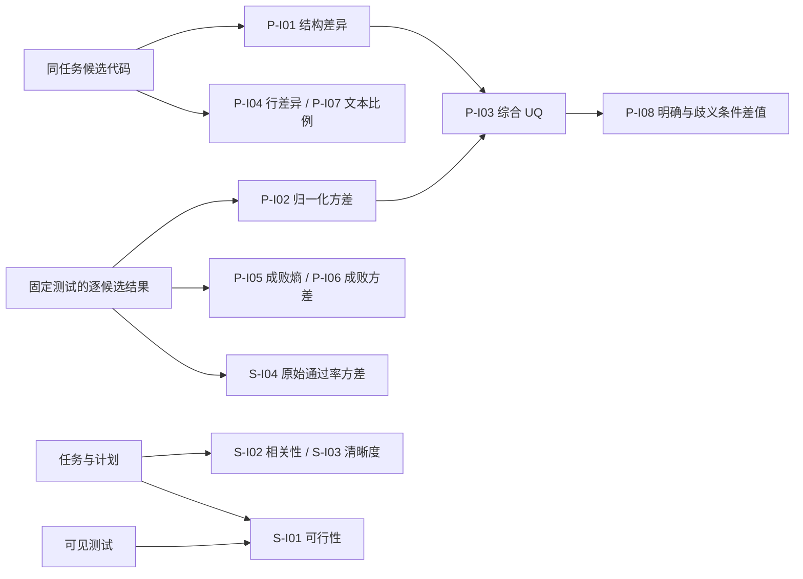
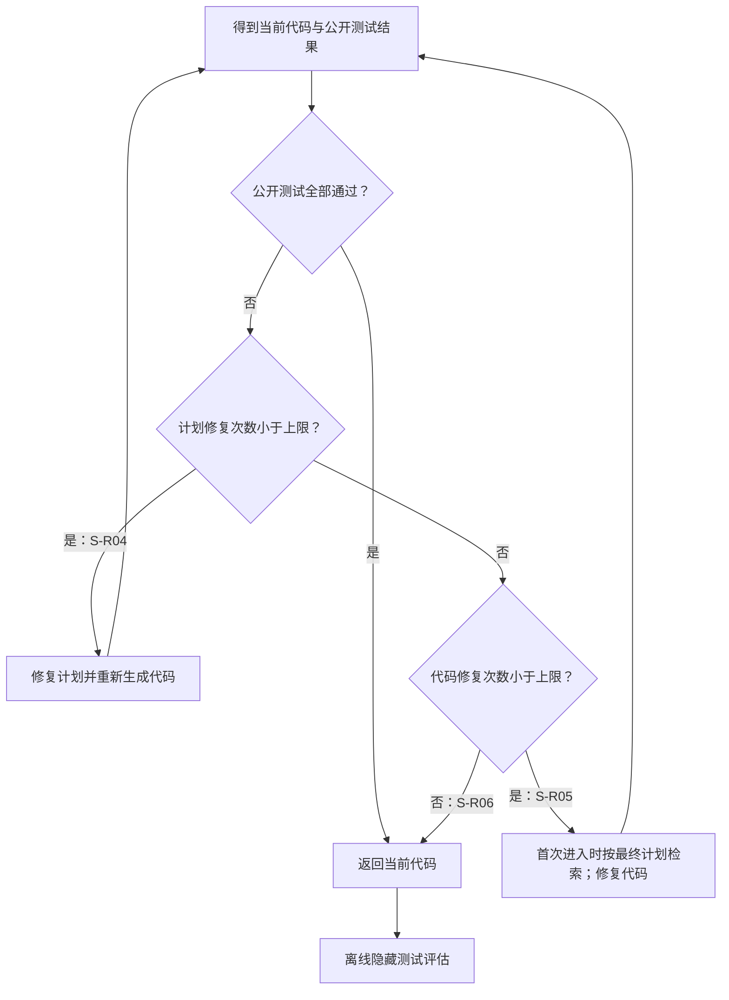

# 决策不确定性及其来源的分析-分类-量化方法研究报告

项目编号：

项目名称：智能软件决策不确定性在线感知与质量风险预测技术

牵头责任单位：

承研单位：北京航空航天大学

项目负责人：

协议编号：

研究周期：

编制日期：

## 摘要

智能软件的需求理解、任务规划和代码生成形成连续决策过程。不确定性可能来自信息缺失、语义歧义、模型推理与采样、计划缺陷及评测环境。本报告建立“决策环节—来源—可观测信号—量化与响应”的分类框架，结合项目展示页面逐项说明十二项指标和十二条规则、策略。PULSE 部分涵盖代码差异、测试波动、成败分布、配对变化和需求风险条件；PlanCoder 部分涵盖计划可行性、相关性、清晰度、通过率波动及分阶段修复策略。报告给出输入、数学表达、短伪代码、合成算例与接口对应，并用需求端受控实验及计划质量论文分析说明其研究依据。结果表明，低生成波动不能排除稳定错误理解，计划质量三个维度也具有不同解释能力。指标、质量结果和修复动作分别组织，形成可查找、可复算、可追溯的目录，为进一步风险验证和项目级成果核定提供基础。

关键词：决策不确定性；来源分类；指标库；规则库；PULSE；PlanCoder

## 1 研究目的与范围

### 1.1 研究对象与问题

本项目以大模型驱动的代码生成为主要观察载体，将需求文本视为输入条件、任务计划视为中间决策、代码与测试结果视为输出及反馈。研究关注三个问题：不确定性可能在哪个环节产生，哪些数据能够观察其表现，以及如何把观测量转为可调用的指标和有明确条件的规则。检索与工具调用可沿用相同记录方式，具体方法见配套《智能软件决策多元不确定性主动感知方法研究报告》。

分析中区分用户实际意图、系统可见需求和测试程序的判定条件。测试通过说明满足当前测试，需求含糊描述输入状态，代码差异反映生成表现，计划评分描述中间方案质量。通过明确这几类对象，可以避免用一个结果反推全部来源，也便于定位应当澄清需求、修改计划还是修复代码。

### 1.2 指标与规则的组织目标

指标回答“观察到什么、如何量化”，规则回答“满足什么条件、提示什么风险或采取什么动作”。本报告采用与展示目录一致的编号和名称，统一给出条目定义、计算方式、实验依据及接口约定。需求端波动指标主要依赖代码生成和测试后的数据；三维计划评分可在代码生成前取得；修复控制依赖当前公开测试反馈。观察时点是条目定义的一部分。

当前目录包括 PULSE 八项指标、六条候选风险条件，以及 PlanCoder 四项指标、三条预测假设、三条修复策略。目录组织旨在支持研究复用与项目展示；独立性、适用场景与验证状态分别标注，统一在第六章说明。

### 1.3 研究基础与资料使用

CodeBLEU 将词法、语法和数据流信息用于代码相似度评价[1]；本项目将同题候选的成对差异用于生成分散程度分析。需求澄清研究提供了通过主动询问补充缺失信息的技术基础[2–4]，PULSE 进一步考察需求条件、生成波动和澄清收益的关系。PlanCoder 从规划提示、三维计划质量及分阶段优化三个方面研究计划对代码生成的作用[5]。

条目名称、输入输出与成熟度与项目展示目录一致[6]，PlanCoder 的研究定义和实验结论依据计划质量研究论文[5]，相关数据与结果通过归档资料追溯[7,8]。函数实现用于说明计算约定和接口行为。合成算例用于演示计算过程，实验统计按论文或归档记录引用，并在正文与表题中标明来源。

## 2 研究方法与分类框架

分类工作按“通用来源梳理—代码生成场景分析—框架整合—指标设计与验证”组织。首先结合历史实施方案辨析信息不完备、模型偏差和生成随机性等共性来源；随后按需求端、规划端和执行端分析场景特有表现，建立端侧与来源的对应关系；最后用可复算指标和受控实验检验部分分类的可观测性。系统性文献检索与项目级类别全集的完善列为后续研究工作。

### 2.1 概念与分析单元

将一次任务表示为需求输入、可选计划、生成代码和评测环境。不确定性指在给定已知信息与观察时点下，决策条件或结果仍存在无法充分确定的部分。分析单元记为“任务—决策环节—来源—观察时点—可观测信号”。事后测试失败是质量结果，不能直接充当事前已经感知的不确定性。

来源分两层：通用来源包括信息不完备或含噪、模型知识与推理局限、生成随机性、交互反馈偏差、外部环境和评测条件变化；领域来源包括规格缺失、接口语义模糊、计划步骤遗漏、代码逻辑违背需求和环境不兼容等。同一失败现象可能有多种原因，须结合对照实验和过程记录判断。

### 2.2 环节与来源的分类框架

| 决策环节 | 来源与典型表现 | 当前可用信号 | 证据状态 |
| --- | --- | --- | --- |
| 需求理解与条件确定 | 规格缺失、词义或句法歧义、隐含约束；可能稳定形成错误理解 | 需求文本；明确与歧义需求的配对差异；生成结果波动 | 已开展受控歧义诊断；真实任务来源识别待验证 |
| 任务规划与方案选择 | 步骤遗漏、可行性不足、目标偏离、表达含混 | 计划可行性、需求相关性、清晰度评分及可见测试反馈 | 有规划质量研究；不确定性解释和复算待核 |
| 代码生成与执行反馈 | 采样差异、知识或推理偏差、接口和环境适配错误 | 代码结构差异、测试表现波动、错误日志 | 部分离线指标可计算 |
| 代码生成跨环节传递 | 需求误解进入计划，计划偏差影响代码，反馈改变后续决策 | 同任务跨环节版本、时间戳和干预记录 | 联合数据与传播强度待建立 |

这是面向当前研究载体的工作分类。合同中的核心类别与来源覆盖率，须依据经项目组确认的类别全集、判定规则和第三方测试样本计算；本表不构成覆盖率结论。

### 2.3 分类边界

“需求含糊”是潜在来源，“代码差异大”是可观测表现，“测试未通过”是质量结果，“先澄清需求”是干预动作。资料记录中应分别标注。计划质量评分与规划决策不确定性可能有关，但未经校准不能直接解释为错误概率。低生成波动也可能掩盖稳定错误理解。

### 2.4 分类维度与编码规则

分类不能只列出故障现象，还应回答“何处产生、由何产生、何时可见、影响何种决策”。为此，建议每条记录至少包含四个主维度。**环节**采用需求、规划、生成执行三类主码，并保留检索或工具调用等扩展码。**来源**先分通用与领域来源，再细化为信息缺失、语义冲突、数据噪声、模型知识不足、采样波动、规划约束遗漏、运行环境差异等子码。**表现**描述文本、计划、代码和测试中直接可观察的事实。**时点**记录信号是在生成前、计划后、执行后还是经反馈修复后取得。质量结果和干预动作另列字段，不与来源混用。

例如，一项需求写有“返回最大的质因子”，变体改为“返回较大的质因子”，其直接变化是选择准则弱化，来源码应指向输入约束模糊；若随后多次代码生成表现分散，可再记录生成差异，但不应把“代码不同”反推成唯一来源。另一项任务的需求删除决定性条件后，模型十次生成均失败且实现相似，此时结果波动指标可能偏低，输入信息缺失仍应保留为候选来源。对于计划遗漏边界处理的任务，应记录计划原文和评分依据，再核对代码是否继承这一遗漏；仅见到最终测试失败，不足以确证偏差是在计划环节首次出现。

一个任务可同时拥有多个来源标签。多标签标注必须区分“直接证据”“有条件推断”和“尚未确定”。直接证据来自原文差异、版本记录或可重放的运行现象；有条件推断需要写明推断链及竞争解释；无法判断时保留未知标签，不强行归入最接近的类别。类别间冲突由标注手册规定优先级，例如“输入缺失”与“语义歧义”可能并存，不能因为其中一类更容易度量便覆盖另一类。这样形成的类别全集才能用于后续覆盖率分母。

### 2.5 来源到观测信号的映射

同一种不确定性来源可以产生不同观测信号，反之亦然。输入歧义可能导致候选代码结构分散，也可能导致模型稳定选择错误解释；计划步骤遗漏可能导致生成失败，也可能被生成模型在后续阶段自行补全；代码执行失败可能由错误算法、异常输入或测试适配器造成。因而，本报告采用“来源—中间状态—质量结果”的链式表示，而不把两端直接等同。链式记录中每一段都注明可观测对象和证据身份：需求文本变化、计划维度评分、代码候选差异、断言结果及人工审核说明。

对跨环节关系，只在同一基础任务、相同测试版本和可比较的生成配置下讨论变化。若需求和计划同时改变，就无法仅凭最终正确率判断哪一端起主要作用；需要配对条件、受控扰动或额外复核。历史方案提出的传播拓扑和强度量化，为后续研究提供结构目标；目前尚未形成同任务的需求端与规划端联合全过程数据，因此本报告只给出可检验的路径描述和记录接口，不给出已验证的因果传播系数。

### 2.6 分类标注与复核程序

正式分类建议先编制案例手册：每类写明定义、正例、反例、可混淆类别和最小证据。标注任务按基础任务分组，避免同一题的多个变体同时进入训练与测试集合；标注者先只看需求和必要上下文，形成输入端判断，再分阶段开放计划、代码与测试记录，防止事后结果反向污染事前标签。对于需依赖用户意图的类别，还应标记事实来源：原需求明确支持、由独立用户回答支持、仅由参考实现或测试推断、无法判定。测试和参考解可用于研究审核，但不能未经说明地冒充在线用户可见的事实。

双人标注后统计一致与分歧，不一致案例经讨论形成带理由的裁决记录。稀有类别应明确样本不足，避免把无样本类别当作高准确率类别。新增类别需说明与原类别的差异、是否要求新增数据字段以及对既有指标的影响；弃用类别则保留版本映射。正式类别数、标注一致性、覆盖率及误分类统计以项目级标注和测评结果为准。

### 2.7 典型边界案例

**稳定失败与低波动。** 一组需求变体虽然遗漏关键目标，模型却稳定地给出同一类错误答案。结构差异和断言方差都可能较小。这说明“生成不稳定”只是可观测的一种不确定性表现，不能成为所有需求来源的充分条件。后续需引入需求完整性、条件覆盖或外部事实询问等独立信号。

**代码差异与功能等价。** 两份候选使用不同算法或命名，CodeBLEU 差异可能较大，但均通过同一测试。此时结构差异提供决策路径分散的证据，尚不能认定质量风险升高。若测试覆盖不足，也不能从共同通过推出完全等价，应保存未测边界和测试版本。

**规划评分与质量结果。** 一份计划表达清晰却遗漏关键条件，清晰度可能高而可行性低；另一份计划描述较粗但模型仍生成正确代码。三个评分维度需要分别记录，不以平均分遮蔽差异。只有通过评分复算、人工一致性及独立样本上的增量效度检验，才可讨论它们的正式入库与风险用途。

### 2.8 需求扰动类型与来源类别的对应

本项目在需求端从两种视角分析输入问题。一种视角描述需求本身可能存在的歧义、模糊、欠规格和隐含约束，关注开发者与模型要理解的内容；另一种视角使用可控制的文本变换，观察模型在相同任务下的代码表现。受控预研究设置了六种文本扰动操作。扰动操作是构造样本的方法，不能直接作为“不确定性来源”的正式类别；只有核对文本前后的任务意图、约束和下游表现，才能讨论它暴露了哪一种来源。

| 本项目需求端预研究的扰动操作 | 变换内容 | 对来源判定的启发 | 必须核对的边界 |
| --- | --- | --- | --- |
| 内容改写 | 抽象或改述功能约束、边界条件或任务意图的细节，保留高层任务 | 可能暴露语义条件弱化、隐含约束或欠规格 | 改写后是否丢失决定性条件、改变目标或新增约束 |
| 格式转换 | 改为自然对话式段落，原则上保留全部功能要求 | 检查模型对表达结构和信息位置的敏感性 | 若语义完全保持，不能仅凭格式变化认定需求有歧义 |
| 示例删除 | 删除输入输出示例或样例用法 | 示例若承载唯一边界信息，可能形成信息缺失 | 示例是否重复正文、删除后是否仍有足够规格 |
| 冗长改写 | 增加重复描述而不改变预期功能 | 检查冗余信息对模型注意和解析的影响 | 冗长不必然导致不确定性，不应与信息缺失混淆 |
| 噪声注入 | 插入无关自然语言内容，不增加任务条件 | 对应通用输入噪声的受控检验 | 是否意外加入可解释为新约束的文字 |
| 拼写扰动 | 引入字符或拼写错误，尽量保持原意可读 | 检查词汇识别受损及其对实现的影响 | 错误是否改变标识符、接口名或关键术语的指向 |

这些操作还应与本报告所用的词汇、语义、句法歧义及模糊表述四种受控变体分开。两组标签的设计目的和构造方法不同，不能建立未经审核的一一对应。例如“内容改写”可能形成语义条件弱化，也可能只是同义表达；“格式转换”可能影响模型表现，却没有改变任何需求约束；“示例删除”只有在示例提供独有信息时才体现规格缺失。六种操作与四种变体均不能相加推算项目的不确定性来源类别数量。

在分类标注中，建议为每个需求对记录五项信息：**变换操作**说明文本如何产生；**语义状态**说明任务目标、输入域、输出约束和边界条件是否保持；**来源判断**说明存在何种信息缺口、歧义、噪声或冲突；**模型响应**分别记录功能表现与生成波动；**澄清价值**记录是否存在可由用户补充且足以改变决策的信息。前三项依赖文本对照与人工裁决，模型响应还需明确生成配置和测试版本，澄清价值则需回答来源与干预对照。若文本没有实质性变化却出现代码波动，应优先检查采样和模型因素；若条件被删却没有 UQ 增量，仍保留输入缺失的来源标签。这样可以把受控扰动分析纳入本项目按来源建立的分类框架。

本项目开展了需求文本扰动对比实验。结果显示，噪声注入、冗长改写等表层变化对生成波动的影响较小或因数据集而异；涉及功能约束的内容改写则更容易导致功能表现下降和生成差异扩大。上述结果来自特定的基准、模型和扰动设置。后续受控歧义诊断使用另一组变体和实验协议，两组结果分别呈现；逐例是否保持原意及相关统计值，仍需结合原始运行记录复核。

## 3 指标库：十二项指标的定义与计算

### 3.1 指标总览与统一符号

本章依据当前展示页面逐项说明十二项指标，编号、名称与目录一致[6]。PULSE 指标观察需求条件下的生成差异，PlanCoder 指标观察计划质量及生成结果的稳定性。A 表示“实现与记录”，B 表示“待独立验证”，C 表示“机制候选”；这是页面成熟度标记，独立条目认定另见第六章。

| 编号 | 页面名称 | 成果类型 | 范围 | 状态 |
| --- | --- | --- | --- | --- |
| P-I01 | 多次生成代码的差异程度 | 不确定性度量 | [0,1] | A |
| P-I02 | 多次生成代码的测试表现波动 | 不确定性度量 | [0,1] | A |
| P-I03 | 代码差异与测试波动综合分数 | 不确定性度量 | [0,1] | A |
| P-I04 | 代码行的差异程度 | 不确定性度量 | [0,1] | B |
| P-I05 | 多次生成结果的成败混合程度 | 不确定性度量 | [0,1] bit | B |
| P-I06 | 多次生成结果的成败波动分数 | 不确定性度量 | [0,0.25] | B |
| P-I07 | 不同代码文本所占比例 | 不确定性度量 | [1/K,1] | B |
| P-I08 | 需求表述变化后的综合分数差值 | 不确定性度量 | [-1,1] | A |
| S-I01 | 计划可行性评分 | 计划质量评分 | [0,1] | B |
| S-I02 | 需求相关性评分 | 计划质量评分 | [0,1] | B |
| S-I03 | 计划清晰度评分 | 计划质量评分 | [0,1] | B |
| S-I04 | 多次生成代码的测试通过率波动 | 结果波动度量 | [0,0.25] | B |

设同一任务、同一需求条件下生成代码 $c_1,\ldots,c_K$，第 $i$ 份代码在固定测试集合上的通过比例为 $r_i\in[0,1]$，完全通过标记为 $y_i=\mathbb{1}[r_i=1]$。记 $\bar r=K^{-1}\sum_i r_i$，$p=K^{-1}\sum_i y_i$。成对差异和生成波动的研究比较采用 $K\ge2$；涉及单个候选和空输入的接口约定见附录 A。下列伪代码展示数学与判断逻辑，公共参数校验省略，示例均为合成算例。



图 1　指标的数据依赖。连线表示计算输入关系，不表示因果传播；S-I01 的可见测试与用于事后评估的完整测试须分别记录。

### 3.2 P-I01 多次生成代码的差异程度

比较同一任务的候选代码在词法、语法及数据流等方面的分散程度。输入为候选代码和固定版本的 CodeBLEU 相似度计算器，取全部无序候选对的差异均值，范围为 $[0,1]$：

$$D_{code}=\frac{2}{K(K-1)}\sum_{i<j}\bigl(1-\mathrm{CodeBLEU}(c_i,c_j)\bigr).$$

相似度为 0.8、0.6、0.7 时，差异度为 0.3。值越高表示生成形式越分散，功能是否错误须结合测试判断。该指标用于 PULSE 的 161 题诊断；复算需冻结候选顺序、CodeBLEU 版本、参数与环境[1,7]。HTTP 试算接口聚合外部提供的成对相似度，本身不执行 CodeBLEU。

### 3.3 P-I02 多次生成代码的测试表现波动

输入同题候选的测试通过比例，先计算总体方差，再除以 $[0,1]$ 变量方差的理论上界 0.25，得到归一化波动：

$$D_{test}=\min\left(1,\frac{K^{-1}\sum_i(r_i-\bar r)^2}{0.25}\right).$$

通过比例为 0、0.5、1 时，方差为 $1/6$，指标约为 0.6667。PULSE 归档测试记录可用于复算[7]。它反映候选间的功能波动；全部通过与全部失败都可能得到零，因此应同时展示平均通过率。

### 3.4 P-I03 代码差异与测试波动综合分数

将结构差异和功能波动各赋一半权重，形成当前 PULSE 实验采用的综合分数：

$$UQ=0.5D_{code}+0.5D_{test},\qquad UQ\in[0,1].$$

当两分量为 0.3 和 0.6667 时，UQ 约为 0.4833。该值用于需求条件比较与选择性澄清研究[7]。固定权重便于复算，但分数没有失败概率含义；其信息来自 P-I01、P-I02，独立计数时应说明组合的增量用途。

### 3.5 P-I04 代码行的差异程度

把每份代码转换为去除空行、逐行去首尾空白后的行集合 $L_i$，计算平均 Jaccard 差异，作为较轻量的文本结构信号：

$$D_{line}=\frac{2}{K(K-1)}\sum_{i<j}\left(1-\frac{|L_i\cap L_j|}{|L_i\cup L_j|}\right).$$

当两份代码的行集合并集为空时，将该候选对的差异记为 0。集合 `{a,b}` 与 `{a,c}` 的差异为 $2/3$。该指标已有计算入口[6]，但变量改名、行拆分也会改变得分；对 P-I01 的补充价值需由实际任务验证。

### 3.6 P-I05 多次生成结果的成败混合程度

根据完全通过测试的比例 $p$ 计算二元熵，刻画成功、失败是否混合出现，单位为 bit，范围为 $[0,1]$：

$$H=-p\log_2p-(1-p)\log_2(1-p),\qquad 0\log_20:=0.$$

一半成功、一半失败时为 1；全成功或全失败时为 0。PULSE 的成败记录支持该计算[6]。它关注整体成败，不保留“通过部分测试”的细节，与 P-I02 的输入层次不同。

### 3.7 P-I06 多次生成结果的成败波动分数

将每次生成是否完全通过测试视为二元变量，其总体方差为：

$$V_{binary}=p(1-p),\qquad V_{binary}\in[0,0.25].$$

三次生成中一次完全成功时，结果为 $2/9$；成功、失败各半时达到 0.25。该指标与 P-I05 共享同一个 $p$，可作为不同统计表达，但不能仅凭公式不同认定为独立能力[6]。

### 3.8 P-I07 不同代码文本所占比例

统计候选中完全不同的代码字符串数量，衡量文本层面的重复情况：

$$R_{unique}=\frac{|\{c_1,\ldots,c_K\}|}{K},\qquad R_{unique}\in[1/K,1].$$

五份代码中有三种不同字符串时为 0.6；五份完全相同时为 0.2。页面按字符串完全一致去重，空白、注释和变量名变化也可能产生新字符串，因此该量描述文本多样性，不直接代表算法多样性[6]。

### 3.9 P-I08 需求表述变化后的综合分数差值

在同一基础任务上比较含糊需求和明确需求对应的综合分数：

$$\Delta UQ=UQ_{ambiguous}-UQ_{clear},\qquad \Delta UQ\in[-1,1].$$

两种条件分数为 0.20 与 0.13 时，差值为 0.07，表示含糊条件下观察到更高波动。该指标服务 PULSE 配对诊断[7]，需要明确需求参照；配置变化也会影响差值，应保留两条件的测试和模型版本。

### 3.10 S-I01 计划可行性评分

评价计划是否包含足够且正确的算法逻辑，能否处理关键约束、边界情况并满足可见测试。输入为任务 $q$、计划 $P$、可见测试 $T_{vis}$ 和评判标准，输出分数及理由：

$$s_f=J_f(q,P,T_{vis})\in[0,1].$$

例如，题目要求空输入返回空列表，而计划未处理空输入，可在评分理由中明确指出该缺口。论文表 2 报告 Pearson/Spearman 相关为 0.293/0.158，表 3 报告人机一致性 CCC 为 0.898[5]。它是计划质量评分；界面评分接口依据论文标准实现，原始实验评分脚本与逐例记录另行归档。

### 3.11 S-I02 需求相关性评分

评价计划是否瞄准题目目标、覆盖明确功能要求，并保持正确的问题范围。输入为任务与计划，该维度不向评判器提供测试：

$$s_r=J_r(q,P)\in[0,1].$$

例如，题目要求返回所有符合条件的元素，计划只寻找第一个元素，应说明目标覆盖不足。论文报告该维度与下游测试通过率的 Pearson/Spearman 相关为 0.198/0.101，人机 CCC 为 0.866[5]。计划表达流畅不能替代需求相关性判断。

### 3.12 S-I03 计划清晰度评分

评价步骤顺序、术语与指代、操作具体性，以及能否据此落实实现。输入为任务与计划，输出 $[0,1]$ 分数和依据：

$$s_c=J_c(q,P)\in[0,1].$$

“处理数据并返回正确结果”缺少可执行步骤；明确遍历对象、判断条件和输出构造更便于实现。论文报告 Pearson/Spearman 相关为 0.102/0.079，人机 CCC 为 0.839[5]。清晰度衡量计划的可理解与可落实程度，不能由篇幅或文风代替。

### 3.13 S-I04 多次生成代码的测试通过率波动

在同一任务和测试条件下，度量多份实现的通过率离散程度。当前页面固定采用总体方差，至少输入两个通过率：

$$V_{plan}=\frac{1}{K}\sum_i(r_i-\bar r)^2\in[0,0.25].$$

通过率为 0、0.5、1 时，结果为 $1/6$。论文 RQ1 每任务每设置生成五次，先计算任务内波动、再跨任务平均[5]；论文未明确方差分母约定，上式为当前界面实现口径。在完全相同的输入和总体方差约定下，P-I02 等于本指标的四倍。

### 3.14 指标的联合解释

十二项指标可以按数据来源联合阅读。代码差异高而测试波动低，可能表示不同实现均满足测试；两者都低但平均通过率低，可能表示稳定失败。计划可行性低、相关性高，提示实现逻辑存在问题；相关性低、清晰度高，提示计划清楚地描述了偏离目标的方案。三维评分宜分别呈现，并保留理由。

质量结果与不确定性信号应并列记录：通过率用于说明当前质量，波动用于说明候选之间的稳定性，计划评分用于定位中间决策的质量特征。未经验证，不将三类数值直接平均成统一错误概率，也不将 $1-s_f$ 自动命名为经校准的规划不确定性。

## 4 规则库：十二条风险条件与修复策略

### 4.1 规则组织与共同约定

当前目录包含六条 PULSE 候选风险条件、三条 PlanCoder 预测假设和三条 PlanCoder 修复策略。以下逐条解释条件与用途。风险条件返回 `triggered`，表示条件是否满足；修复策略决定下一动作。需求类别、语义缺口和回答核对结果由外部检测器或人工提供，规则函数不自行完成这些识别。

设 $U$ 为当前可用的 UQ，$U_{prev}$ 为历史批次 UQ，$\tau_H$、$\tau_L$ 分别为高、低分界线；$\theta_f,\theta_r,\theta_c$ 为三维计划分数阈值。阈值应在开发数据上确定并在独立测试前冻结。下文示例中的 0.6、0.3 仅用于演示判断，不作为论文实证阈值。规则编号、成熟度与页面保持一致[6]。

### 4.2 P-R01 综合分数较高时的后续失败风险

**条件与用途：**当前一批代码的 UQ 达到高分阈值时，对后续生成给出风险提示，供复核或预算分配使用；后续批次的测试结果仅用于验证。

**判定式：**$U_{prev}\geq\tau_H$。

如历史 UQ 为 0.7、阈值为 0.6，则触发。页面记录的 520 案例事后分组中，最低与最高 UQ 组的后续失败比例约为 4.90% 和 48.75%；该探索性关系支持继续验证，当前状态为 B[6]。

### 4.3 P-R02 模糊表述的正确性下降风险

**条件与用途：**需求被可靠识别为模糊表述类时，提示检查选择准则、范围和程度词等不明确条件。

**判定式：**需求类别为“模糊表述”。

例如“返回较大的元素”缺少明确比较基准，需结合完整需求确认类别。161 题受控实验中，该条件的可靠性较明确需求低 18.82 个百分点；这一类均值差异为规则提供依据，不能直接作为单任务下降幅度。状态为 B[6,7]。

### 4.4 P-R03 词汇歧义的正确性下降风险

**条件与用途：**需求被识别为词汇歧义类时，提示核对多义词、领域术语及其指代，必要时澄清。

**判定式：**需求类别为“词汇歧义”。

例如需求中的“唯一”究竟要求去重还是只保留出现一次的元素，需要上下文或用户确认。受控实验中词汇歧义条件的可靠性下降 7.33 个百分点。此条与 P-R02 共用类别触发模板，状态为 B[6,7]。

### 4.5 P-R04 综合分数低时仍可能遗漏关键需求

**条件与用途：**独立检查发现关键语义缺口，同时 UQ 处于低值区间，仍发出需求复核提示。

**判定式：**独立检测到语义缺口，且 $U\leq\tau_L$。

如 UQ 为 0.2、低值阈值为 0.3，且已发现“所有”与“任意一个”的条件不清楚，则触发。依据是语义歧义下可靠性下降 6.09 个百分点，而 UQ 平均增量约为 0.003。状态为 B；条件中的语义缺口不能仅由低 UQ 推断[6,7]。

### 4.6 P-R05 无依据澄清约束的退化风险

**条件与用途：**追加回答的前提、表述完整性、事实依据、历史一致性或关键条件完整性任一核对未通过，提示先复核再整合。

**判定式：**前提有据、回答自足、内容可由依据支持、历史一致、关键条件完整这五项核对中，任一项未通过。

例如原需求允许零值，追加回答却无依据地限定“仅正数”，应触发。该规则源于澄清负收益案例及防护要求，当前状态为 C；核对字段由人工或外部检查器给出，条件函数本身不证明回答真实[6]。

### 4.7 P-R06 结果看似稳定却持续误解需求的风险

**条件与用途：**UQ 较低，且有独立证据表明决定性需求条件缺失，提示检查模型是否稳定采用了错误默认解释。

**判定式：**$U\leq\tau_L$，且有独立证据表明决定性约束缺失。

例如任务只允许处理奇数位置，但这一条件在输入中丢失，模型可能稳定处理全部位置。既有案例支持这一风险机制，状态为 C。与 P-R04 相比，本条强调决定性约束缺失及稳定误解；两条存在交叉，需在正式计数时核对[6]。

### 4.8 S-R01 低计划可行性的后续实现风险

**条件与用途：**生成前的可行性分数低于预定阈值，提示检查算法步骤、边界处理及公开测试一致性。

**判定式：**$s_f<\theta_f$。

如评分为 0.4、演示阈值为 0.6，则触发。依据是论文中可行性与测试通过率的正向关系，Pearson 为 0.293，Spearman 为 0.158。当前状态为 C；阈值分类性能需要独立数据验证[5,6]。

### 4.9 S-R02 低计划相关性的后续实现风险

**条件与用途：**相关性分数低于预定阈值，提示核对计划是否覆盖任务目标、输出约束和功能范围。

**判定式：**$s_r<\theta_r$。

例如计划处理了排序却忽略题目要求的去重，可产生相关性风险提示。论文报告 Pearson/Spearman 为 0.198/0.101。当前状态为 C，与另外两维共享低分触发规则族[5,6]。

### 4.10 S-R03 低计划清晰度的后续实现风险

**条件与用途：**清晰度分数低于预定阈值，提示补充操作顺序、条件分支、输入输出及关键中间变量的说明。

**判定式：**$s_c<\theta_c$。

例如“根据情况处理异常”没有说明条件与动作，可据评分理由复核。论文中该维度与代码通过率的 Pearson/Spearman 为 0.102/0.079，关联较弱，当前状态为 C[5,6]。

### 4.11 S-R04 公开测试失败后的计划修复

**条件与动作：**当前代码未通过全部公开测试，且计划修复预算仍有余量，则修复计划并重新生成代码。记已执行计划修复次数为 $i$，上限为 $B_P$，页面默认 $B_P=5$。

**判定式与动作：**公开测试未全部通过，且 $i<B_P$ 时，修复计划并重新生成代码。

如测试失败且已修复计划两次，则继续这一阶段。论文以可行性、相关性、清晰度指导修复，公开测试结果决定是否继续。页面状态为 A，成果类型为修复策略[5,6]。

### 4.12 S-R05 计划修复耗尽后的检索与代码修复

**条件与动作：**公开测试仍失败、计划修复预算已耗尽，而代码修复次数 $j$ 尚未达到上限 $B_C$，进入代码修复阶段；页面默认 $B_C=6$。

**判定式与动作：**公开测试未全部通过、$i\geq B_P$ 且 $j<B_C$ 时，依据最终计划检索并修复代码。

如计划修复五次仍失败、代码修复尚未开始，则触发。进入阶段时用最终计划检索、重排参考案例；之后固定计划及案例，逐轮更新失败代码与反馈。状态为 A[5,6]。

### 4.13 S-R06 公开测试通过或预算耗尽后的停止

**条件与动作：**任一阶段通过全部公开测试时立即返回；若两类修复预算均耗尽，则返回最后的实现。研究评估随后使用隐藏测试判断返回代码的质量。

**判定式与动作：**公开测试全部通过，或 $i\geq B_P$ 且 $j\geq B_C$ 时，返回当前代码，并记录停止原因。

首次生成即通过时无需耗尽预算；执行完五次计划修复和六次代码修复仍失败时也应停止。公开测试通过与预算耗尽须记录不同停止原因，状态为 A[5,6]。

### 4.14 三条修复策略的衔接



图 2　PlanCoder 修复策略的优先级。通过测试优先停止；预算只在对应修复实际执行后累加。三条策略说明控制流程，低计划质量的三条假设说明风险提示，两者在用途上分别登记。


## 5 实验依据与结果解释

本章依据 PULSE 研究归档中的受控诊断与文本审核结果[7]，计划质量分析以论文表 2～3 为依据[5]。数值说明指标和规则的研究来源，算法解释与接口样例见前两章。

### 5.1 受控诊断的数据组织

需求端诊断以基础任务为配对单位，为每个任务准备明确需求以及词汇歧义、语义歧义、句法歧义、模糊表述四种条件。原始集合包含 164 个任务；由于三项任务的语义变体与预期函数入口不匹配，主要分析统一排除这三项，保留 161 个基础任务、五种条件，共 805 组需求条件和 8050 份生成代码。排除依据来自输入错配，未依据可靠性或 UQ 大小选择样本；原始结果仍作补充记录。实验中的变体是受控文本操作，便于比较某一类表达变化的影响，但其类别标签不等于自然用户需求的真实分布。

五种条件采用同一套测试和统一的统计口径比较，既记录完全通过测试的候选比例，也记录平均断言通过率及 UQ。以基础任务为单位做配对分析，可减弱任务难度差异对类别比较的干扰；如果把 805 组条件或 8050 份代码简单当作相互独立样本，会低估同题样本之间的相关性。研究报告中的总体数值应注明“任务”“需求条件”“候选代码”三个不同层级，避免把 520 个变体案例误读为 520 个独立基础任务。

### 5.2 不同需求变化的观察结果

| 需求条件 | 代码可靠性 | 平均 UQ | 相对明确需求的解释 |
| --- | ---: | ---: | --- |
| 明确需求 | 83.79% | 0.1349 | 配对参照 |
| 词汇歧义 | 76.46% | 0.1564 | 可靠性下降，波动上升 |
| 语义歧义 | 77.70% | 0.1379 | 可靠性下降，UQ 增量很小 |
| 句法歧义 | 81.30% | 0.1479 | 影响较小但不能视为无风险 |
| 模糊表述 | 64.97% | 0.1524 | 可靠性下降较明显 |

该表说明两个问题。其一，需求表述变化能够通过代码功能表现体现，但不同变化类别的平均影响并不相同。其二，UQ 和可靠性不是一一对应关系：语义歧义条件可靠性比明确需求低 6.09 个百分点，平均 UQ 只增加约 0.003。可能的解释包括模型对错误语义形成一致理解、现有相似度对关键语义变化不敏感、测试覆盖与生成样本规模不足等。现有数据支持“单一波动度量存在漏检边界”，尚不能在这些解释之间做唯一归因。

研究进一步对类别差异使用基础任务配对统计，而不是仅比较五个总体均值。按已归档主要分析，词汇和语义歧义的可靠性下降在任务级配对区间中未跨零；这说明在当前受控样本和评测协议下观察到差异。统计显著性不代表实际应用中同类歧义的发生概率或风险幅度相同，也不能直接推导出适合在线系统的统一阈值。

### 5.3 澄清案例对量化解释的反证

后续选择性澄清实验保留了低 UQ 却有较大可恢复收益的案例。例如，有任务遗漏“所有”这一全称条件、目标数字或对输入结构的限定，旧批次 UQ 较低，新批次澄清后候选代码明显改善。这类案例与“高波动可能意味着多种解释并存”并不矛盾：它表明“多种解释并存”只是输入不确定性的一种表现；关键条件缺失还可能促使模型稳定采用默认解释。分类框架因此需要独立记录信息缺失，并将 UQ 视为局部观测量。

另一方面，某些高 UQ 任务在澄清后仍无改善，甚至退化。若回答补充了没有依据的新约束，或者生成模型无法正确落实已补充条件，质量结果也可能下降。这样一来，UQ 的大小、澄清收益和澄清风险需要分别建模。把澄清后的好坏直接用于定义此前的“不确定性高低”，会导致指标含义随干预策略变化而漂移。

### 5.4 规划端分析的适用范围

本项目规划端从有结果波动的任务中筛选 202 个任务，比较每题较好和较差的计划，共形成 404 份计划样本。三项计划评分与下游测试通过率的 Pearson 相关分别约为 0.293、0.198 和 0.102；与人工评分的一致性分析另外抽取 100 题、200 份计划，得到三维度的协调一致性系数约为 0.898、0.866、0.839。前者讨论评分与代码表现的关系，后者讨论评分是否接近人工评判，二者不能互相替代。由于任务筛选有条件、可见测试不完备、评分依赖模型评判器，结论限于该实验设置。逐例材料尚待归档并独立复算，因此上述统计结果仍按当前样本和评判设置解释。

计划可行性与代码表现的关联较其他两个维度强，但系数仍较低。真实的规划风险可能需要结合需求端信息、计划版本差异、步骤覆盖率和后续测试反馈共同解释。质量评分适合成为后续规划端分析的输入，是否作为独立不确定性指标，应由定义、重复评分稳定性和独立任务验证决定。

### 5.5 评测误差与可复现性

代码候选的功能评分依赖测试适配器。有一项任务的比较断言曾因逗号文本被解析为元组而出现恒真风险；限定范围修复后，相关候选重新评测，原始冻结值与修订值分别保存。此类问题说明，测试与参考解均不是绝对无误的“真实意图”。另有少数任务的文字输入域与原测试用例不一致，当前记录保留其差异，不静默删测或改写需求。报告中引用的主要诊断、固定预算实验和后续敏感性分析，应注明各自采用的测试版本，避免将不同口径的百分数混成同一估计。

CodeBLEU 的部分历史结果受 Python 哈希顺序影响，同样代码在不同进程中可能得到略有不同的结构差异分数。已保存的原 UQ、选择名单和实验计划不应被事后重算值覆盖。后续复现需固定哈希种子或规范化实现，保存相似度库版本，并对阈值附近的任务检查排序敏感性。功能收益的主要统计由测试通过标记计算，不依赖重新计算 CodeBLEU；但任何将 UQ 用于新选择策略的实验，都必须先明确采用哪一个指标版本。

### 5.6 变体标签的构念有效性

受控构造将文本操作分成词汇、语义、句法和模糊表述，便于组织实验，但“被标为某类变体”与“真实用户在该类信息上需要澄清”不是同一个命题。后续对 520 个验证案例的文本复核发现，有的变体只是换序、标点或近义改写，有的删除了决定性条件，还有个别直接改变了需求。全池按空白折叠比较，有 25 个变体与明确需求文本完全相同；另抽取 16 个案例做不按收益选例的文本审核，也观察到轻微改写与实质条件变化混合。小样本审核不能估计全体比例，但足以提醒：不能把四个构造标签直接视为四种经过自然场景验证的不确定性类别。

因此，正式分类应区分“扰动操作标签”“语义影响标签”“来源类别”“模型响应记录”和“澄清价值标签”。前述六种操作与本实验的四种变体属于不同构造口径，均不能直接计入合同类别数量。扰动操作说明文本如何生成；语义影响判断输入域、目标条件或输出约束是否改变；来源类别归纳经核对的信息缺失、歧义、噪声或冲突；模型响应记录功能表现与生成波动；澄清价值还要求用户有可提供的信息且回答能够影响后续决策。这五项信息需要不同的标注证据。对自然数据的类别覆盖率，不应仅用受控变体的种类数填充。若使用受控样本训练检测器，也应检查检测器是否只学会辨认扰动痕迹，而未识别真正缺失的条件。

### 5.7 统计结果的层级解释

报告中出现的百分比、相关系数和置信区间分别回答不同问题。条件可靠性比较的是在当前测试上的候选代码整体通过比例；UQ 比较的是结构和断言波动；规划评分相关系数比较的是计划评分与后续测试表现的样本关联；澄清策略差异比较的是在相同预算下选择不同案例后全池可靠性的变化。它们的分母分别可能是候选代码、需求条件、基础任务或计划样本。只有明确统计单位，才能正确解释差异大小与不确定性。

对同一基础任务的多个需求条件，统计区间应按基础任务整组重抽样；对同一计划的多次评分，应按任务或计划聚类。区间跨零表示在既定数据和方法下未确立方向性优势，不等于证明效果为零。相关性为正也不等于已找到因果路径。正式报告应同时保存点估计、区间、样本选择规则和未纳入的不确定因素，使审阅者能够区分“观察到差异”“形成解释假设”和“通过独立验证”三个层次。

## 6 条目组织、接口与验证安排

### 6.1 从来源到条目的映射

本报告以“发生环节—不确定性来源—可观测信号—条目编号—后续动作”组织成果，便于从一个问题追溯到计算与使用方式。

| 典型来源或表现 | 可用指标 | 可用规则或策略 | 主要作用 |
| --- | --- | --- | --- |
| 需求表述变化后生成分散 | P-I01～P-I04、P-I07、P-I08 | P-R01～P-R03 | 比较条件差异，提示需求复核 |
| 成功与失败候选混合 | P-I02、P-I05、P-I06 | P-R01 | 描述功能波动并研究后续风险 |
| 关键条件缺失但生成稳定 | P-I03 与独立语义检查 | P-R04、P-R06 | 补充单一波动指标的漏检情形 |
| 澄清引入无依据约束 | 回答与来源核对字段 | P-R05 | 追加约束前进行防护检查 |
| 计划步骤、目标或表达有缺陷 | S-I01～S-I03 | S-R01～S-R03 | 分维度定位计划质量问题 |
| 公开测试失败且需要继续修复 | 测试结果、修复计数 | S-R04～S-R06 | 决定计划修复、代码修复或停止 |
| 同任务生成结果不稳定 | S-I04 | 结合测试与三维计划评分解释 | 比较规划设置的生成稳定性 |

类别标签、计算结果和质量结果分别保存。测试失败本身不能确定来源首次出现于哪个环节，必须结合需求、计划和代码版本分析。配套《智能软件决策多元不确定性主动感知方法研究报告》进一步说明这些观测量如何进入主动澄清、PlanCoder 修复及推理与检索协同的方法流程。

### 6.2 页面与接口的对应

目录使用 `P-` 表示 PULSE、`S-` 表示 PlanCoder，`I` 为指标、`R` 为规则或策略。页面支持按研究工作、成果类型和成熟度筛选。各条目通过统一接口获取定义并进行试算，完整字段见 [OpenAPI](../../dist/openapi.json) 与 [项目说明](../../README.md)。

| 用途 | 接口 | 输入和输出要点 |
| --- | --- | --- |
| 查询目录或条目 | `GET /api/v1/catalog`；`GET /api/v1/metrics/{id}`；`GET /api/v1/rules/{id}` | 返回名称、类型、定义、证据及输入示例 |
| 数值指标计算 | `POST /api/v1/metrics/{id}/evaluate` | 提交通过率、成败标记、代码或已算相似度，返回 `value` |
| 计划评分记录校验 | `POST /api/v1/metrics/S-I01/evaluate` 至 `S-I03/evaluate` | 提交已有 `review`，校验维度、分数、理由、评判器和标准版本 |
| 真实模型计划评分 | `POST /api/v1/plans/score` | 服务端完成模型配置后，根据任务和计划请求评分 |
| 条件判断 | `POST /api/v1/rules/{id}/evaluate` | 返回条件是否触发及解释 |
| PlanCoder 阶段决策 | `POST /api/v1/plans/decision` | 根据公开测试结果及预算返回下一动作 |

可下载的 JavaScript 函数 `planFeasibility`、`planRelevance`、`planClarity` 接收调用方的模型配置并请求评分；HTTP 的三项指标 `evaluate` 接口则校验已有评分记录。两类入口在输入和执行方式上不同。S-I01 接收可见测试，S-I02、S-I03 仅依据任务和计划。评分器与接口版本用于复算追踪，不应被当作论文原始实验配置。

P-I01 的 HTTP 输入是 `pairSimilarities` 与 `implementationVersion`，需要调用方先按固定规则计算全部候选对的相似度。规则函数也只消费给定的类别与语义检查结果；将代码文本提交给接口、或将一个布尔字段设为真，不等于完成了原研究的全部识别过程。

### 6.3 独立性与成果类型

指标库保留十二项便于使用的目录条目，独立能力按数据来源与增量价值核对：P-I03 组合 P-I01 和 P-I02；P-I08 由两种条件的 P-I03 相减；P-I05 和 P-I06 共用成败比例；相同输入下 P-I02 与 S-I04 仅相差归一化尺度。它们可以分别服务不同分析任务，但目录数量不能直接代替去重后的考核数量。

规则库中，P-R02/P-R03 共享类别触发模板，S-R01～S-R03 共享低计划质量规则族，P-R04 与 P-R06 存在语义交叉。S-R04～S-R06 是有明确条件的流程控制策略。正式归类应保留这些关系，并依据任务协议分别核定风险预测、机制检查与修复策略的成果类型。

### 6.4 统一验证程序

| 验证内容 | 要回答的问题 | 所需材料 |
| --- | --- | --- |
| 计算与边界 | 相同输入能否得到一致结果？ | 固定公式、版本、合成算例、真实样例 |
| 信号含义 | 指标能否区分所声称的来源或表现？ | 正反例、人工标签、受控条件 |
| 规则预测价值 | 预先触发是否对应后续质量差异？ | 按任务隔离的数据、冻结阈值、误报与漏报统计 |
| 计划评分 | 分数是否稳定并接近人工判断？ | 评分标准、重复评分、人工对照、逐维理由 |
| 策略执行 | 阶段切换和预算是否符合定义？ | 运行轨迹、公开测试结果、计数与停止原因 |
| 项目级覆盖 | 各类来源是否有数据和验证支持？ | 类别全集、映射表、独立计数及正式测评记录 |

正式验证按基础任务划分开发集和测试集，避免同题变体跨集合。真实评分、历史计算和合成算例分别标注来源；对测试适配器或相似度实现的修订保留前后版本。原始评分、传播联合数据、类别全集及第三方测评结果是后续验证与成果归档的关键材料。

## 7 综合算例与结论

### 7.1 一个任务如何连接多个指标

设三份候选在同一测试集上的通过比例为 0、0.5、1，三组成对相似度为 0.8、0.6、0.7，三个代码字符串互不相同。按当前页面定义可得到：

| 条目 | 计算结果 | 解释 |
| --- | ---: | --- |
| P-I01 | 0.3000 | 结构存在差异 |
| P-I02 | 0.6667 | 归一化测试波动较明显 |
| P-I03 | 0.4833 | 两类分散信息的固定权重组合 |
| P-I05 | 0.9183 bit | 一份全成功、两份未全成功的混合程度 |
| P-I06 | 0.2222 | 同一成败比例的二元方差 |
| P-I07 | 1.0000 | 三份文本均不同 |
| S-I04 | 0.1667 | 原始测试通过率总体方差 |

此例不包含两种需求条件或计划原文，因此不填写 P-I08 和三维计划评分。若当前代码公开测试失败、计划已修复两次、代码尚未修复，则阶段决策触发 S-R04。是否触发低计划质量规则，需要先取得相应维度评分和预先指定阈值；是否属于需求歧义，需要独立的文本或语义证据。

### 7.2 结论

本报告以需求、规划和生成执行三个环节建立分类框架，并将页面的十二项指标与十二条规则、策略逐项落实到输入、公式、条件和短算法。PULSE 提供生成差异、功能波动及需求变化的量化工具，PlanCoder 提供计划质量观测与分阶段修复控制。受控实验和论文分析共同表明，质量结果、生成稳定性与中间计划质量应联合解释：稳定输出可能持续失败，清晰计划也可能缺少有效算法。

当前目录已形成从名称、编号、函数到研究依据的对应关系。进一步工作集中在固定数据与实现版本、验证风险阈值、补齐评分原始记录和核定独立条目；具体主动感知方法及其效果见配套《智能软件决策多元不确定性主动感知方法研究报告》。

## 参考文献与资料依据

[1] Ren S, Guo D, Lu S, et al. CodeBLEU: a Method for Automatic Evaluation of Code Synthesis. arXiv:2009.10297, 2020. https://arxiv.org/abs/2009.10297

[2] Mu F, Shi L, Wang S, et al. ClarifyGPT: A Framework for Enhancing LLM-Based Code Generation via Requirements Clarification. Proceedings of the ACM on Software Engineering, 2024. https://doi.org/10.1145/3660810

[3] Li H-S, Mesgar M, Martins A, Gurevych I. Python Code Generation by Asking Clarification Questions. ACL, 2023. https://aclanthology.org/2023.acl-long.799/

[4] Kobalczyk K, Astorga N, Liu T, van der Schaar M. Active Task Disambiguation with LLMs. ICLR, 2025. https://proceedings.iclr.cc/paper_files/paper/2025/hash/5e07476b6bd2497e1fbd11b8f0b2de3c-Abstract-Conference.html

[5] Anonymous Author(s). What Makes a Good Plan for Effective Code Generation? PlanCoder 研究稿，共 17 页。计划评价见第 4～7 页、表 2～3；三阶段方法见第 7～9 页、图 3；实验与消融见表 4～7。

[6] 项目指标与规则展示目录，[catalog.json](../../dist/catalog.json)、[首页](../../dist/index.html)、[函数入口](../../dist/catalog-functions.mjs)、[PULSE 函数](../../dist/pulse-functions.mjs) 与 [接口定义](../../dist/openapi.json)。查阅日期：2026-10-24。

[7] PULSE 归档摘要：[pulse-evidence.json](../../dist/pulse-evidence.json)。需求分类、澄清案例与文本审核详见研究记录归档（2026-10-23，Git 提交 `bacfa12`）；摘要文件列有原研究备份路径及文件哈希。

[8] PlanCoder 归档结果摘要：[plancoder-evidence.json](../../dist/plancoder-evidence.json)。该文件保存主实验结果索引、计算口径和审核事项；论文中的相关性及人机一致性数值按论文报告值引用。

## 附录 A 接口算例与边界约定

以下为合成输入，展示报告定义与接口的对应。

```json
{
  "endpoint": "/api/v1/metrics/S-I04/evaluate",
  "input": {"passRates": [0, 0.5, 1]},
  "expectedValue": 0.16666666666666666
}
```

```json
{
  "endpoint": "/api/v1/rules/S-R04/evaluate",
  "input": {"publicPassed": false, "planRepairs": 2, "codeRepairs": 0},
  "expectedTriggered": true
}
```

所有通过率与评分须为 $[0,1]$ 内有限数；计数须为非负整数且不超过配置预算。S-I04 对不足两次生成报错。PULSE 的单候选波动函数可返回零，底层成对差异函数对不足两份候选也有零值约定；研究解释中须标为“样本不足”，不能将其当作已经证实的稳定性。P-I04 两个空行集合的距离定义为零。P-I07 按原始字符串去重，与 P-I04 的逐行去空白规则不同。

三维评分 HTTP 校验记录需要 `dimension`、`score`、`rationale`、`evaluator`、`rubricVersion`。只有满足这些格式要求才能追溯评分来源，但格式合格不等于评分正确。运行与配置细节统一维护在项目 README；本文保留研究层面的输入、计算与解释。

## 附录 B 材料归档清单

指标复算保留任务与需求版本、候选代码、逐断言结果、相似度版本、采样配置和中间量；计划评价保留计划原文、可见测试、评判提示、逐维分数与人工对照；规则验证保留阈值确定过程、任务划分、触发记录和后续结果；修复策略保留每阶段输入输出、预算消耗与停止原因。项目类别全集、正式计数和专家测评材料集中归档。
