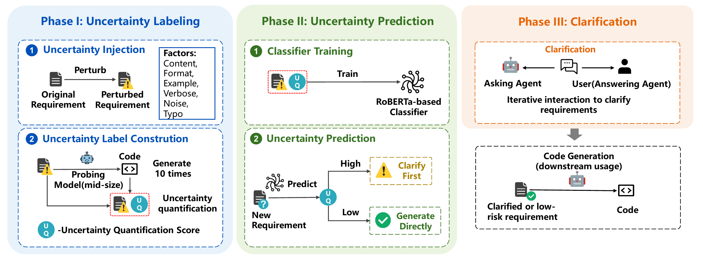
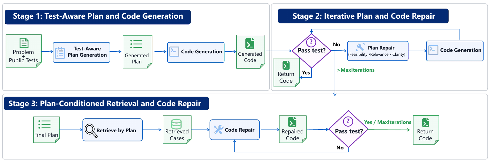
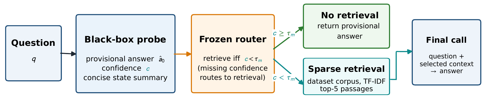

# 智能软件决策多元不确定性主动感知方法研究报告

项目编号：

项目名称：智能软件决策不确定性在线感知与质量风险预测技术

牵头责任单位：

承研单位：北京航空航天大学

项目负责人：

协议编号：

研究周期：

编制日期：

## 摘要

本项目围绕大模型代码生成中的需求理解、任务规划与信息获取，研究如何在决策过程中主动识别信息不足，并选择澄清、修复或检索等动作。报告分别介绍生成前需求不确定性预测与选择性澄清、计划质量感知与分阶段优化、黑盒置信信号向检索决策传播三种方法。需求端方法将离线多次生成的结构和功能波动转为监督标签，训练轻量文本分类器，在生成前选择值得澄清的需求；规划端方法以可见测试约束计划，并结合三维评分、计划修复和计划引导的案例检索改善代码实现；传播方法以结构化探测取得自报置信度，通过预先冻结的阈值控制外部证据获取。各方法均按研究动机、预先研究、研究方法和实验验证展开，区分信号有效性、干预收益与计算成本。现有实验支持需求澄清和计划优化在所测代码任务上的作用，以及置信信号在问答检索资源分配中的价值；三者在同一软件任务上的联合收益仍需专门验证。

关键词：主动感知；需求不确定性；选择性澄清；计划质量；分阶段修复；不确定性传播

## 1 研究目的与问题定位

### 1.1 从多阶段代码生成到不确定性主动感知

MapCoder 将相关示例回忆、求解规划、代码生成和测试驱动调试组织为多个智能体协作的过程[1]。它说明代码质量不仅取决于最后一次生成，还受任务理解、计划选择与反馈使用影响。由此，本项目将研究对象扩展到代码生成前后的连续决策：需求是否充分、计划是否可靠、知识是否足够，以及执行反馈应当用于修改哪个对象。

![图 1 MapCoder 多智能体代码生成与动态遍历流程（引自文献[1]）](figures/mapcoder-overview.png){width=15.5cm}

这一过程存在多元不确定性。需求缺少边界条件时，模型可能采用不同解释，也可能稳定采用错误解释；计划遗漏算法步骤时，后续代码可能继承缺陷；面对陌生接口或知识性问题时，模型需要判断是否获取外部证据。如果只在最终代码失败后增加生成次数，既难以解释问题来源，也可能把预算投入错误的环节。

本项目把主动感知定义为：在明确的决策时点取得可用的不确定性或质量信号，据此选择有针对性的信息获取或修改动作，并评价其对后续结果的影响。研究目的包括识别生成前的需求风险、建立可评价和可修复的中间计划，以及使一个模块产生的信号能够指导另一模块行动。这些目的将需求、计划与传播研究统一到代码生成可靠性问题上，同时保留各自不同的观察对象。

本项目不同方法的实验对象并不完全相同。需求端和规划端实验直接采用代码任务；推理—检索传播实验采用知识问答，验证黑盒信号如何参与证据获取。后者可以为软件文档和接口知识查询提供方法启发，但其问答效果不能直接视为代码正确率提升。

### 1.2 三种方法及观察时点

| 方法 | 感知对象与信号 | 取得信号的时点 | 主动动作 | 主要评价 |
| --- | --- | --- | --- | --- |
| 生成前需求预测与选择性澄清 | 需求文本；由离线生成波动监督的分类分数 | 在线代码生成前 | 针对缺失约束提问，保留原需求并追加确认信息 | 分类性能、澄清后的 pass@1、项目测试结果 |
| 计划质量感知与分阶段优化 | 可行性、相关性、清晰度；公开测试反馈 | 计划生成后及每次公开测试后 | 修复计划、重新生成、按最终计划检索并修复代码 | 隐藏测试正确性、任务内方差、调用与运行成本 |
| 黑盒置信信号驱动检索 | 临时答案、自报置信度、简短状态 | 探测后、检索前 | 根据阈值直接回答或检索后再回答 | 问答 F1、检索量、token 和分配收益 |

第一种方法将较昂贵的重复生成放在离线阶段，在线直接从需求文本预测；第二种方法利用可检查的计划和公开执行反馈调整生成过程；第三种方法将局部置信信号传给检索模块，研究是否值得补充证据。它们分别改变输入条件、中间方案和证据获取决策。

三种信号即使都取值于 $[0,1]$，也没有共同的概率含义。需求分类分数预测的是由特定探测模型定义的高不确定性类别，计划评分描述方案质量，自报置信度描述模型表达出的确定程度。因此，本项目分别解释信号和校准阈值，不把它们直接平均成统一错误概率。

### 1.3 研究问题与信息边界

本项目关注四个相互关联的问题：能否在生成前识别值得补充的信息；能否通过计划质量检查定位可修复的中间缺陷；局部信号能否指导下游模块进行有效选择；这些动作的质量收益与资源消耗如何权衡。信号相关性、评分一致性和策略效果分别回答不同问题，实验需要同时记录，而不能用其中一项代替全部结论。

每次决策只能使用当时允许取得的信息。在线需求分类不调用当前任务的隐藏测试；计划评分和修复使用可见测试；问答路由不读取参考答案。离线监督和最终评价可以使用研究设置规定的测试或标准答案，但应与实际在线输入分开记录。澄清中补充的信息也应有来源，不能把评估答案伪装成真实用户提供的条件。

应用中保留任务版本、观察时点、信号、阈值、所选动作、结果和成本即可支持过程复核。现有实验分别评价了各方法，尚未在同一批软件任务上完成联合验证；第五章据此限定可直接使用的部分和需要迁移评估的部分。

### 1.4 相关研究与方法定位

**需求澄清与欠规格处理。** CodeClarQA 将不充分的自然语言描述、代码以及澄清问答组织为研究任务，说明补充需求信息可以改善生成，并提出何时询问、询问什么的问题[2]。ClarifyGPT 通过代码一致性分析识别潜在需求歧义，再生成针对性问题，利用回答细化需求[3]。这些工作为把用户信息获取纳入生成流程提供了基础，也表明澄清内容需要与实现有关。其识别和交互过程可能涉及代码生成或测试，生成前低成本预测因此具有独立研究价值。

**需求不确定性与输入敏感性。** 需求含糊和模型生成不稳定并不完全等价。明确需求也可能因模型能力不足产生波动，模糊需求也可能被模型稳定地解释为同一种含义。本项目通过多种受控扰动检查文本变化与下游表现的关系，并以结构差异和功能波动构造面向模型的监督信号。据此将“对人而言不充分”与“在给定模型下容易产生不稳定结果”分别解释，研究由离线生成行为学习在线文本预测的可行性。

**计划生成与中间方案评价。** 自规划方法将求解过程分为规划和实现，使模型先组织步骤，再据此生成代码[4]。MapCoder 进一步把规划放入多智能体协作过程[1]。这些研究说明计划具有指导价值，但“有计划”并不能说明计划中哪些因素有效。本项目比较不同提示和测试条件，并从可行性、相关性与清晰度评价计划，把计划视为可独立检查的中间对象，进一步研究失败后先修计划还是进入代码修复。

**代码差异、功能波动与质量。** CodeBLEU 从多个层面度量代码相似性[5]，可为候选结构分散程度提供计算工具；执行测试则提供功能表现。两者结合能区分形式差异与行为波动，但仍不能把低差异解释为高正确性。本项目需求端使用二者形成综合分数，规划端用任务内测试通过率方差分析稳定性，同时保留平均质量和波动指标，以免将稳定失败误写为不确定性已经消除。

**检索增强与模块协同。** 外部检索可补充模型参数知识，但检索时机和查询内容会影响最终结果。IRCoT 将检索与多步推理交替组织，使后续检索利用已经形成的推理状态[6]。本项目研究另一种较简单的协同形式：黑盒模型先报告置信度，再由一个固定规则决定是否进行一次检索。其研究重点是信号对资源分配是否有价值，不能将该流程描述为逐步传播完整推理链的多轮系统。

**本项目的研究定位。** 三种方法分别对应需求信息、中间计划和证据获取三个可干预位置。需求端强调将离线行为压缩为生成前可用的信号；规划端强调从可解释评分进入分阶段优化；传播方法强调让局部可观察信号影响下游行动。比较这些方法时，需要同时关注信息可见性、标签含义、任务分布和资源预算。已有工作提供不同层面的支持，本项目据此形成有明确输入、动作和评价对象的方法体系。

## 2 生成前需求不确定性预测与选择性澄清

### 2.1 研究动机

相同代码生成器面对不同需求时，结果稳定性可能明显不同。需求缺少关键约束会增加实现选择空间，但格式、噪声和表述长度也可能影响模型处理。逐条人工判断不适合大规模任务，逐条先生成多份代码再判断又会消耗较高成本，并使感知发生在生成之后。

本项目需求端研究把“需要反复生成才能观察的波动”转化为“读取需求即可取得的预测”，并只对值得补充信息的需求进行澄清。方法既要关注预测性能，也要检查所选择的澄清是否改善实际代码质量。由于监督来自某一探测模型，目标类别表示模型条件下的生成不确定性，而不是所有开发者都会一致认定的歧义标签。

### 2.2 预先研究

本项目在 HumanEval-ET 和 LiveCodeBench 上设置六类扰动：内容改写对功能细节、边界或任务描述进行抽象；格式转换调整表达组织；示例移除减少示例信息；冗长改写扩展描述而保持功能要求；噪声注入添加无关内容；拼写扰动改变字符。每个原始或扰动需求由 DeepSeek-V4-Flash 生成五个候选，在固定测试条件下计算平均通过率和生成波动。

设候选代码为 $c_1,\ldots,c_K$，测试通过率为 $t_1,\ldots,t_K$，则：

$$APR=\frac{1}{K}\sum_i t_i,$$

$$D=\frac{2}{K(K-1)}\sum_{i<j}\left(1-\operatorname{CodeBLEU}(c_i,c_j)\right),$$

$$S=\min\left(1,\frac{K^{-1}\sum_i(t_i-APR)^2}{0.25}\right),\qquad UQ=\frac{D+S}{2}.$$

APR 衡量质量，D 衡量结构分散，S 衡量功能波动。配对变化采用原始 APR 减扰动 APR，以及扰动 UQ 减原始 UQ。内容改写在两个数据集上均造成较明显的质量退化和 UQ 增加；无关噪声不必然增加 UQ，拼写变化较小，其他扰动则存在数据集差异。这些结果支持直接观察模型行为，而不是按扰动名称预先赋予固定风险等级。

本项目还比较探测模型的敏感性：

| 数据集 | 探测模型 | APR | UQ |
| --- | --- | --- | --- |
| HumanEval-ET | DeepSeek-V3.2 | 0.844 | 0.057 |
| HumanEval-ET | Qwen2.5-7B-Coder-Instruct | 0.807 | 0.154 |
| MBPP-ET | DeepSeek-V3.2 | 0.527 | 0.148 |
| MBPP-ET | Qwen2.5-7B-Coder-Instruct | 0.493 | 0.255 |

较强模型可能在更多输入条件下保持稳定，掩盖用于区分需求的波动。本项目因此选择 Qwen2.5-7B-Coder-Instruct 作为离线探测模型。这是为获得有区分度监督信号作出的选择，不表示其代码生成质量高于较强模型。

### 2.3 研究方法

{width=15.8cm}

**离线构造监督。** 对每个需求使用探测模型生成十份代码，计算 UQ；在 UQ 分布上拟合两个分量的高斯混合模型，用 EM 估计参数，将均值较高的分量记为高不确定性分量。需求标签定义为：

$$y(r)=\mathbf{1}\left[P_{\mathrm{GMM}}(z=\mathrm{high}\mid UQ(r))\geq0.5\right].$$

这里的概率用于构造标签，重复生成与执行都发生在离线阶段。标签与探测模型、解码和测试条件有关，不能解释为用户需求存在歧义的客观概率。

**训练生成前预测器。** 用 RoBERTa 编码需求文本，接轻量二分类头，得到 $p_\theta(y=1\mid r)$。在线只需输入文本，按验证集选定的阈值 $\tau$ 判断是否澄清：

$$\hat y(r)=\mathbf{1}[p_\theta(y=1\mid r)\geq\tau].$$

混合模型的 0.5 后验阈值与在线分类阈值是两个不同设置。本项目根据高不确定性识别目标在验证集选择后者，而不假设模型输出已经校准、直接固定为 0.5。预测本身不调用代码生成模型；实验记录的单需求分类时间约为 10 ms，零生成式 API token 开销不意味着零本地计算成本。

**面向实现的信息获取。** 对预测为高不确定性的需求，由提问智能体关注边界情况、输入输出类型、异常处理、性能要求和缺失上下文。回答智能体模拟用户，根据原始需求提供最小且直接的回答；实验使用同一大模型承担相应角色。对话设定轮次上限，若已没有可操作的新信息则提前结束。应用时应按交互预算配置轮数。

**保留来源的需求整合。** 最终输入保留原始需求主体，并追加编号后的已确认信息，而不直接用重写文本覆盖原需求。这样可以区分原有要求与后续补充，便于检查语义漂移。实际使用中，无法从原文确认的事实需要由真实用户或授权资料提供；实验模拟回答的条件不能当作已经验证的真实用户交互效果。

### 2.4 实验验证

实验采用 HumanEval-ET 164 题、MBPP-ET 974 题，以及 LiveCodeBench release_v6 中适合函数签名形式的 444 题；后者从 1,055 题筛选得到。本项目按 6:2:2 划分数据并合并训练数据训练分类器，使用 DeepSeek-V4-Flash 和 GPT-5.4-mini，比较直接生成、MapCoder 与 DebateCoder 三类生成流程。不同研究问题采用不同评估子集，以下分别保留各表的统计口径。

**澄清对代码生成的作用。** 完整干预评估集包含 HumanEval-ET 40 题、LiveCodeBench 136 题、MBPP-ET 198 题，其中实际澄清分别为 6、77、81 题。下表为这些完整评估集的 pass@1，箭头表示加入需求处理前后；并非整个原始数据集上的结果。

| 生成流程 | 数据集 | DeepSeek-V4-Flash | GPT-5.4-mini |
| --- | --- | --- | --- |
| 直接生成 | HumanEval-ET | 67.5% → 67.5% | 52.5% → 55.0% |
| 直接生成 | LiveCodeBench | 50.7% → 61.0% | 65.4% → 68.4% |
| 直接生成 | MBPP-ET | 47.5% → 53.0% | 47.5% → 54.0% |
| MapCoder | HumanEval-ET | 85.0% → 90.0% | 67.5% → 72.5% |
| MapCoder | LiveCodeBench | 79.4% → 86.0% | 85.3% → 87.5% |
| MapCoder | MBPP-ET | 74.2% → 74.7% | 63.6% → 66.7% |
| DebateCoder | HumanEval-ET | 92.5% → 92.5% | 80.0% → 80.0% |
| DebateCoder | LiveCodeBench | 81.6% → 86.0% | 78.7% → 82.4% |
| DebateCoder | MBPP-ET | 46.0% → 49.0% | 47.0% → 55.6% |

结果说明需求处理可与不同生成流程组合，但增益依赖基准、模型与原流程。HumanEval-ET 仅澄清六题，其子集比例容易受少量样本影响。直接生成的五次重复实验还在十二种统计设置中的十种观察到 pass@1 方差降低；这里统计的是多次运行的集合级 pass@1，不是单题多份代码测试通过率的方差。

**选择信号的作用。** 在澄清子集中按 UQ 分位数分组，MBPP-ET 的高分组通常获得较大收益；LiveCodeBench 并非所有设置都呈单调关系。例如直接生成的中分组从 56.9% 提升至 80.4%，高分组从 54.9% 提升至 70.6%，低分组从 71.2% 降至 67.3%，这些值为两种模型的平均结果。因此，UQ 可作为选择依据，但高分不保证收益最大，低分也不能直接解释为没有需求问题。

**生成前分类能力。** 分类评估集与上述干预集不同，结果如下：

| 数据集 | 分类样本数／高不确定性数 | Macro Precision | Macro Recall | Macro F1 | Weighted F1 |
| --- | --- | --- | --- | --- | --- |
| HumanEval-ET | 60／9 | 0.509 | 0.507 | 0.505 | 0.765 |
| LiveCodeBench | 204／82 | 0.576 | 0.577 | 0.559 | 0.560 |
| MBPP-ET | 297／82 | 0.556 | 0.567 | 0.553 | 0.620 |

分类器在后两个较大评估集上的 Macro F1 和 Weighted F1 高于实验中比较的提示式基线；HumanEval-ET 上少样本 DeepSeek 的 Macro F1 为 0.650，高于分类器的 0.505，不能概括为所有基准均最优。分类能力还存在明显改进空间，类别不平衡也要求同时查看宏平均和加权指标。

**项目级应用。** 本项目在 PythonDevBench 的十个项目上将需求处理接入项目生成流程，重复五次。全部测试通过的项目平均数量由 3.00 增至 3.80，平均测试通过比例由 0.588 增至 0.684。前者单位是“十个项目中的平均项目数”，后者提高 9.6 个百分点。结果支持小规模项目应用的潜力；模拟用户、有限项目规模及模型条件标签，仍限制其向真实复杂需求直接外推。

## 3 计划质量感知与分阶段代码优化

### 3.1 研究动机

在需求给定之后，计划为算法选择、任务分解和边界处理提供中间表达。已有流程通常把计划作为代码生成提示的一部分，但难以回答怎样的计划更有效，失败后应继续修改代码还是先调整计划。过于冗长的计划可能掩盖关键约束，表述清楚的计划也可能逻辑错误。

本项目规划端研究三个问题：不同规划提示是否改善质量与稳定性，计划的哪些维度与后续实现有关，以及能否把这些认识组织成可执行的修复流程。为此，将计划视为可检查、可修订和可用于检索的决策对象，通过可见测试和分阶段反馈逐步定位错误。

### 3.2 预先研究

**计划形式与生成表现。** 本项目使用 DeepSeek-V4-Flash，在 HumanEval-ET 和 MBPP-ET 上比较五种设置，每任务每设置生成五次。

| 数据集 | 设置 | Pass@1 | 平均测试通过率 | 平均任务内方差 |
| --- | --- | --- | --- | --- |
| HumanEval-ET | 无计划 | 79.76% | 91.66% | 0.023 |
| HumanEval-ET | 自规划 | 80.37% | 95.52% | 0.003 |
| HumanEval-ET | 结合可见测试的计划 | 82.32% | 96.14% | 0.002 |
| HumanEval-ET | 在自规划中加入可见测试 | 81.46% | 95.89% | 0.0025 |
| HumanEval-ET | 移除测试的同类计划提示 | 79.88% | 94.71% | 0.0037 |
| MBPP-ET | 无计划 | 50.43% | 64.02% | 0.023 |
| MBPP-ET | 自规划 | 51.29% | 65.22% | 0.004 |
| MBPP-ET | 结合可见测试的计划 | 60.76% | 77.42% | 0.003 |
| MBPP-ET | 在自规划中加入可见测试 | 56.84% | 72.36% | 0.0034 |
| MBPP-ET | 移除测试的同类计划提示 | 50.72% | 64.58% | 0.0052 |

Pass@1 衡量一次生成完全通过测试的比例，平均测试通过率保留部分通过的信息，方差描述同任务候选之间的波动。结果支持简洁且利用可见测试的计划；额外加入更多规划说明并不保证进一步改善。表中方差按原实验汇总值保留，现有记录未明确分母约定。

**计划质量维度。** 本项目将计划质量分为可行性、需求相关性和清晰度。可行性检查算法能否落实约束并满足可见测试；相关性检查是否覆盖任务目标；清晰度检查步骤和操作是否明确。三个维度分别评分，而不只依赖一个总体印象。

研究从生成方差非零且至少有一次完全成功的任务中取得 202 题，选择每题表现最好和最差的计划，共 404 份；表现并列时随机选择。各维度与下游测试通过率的 Pearson／Spearman 相关分别为：可行性 0.293／0.158、相关性 0.198／0.101、清晰度 0.102／0.079。可行性的关联更强，但三个分数都不是已校准的成功概率。

人工复核按基准分层抽取 100 题、200 份计划，由三名独立 Python 标注者评价。标注者不查看模型分数、代码结果及最好／最差身份。三个维度的人机 CCC 为 0.898、0.866、0.839，MAE 为 0.052、0.044、0.034。这支持评分标准的可解释性；样本的条件筛选仍意味着不能把相关性直接外推到所有任务。

### 3.3 研究方法

{width=15.8cm}

**初始计划与代码生成。** 输入任务及公开可见测试，生成简洁的求解计划，再生成实现并运行公开测试。计划中应明确关键算法、输入输出与边界处理。只要公开测试全部通过，立即返回当前实现，随后在离线评估中使用隐藏测试。

**依据三维标准修复计划。** 初始实现失败时，在计划修复预算内结合失败反馈修订计划，并重新生成代码。可行性检查优先关注错误逻辑和约束缺口，同时检查是否偏离目标、操作是否不清楚。三维标准的评分输入分别为：

$$s_f=J_f(q,P,T_{vis}),\qquad s_r=J_r(q,P),\qquad s_c=J_c(q,P).$$

可行性使用可见测试，另外两维使用任务与计划。评分用于定位计划缺陷；控制流程是否继续由公开测试反馈和预算决定，不要求把未经验证的评分阈值当成唯一停止条件。本项目设置最多五次计划修复，每次随后重新生成并测试代码。

**最终计划引导检索与代码修复。** 若计划修复预算耗尽仍未通过公开测试，以最终计划为唯一查询，在计划索引的参考案例池中检索并重排案例。随后固定最终计划和案例集合，最多执行六次代码修复；每轮只更新代码和失败反馈。这样，计划修复阶段处理方案问题，代码修复阶段利用相对稳定的方案与参考案例处理实现问题。

案例池来自 SWIFTCODER 的 9,451 条记录，去除与 APPS 重合的 21 条后保留 9,430 条，其计划由 DeepSeek-V4-Flash 生成。去重范围仅覆盖这一具体重合检查，不能据此推断所有训练污染风险已被排除。

**预算与返回约定。** 整个流程最多包含一次初始代码生成、五次计划修复后的重新生成和六次代码修复，即十二次代码版本生成机会。它不等于十二次大模型调用，因为计划生成、评价或修复也可能需要调用。任一阶段公开测试通过即停止；全部预算耗尽则返回最后版本。隐藏测试不参与阶段选择、修复或中间版本筛选。

### 3.4 实验验证

**整体效果。** 本项目在 MBPP 500 题、APPS 139 题、CodeContests 150 题及 LiveCodeBench 140 题，共 929 个任务上，与 MapCoder、DebateCoder、LPW 比较。下表为 pass@1；模型名称沿用实验时的网关标识，平均列为四个数据集宏平均。

| 模型 | 方法 | MBPP | APPS | CodeContests | LiveCodeBench | 平均 |
| --- | --- | --- | --- | --- | --- | --- |
| GPT-5.4-mini | MapCoder | 69.6% | 63.3% | 34.0% | 78.6% | 61.4% |
| GPT-5.4-mini | DebateCoder | 66.8% | 64.7% | 32.0% | 75.7% | 59.8% |
| GPT-5.4-mini | LPW | 70.2% | 64.0% | 36.0% | 72.9% | 60.8% |
| GPT-5.4-mini | 本项目方法 | 73.4% | 70.5% | 40.0% | 79.3% | 65.8% |
| GPT-5.6-luna | MapCoder | 74.0% | 62.6% | 35.3% | 82.1% | 63.5% |
| GPT-5.6-luna | DebateCoder | 75.2% | 69.8% | 38.0% | 80.7% | 65.9% |
| GPT-5.6-luna | LPW | 73.2% | 77.7% | 55.3% | 81.4% | 71.9% |
| GPT-5.6-luna | 本项目方法 | 75.4% | 86.3% | 60.0% | 85.7% | 76.9% |

两种模型上相对最强基线宏平均分别提高 4.4 和 5.0 个百分点。结果支持完整流程在所测任务上的有效性，不意味着任一单独评分维度都有相同收益。

**阶段作用。** 在 GPT-5.4-mini 上，初始计划与实现的宏平均为 56.8%，加入计划修复后为 62.7%，再加入检索与代码修复后为 65.8%。两阶段分别增加 5.9 和 3.1 个百分点。这项累积比较同时改变了可用预算，说明增加阶段后的整体收益，不能作为严格等计算条件下的单因素因果结论。

**检索查询的作用。** 题目查询与最终计划查询的宏平均分别为 63.6% 和 65.8%。在 929 个配对任务中，41 个任务仅计划查询成功，19 个仅题目查询成功，精确 McNemar 检验 p=0.006。该实验较直接地支持把最终计划作为检索表达。计划查询在部分数据集上的 token 和调用次数增加，因此不能概括为所有成本指标同时下降。

**效率与适用条件。** 本项目分别统计 token、模型调用次数和运行时间。在 GPT-5.4-mini 下，本项目方法在四个基准上的调用次数和运行时间均低于所比较基线，但 LiveCodeBench 的 token 为 5,190，略高于 DebateCoder 的 5,021；GPT-5.6-luna 下三个成本指标在四个基准上均为所比较方法中最低。这些结果依赖具体模型、执行配置和任务分布。公开测试覆盖不足时，流程仍可能提前返回隐藏测试失败的代码；因此需要把“公开测试通过”作为停止条件，把隐藏测试正确性作为独立效果指标。

## 4 黑盒置信信号驱动的推理—检索传播

### 4.1 研究动机

代码生成中的接口查询、依赖使用和领域知识处理，都可能涉及模型是否拥有足够信息的问题。始终检索会增加上下文和成本，也可能引入干扰；完全不检索则难以处理参数知识不足的任务。一个可行方向是让模型先表达局部确定程度，再由下游模块据此决定是否获取证据。

本项目在知识问答任务中研究这一问题。方法不依赖模型内部 logits 或隐藏状态，而是通过黑盒接口取得结构化的置信信号。研究重点是：自报置信度是否包含对检索收益有用的信息，以及把信号交给检索模块后，能否改善证据分配。对软件任务的启发在于模块间的决策信息传递，现有问答实验尚不能直接证明代码生成效果。

### 4.2 预先研究

本项目先检查两种关系：置信度能否排序当前回答质量，以及不确定性是否与检索带来的增益有关。这一信号诊断为后续路由方法提供前提分析。二者相关但不等价，因为一个模型没有把握的问题也可能无法通过当前检索库解决。

设模型自报置信度为 $c_0$，不确定性为 $u_0=1-c_0$；同一问题检索后的 F1 与不检索 F1 之差为 $\Delta F1$。在 8,837 个具有有效置信度的样本上，$u_0$ 与检索增益的 Spearman 相关为 0.154，95% 置信区间为 [0.131,0.177]；将“检索有益”作为二元目标时，AUROC 为 0.628，AUPRC 为 0.447，正例比例为 0.354。这表明信号具有一定排序能力，但区分能力并不强。

三个模型族的置信度与最终回答 F1 的 Spearman 相关约为 0.276、0.300、0.309；五分箱校准误差分别为 0.487、0.528、0.426。因此，自报置信度不能直接解释为正确概率。研究采用按模型在验证集选阈值的方式使用这一信号，而不是假定同一数值在所有模型上具有同样含义。

### 4.3 研究方法

{width=15.8cm}

**结构化黑盒探测。** 对问题 $q$ 先进行一次探测，要求返回临时答案 $a_0$、置信度 $c_0\in[0,1]$、建议动作 $d_0$ 和不超过两句话的状态摘要 $m_0$。摘要是面向接口的简短说明，不要求获取模型隐藏推理。实际路由只使用置信度；建议动作保留为记录，不代替阈值规则。

**将置信信号传给检索决策。** 设模型对应阈值为 $\tau_m$：

$$R(q)=\mathbf{1}[c_0(q)<\tau_m].$$

当 $R=0$ 时，直接返回探测得到的临时答案；当 $R=1$ 时，以原始问题为查询，检索固定语料库中的五个片段，再调用模型形成最终答案。置信度缺失或无法解析时保守地进入检索分支。该流程只有一次路由和至多一次检索后的回答，不是多轮检索，也不训练复杂的策略网络。

**阈值选择与知识环境。** 阈值在独立验证数据上按回答 F1 选择，并在正式测试前冻结。实验使用的网关模型标识及阈值为：OpenAI 的 gpt-5.5 为 1.0，Gemini 的 gemini-3.5-flash 为 1.0，Claude 的 claude-sonnet-5 为 0.9。这些是实验网关标识，不据此推断底层模型版本。即使两个模型阈值相同，实际检索比例也可能不同。

检索使用从各基准处理后的开发集、测试集上下文构建的固定本地语料，按标题和段落去重，以 TF-IDF 单词及双词特征检索前五条。该设置控制知识环境，便于比较路由，不等价于生产环境中的实时开放网络检索。问题参考答案只用于评价。

**从信号到动作的解释。** 若把检索的预期收益记为 $\mathbb{E}[\Delta Q\mid q]$、成本记为 $C$，合理决策应考虑收益是否超过 $\lambda C$。本项目用置信度阈值近似这一选择，尚未证明自报置信度已经等于收益或成本的最优估计。所谓传播，具体表现为推理模块输出的一个可观测数值被检索模块消费，并改变其行动。

### 4.4 实验验证

**数据与对照。** 实验包含 NQ、HotpotQA、2WikiMultihopQA、SQuAD、TriviaQA 和 MuSiQue，每个基准 500 个问题，共 3,000 题；配合三个模型，形成 9,000 个问题—模型配对。对每个配对运行不检索、始终检索和置信度路由，共 27,000 条主要策略记录。不检索和始终检索通常各有一次回答调用，置信度路由具有探测调用，检索分支还增加一次回答调用。

| 策略 | 平均 F1 | 平均 token | 平均检索片段数 |
| --- | --- | --- | --- |
| 不检索 | 0.401 | 529.1 | 0 |
| 始终检索 | 0.467 | 1,201.5 | 4.966 |
| 置信度路由 | 0.483 | 1,539.8 | 3.952 |

相对始终检索，置信度路由平均 F1 增加 0.016，检索片段减少约 20.4%，但 token 增加约 28.2%。实验显示检索分配和回答质量有所改善，端到端 token 用量则上升。原因之一是路由本身需要额外探测，减少检索次数不必然抵消探测开销。

**相同路由数量下的分配价值。** 本项目另构造事后随机分配对照：在每个数据集—模型单元内选择与置信度路由完全相同数量的问题进行检索，但按稳定哈希选择问题。该对照的平均 F1 为 0.459，置信度路由为 0.483，且后者在十八个单元中的十七个较高。这一结果支持信号具有“选择哪些问题”的价值。对照复用静态策略输出，没有独立执行相同的探测与回答调用链，所以并非严格等调用路径的随机路由实验。

**模型差异与统计证据。** 正式运行的平均检索比例分别为 OpenAI 98.5%、Gemini 62.8%、Claude 75.9%。前者接近始终检索，说明阈值的作用取决于置信度分布，不能只比较阈值大小。在联合 Holm 校正的 54 项配对检验中，置信度路由与始终检索只有三个单元达到显著差异，其中两个支持置信度路由，一个支持始终检索。平均增益不应扩展成所有数据集和模型均有显著优势。

**失败处理与适用范围。** 152 条 API 失败和 232 条结构化解析失败保留在分母中，答案质量按零处理；只在成功记录上分析时，主要策略排序仍保持一致。实验提供了黑盒信号参与检索决策的机制证据，但语料是固定基准上下文、路由是单次阈值，效果不能直接外推到动态软件文档、复杂工具链或真实生产调用成本。

## 5 方法应用与组合方式

### 5.1 面向需求输入的应用

需求预测适合放在代码生成入口：读取需求后输出高不确定性判断，将需要补充的任务转入澄清，再把原需求和确认信息一起交给生成器。分类器对后续生成流程的改动较小，本项目已在直接生成和多智能体流程中验证这种接入方式，并开展小规模项目实验。

例如，需求要求“输出唯一记录”，但未说明是去重还是保留仅出现一次的记录。系统可先识别风险，再询问具体含义和重复判定字段；用户确认后，将回答作为附加约束保留。此例用于说明应用过程，不计入前述实验样本。原文无法支持的条件应由用户或授权上下文提供，分类器低分也不能替代需求完整性检查。

迁移到新领域时，优先检查探测标签和目标生成器是否仍匹配，并按目标数据调整阈值。直接沿用原模型分数作为通用需求质量尺度，可能遗漏新接口、新领域术语或复杂多文件需求中的信息缺口。

### 5.2 面向规划与测试反馈的应用

对已有公开测试的任务，可先生成测试约束下的计划，在实现前检查算法、目标覆盖和清晰度，执行后按预算进行计划修复和代码修复。可行性较低时，评分理由能帮助定位边界与逻辑；公开测试失败时，分阶段流程进一步决定改变计划还是保留计划并修复实现。

例如，需求已经明确“保持原始顺序并去重”，计划却提出先排序。相关性检查应指出顺序约束被破坏，可行性检查结合可见示例确认问题。修复计划后再生成代码，避免持续修改一个由错误方案支配的实现。若计划已经稳定而代码仍存在索引或类型错误，则进入参考案例辅助的代码修复。

应用中要明确测试的可见性，保存计划、代码与失败反馈的对应版本，并分别统计公开测试停止率和最终隐藏测试正确率。这样可以解释一次修复到底改变了哪个决策对象，也能识别公开测试覆盖不足导致的提前停止。

### 5.3 面向软件知识获取的应用

置信度路由可作为软件接口、依赖用法或领域知识查询的候选机制：模型先产生临时回答和置信信号，信号不足时查询固定版本的授权文档，再依据检索证据回答。这里的适用前提是检索库包含相关信息，并且探测、检索及回答成本已经被记录。

例如，生成代码需要确认某库在特定版本下的异常类型，临时回答置信度低于目标模型阈值时，可查询该版本文档。返回证据再用于修订计划或实现。这个软件场景是对第四章机制的应用设计；现有实验对象是问答任务，因此仍需以接口选择是否正确、代码测试结果和实际调用成本评价迁移效果。

不能仅凭检索次数减少宣布成本降低。若探测调用较昂贵，路由的总 token 或延迟可能上升；若模型对大多数问题都给出极端置信值，同一阈值也可能几乎没有选择作用。应用时应保留不检索、始终检索及相同执行路径的随机路由对照，以判断新增信号是否有实际价值。

### 5.4 三种方法的衔接与应用评价

三种方法可以按决策对象衔接：需求入口先判断是否补充约束；明确需求后生成并检查计划；遇到需要外部依据的知识问题时，再由专门的查询步骤决定是否检索；代码执行后按公开反馈进入相应修复阶段。需求澄清、计划修改和知识检索分别保存结果，避免下游无法识别哪些条件来自原始需求、用户补充或文档证据。

| 应用位置 | 使用的方法 | 直接产物 | 应重点检查的结果 |
| --- | --- | --- | --- |
| 代码生成前 | 需求预测与选择性澄清 | 原需求及有来源的补充条件 | 分类漏检、回答依据、代码质量变化 |
| 计划生成及执行反馈后 | 计划感知与分阶段优化 | 计划版本、代码版本及修复动作 | 公开与隐藏测试结果、任务内方差、预算使用 |
| 需要外部知识时 | 置信信号驱动检索 | 临时答案、路由结果、证据与最终回答 | 证据相关性、答案或接口正确性、总成本 |
| 完整流程评价 | 按上述位置组合 | 同任务的完整决策记录 | 相对单方法的增量收益及新增开销 |

组合效果应在同一批任务上分别比较直接生成、仅需求处理、仅计划优化及二者组合；加入知识路由时，还应采用相同文档版本和明确的成本统计。需求、计划和知识信号的单独有效性，不保证叠加后一定获得收益：澄清可能已经解决后续计划缺口，重复检查会增加开销；检索也可能引入与任务不相关的信息。

现有实验为各环节提供了不同强度和范围的依据。本项目可以据此组织可解释的主动感知流程，但联合应用应以实际任务上的质量、稳定性与成本结果评价，保留每一步所使用的信息及动作理由。

## 参考文献

[1] Islam M A, Ali M E, Parvez M R. MapCoder: Multi-Agent Code Generation for Competitive Problem Solving. Proceedings of ACL, 2024: 4912–4944.

[2] Li H S, Mesgar M, Martins A, Gurevych I. Python Code Generation by Asking Clarification Questions. Proceedings of ACL, 2023: 14287–14306.

[3] Mu F, Shi L, Wang S, et al. ClarifyGPT: A Framework for Enhancing LLM-Based Code Generation via Requirements Clarification. Proceedings of the ACM on Software Engineering, 2024, 1(FSE): Article 103, 2332–2354.

[4] Jiang X, Dong Y, Wang L, et al. Self-Planning Code Generation with Large Language Models. ACM Transactions on Software Engineering and Methodology, 2024, 33(7): 1–30.

[5] Ren S, Guo D, Lu S, et al. CodeBLEU: a Method for Automatic Evaluation of Code Synthesis. 2020, arXiv:2009.10297.

[6] Trivedi H, Balasubramanian N, Khot T, Sabharwal A. Interleaving Retrieval with Chain-of-Thought Reasoning for Knowledge-Intensive Multi-Step Questions. Proceedings of ACL, 2023: 10014–10037.
