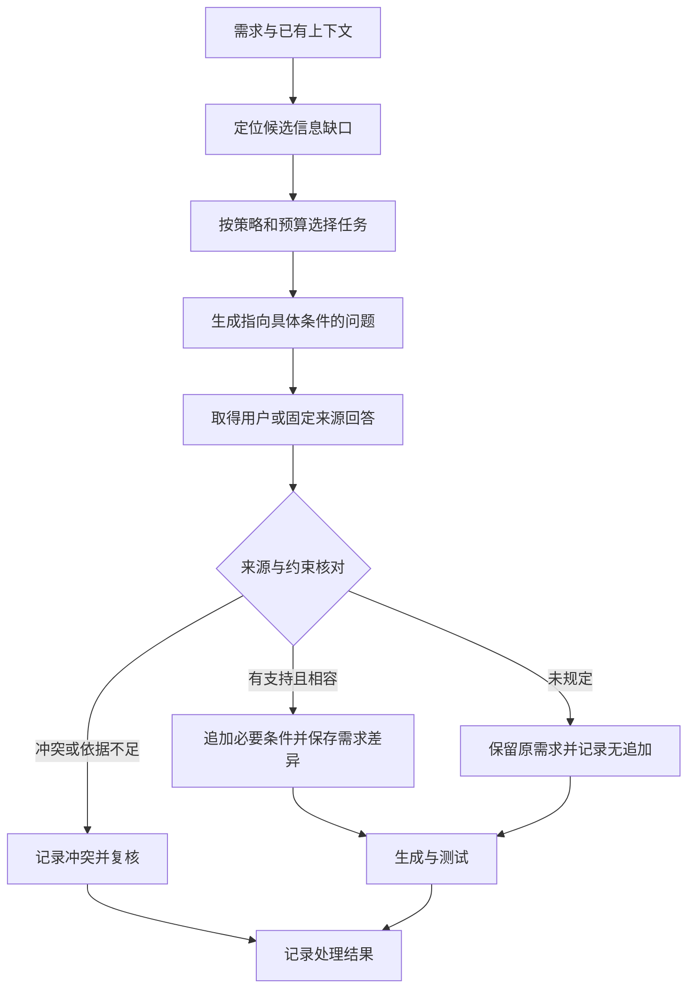
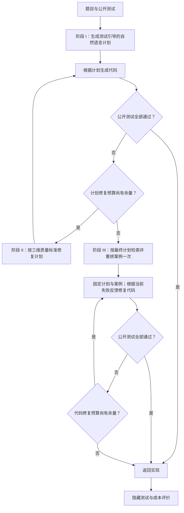
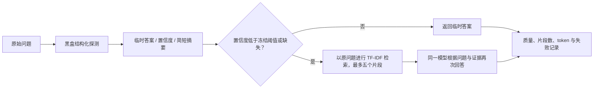

# 智能软件决策多元不确定性主动感知方法研究报告

项目编号：

项目名称：智能软件决策不确定性在线感知与质量风险预测技术

牵头责任单位：

承研单位：北京航空航天大学

项目负责人：

协议编号：

研究周期：

编制日期：

## 摘要

智能软件在需求理解、任务规划、知识获取和代码执行中面临不同来源的不确定性。主动感知需要在适当时点获取可解释信号，并将信号转化为澄清、修复或检索等具体决策。本报告围绕三条研究主线展开：PULSE 通过需求条件下的代码差异与功能波动分析信息缺口，并研究选择性澄清；PlanCoder 将计划作为可评价、可修复和可检索的中间决策对象，以可见测试引导规划，按可行性、相关性与清晰度修订计划，再以最终计划检索参考案例支持代码修复；BeyondUncertainty 从黑盒模型的结构化探测中提取自报置信度，通过验证集上冻结的阈值将这一信号传给检索模块，按需获取外部证据。报告逐一给出问题定义、输入输出、关键算法、流程图、实例及实验依据，并比较三类方法在观测时点、干预对象和资源使用上的差异。已有研究表明，澄清、计划优化和检索路由均具有具体的作用条件；生成稳定性、计划质量、置信度排序能力与最终正确性需要分别评价。三条方法为项目提供了需求端信息获取、规划端反馈优化和推理—检索模块协同的研究基础，并据此提出同任务联合验证与成果追踪方案。

关键词：主动感知；需求澄清；计划不确定性；PlanCoder；不确定性传播；自适应检索

## 1 研究目的与问题定位

### 1.1 主动感知的研究对象

一次智能软件决策不仅包含最终输出，也包含输出形成前的信息选择、任务分解和外部证据获取。需求可能缺少决定性条件，计划可能遗漏边界处理，模型可能对知识性回答过度自信。若只在结果失败后记录错误，就无法解释此前应该获取什么信息、在哪个环节调整决策。本报告把主动感知定义为：在明确的观察时点识别可用的不确定性或质量信号，并据此选择有目的的信息获取或反馈行动，再评价行动对后续质量和成本的影响。

研究以代码生成和知识问答两类载体展开。代码生成可以保存需求、计划、代码及可执行测试，适于研究需求澄清和规划修复；知识问答可以保存临时答案、置信度、检索片段和最终答案，适于研究黑盒信号如何控制外部证据获取。两类载体共享“观察—判断—行动—验证”的结构，但保留各自的质量评价与数据单位。

### 1.2 三条研究主线

| 研究主线 | 主要问题 | 感知信号 | 主动动作 | 验证对象 |
| --- | --- | --- | --- | --- |
| PULSE 需求端研究 | 哪些需求存在值得补充的信息？ | 需求文本、历史生成波动、语义缺口及回答依据 | 选择任务、提出问题、核对并补充约束 | 澄清后的代码质量、同预算选择收益与退化 |
| PlanCoder 规划端研究 | 怎样识别和改进影响代码生成的计划？ | 可行性、相关性、清晰度及公开测试反馈 | 修订计划、重新生成、按计划检索并修复代码 | 隐藏测试表现、生成稳定性与调用成本 |
| BeyondUncertainty 推理与检索协同 | 哪些问题值得调用外部检索？ | 黑盒探测的自报置信度 | 按冻结阈值返回临时答案或检索后再回答 | 问答 F1、检索量、token 及分配价值 |

本报告说明不确定性信号如何进入研究方法、形成行动并获得实验支持。第三章说明 PULSE 的观测指标、澄清规则与本项目实验结果；第四章依据计划质量研究论文[1]说明 PlanCoder 的评分、修复方法和实验结果；第五章依据文献[2]说明 BeyondUncertainty 的推理—检索传播方法。核心算法与条目编号的对应关系见附录 A。

### 1.3 需要回答的研究问题

第一，局部信号能否指出值得获取的信息？生成波动可以反映多种候选解，但低波动也可能掩盖稳定错误理解。第二，计划质量能否成为可操作的中间检查点？需要证明评分维度有可解释含义，并说明计划修复如何改变后续实现。第三，一个模块产生的置信信号能否被下游模块使用？需要给出确定的传播对象、消费接口与动作规则。第四，行动带来的收益是否超过成本？正确率、问题数量、检索片段、模型调用和 token 应分别统计。

这些问题共同决定主动感知的评价方式：既考察信号是否有信息，也考察行动是否有效，并检查同预算或相同执行条件下是否仍有优势。相关性、人机评分一致性、策略收益和系统级感知准确率分别回答不同问题。

### 1.4 相关研究与方法定位

相关研究从不同角度讨论“是否需要问”和“问什么”：CodeClarQA 面向代码生成中的欠规格描述构造澄清问答[3]，ClarifyGPT 研究需求澄清对代码生成的作用[4]，TiCoder 利用交互式测试反馈帮助用户表达意图[5]；主动任务消歧把提问作为降低候选解释不确定性的选择问题[6]。相关软件工程工作进一步讨论缺失信息的任务相关性、用户可回答性以及提问和执行角色的区分[7–9]。各方法的任务规模、信息来源和预算构成其效果比较的前提。

本报告围绕需求澄清、计划优化和检索路由三类主动决策展开：PULSE 研究需求信息获取，PlanCoder 对可执行任务计划进行评价与修复，BeyondUncertainty 将可观察置信信号用于检索路由。三类方法分别通过补充需求条件、改变计划以及选择外部知识干预决策过程，并以各自实验设计检验收益。

## 2 多源信号、观察时点与共同方法框架

### 2.1 观察对象和信息边界

| 时点 | 当时可见的信息 | 可计算或记录的信号 | 可采取的动作 |
| --- | --- | --- | --- |
| 收到需求或问题 | 输入文本、授权上下文、历史资料 | 信息缺口、歧义类别、历史风险提示 | 澄清或继续处理 |
| 计划生成后 | 题目、计划、公开测试 | 三维计划质量、步骤覆盖与测试一致性 | 检查计划或进入代码生成 |
| 代码公开测试后 | 当前代码、公开测试结果与失败信息 | 失败位置、修复次数、预算余额 | 修计划、修代码或停止 |
| 问答探测后 | 临时答案、自报置信度、简短状态摘要 | $c_0$ 与 $u_0=1-c_0$ | 决定是否检索 |
| 检索和最终回答后 | 检索片段、最终答案、调用记录 | 质量、证据量、推理成本 | 评价当前决策并保存记录 |
| 离线研究评估 | 隐藏测试或问答参考答案 | 功能正确性、F1、EM、干预收益 | 分析与验证方法 |

隐蔽测试和问答参考答案用于最终评价，不能作为当次在线决策的输入。PULSE 的历史 UQ 可以影响下一批次的选择，但当前生成完成后才得到的 UQ 不能作为首次生成前的已知信息。PlanCoder 的失败反馈来自公开测试；BeyondUncertainty 的路由由探测置信度决定，测试 F1 只用于评估。

### 2.2 “信号—决策—动作—结果”的记录结构

建议每次研究运行保存任务 ID、数据集与版本、观察时点、可见输入、信号值、标准或阈值、所选动作、动作结果和成本。计划、代码、问答及测试分别保存版本，使一次决策可以追溯到当时使用的信息。缺失信号记录为未观测，冲突信号保留各自值与依据。

图 1　三条研究主线的共同分析结构。该图概括研究对象与记录关系，各方法的实际控制流分别见第三至第五章。

### 2.3 信号解释与方法协同

需求端 UQ 反映某一生成配置下的结果分散程度；计划三维评分反映评判标准下的方案质量；问答置信度是模型自报的确定程度。即使都位于 $[0,1]$，它们也没有天然统一的概率尺度。方法协同应先确定信号的时点和用途，再讨论组合。例如，需求内容已完整而计划遗漏算法步骤时，可以优先处理计划；模型缺少知识证据时，可以研究检索；回答引入原文未支持的新约束时，应先核对来源。

本报告将已有方法与拟开展的联合验证分别说明。PlanCoder 的测试反馈循环与 BeyondUncertainty 的单次置信度路由各自有完整流程；PULSE 与 PlanCoder 在同任务上的联合收益，以及代码生成任务中加入置信度检索的效果，仍需按第六章设计验证。

## 3 需求端主动感知：PULSE 与选择性澄清

### 3.1 从生成波动观察需求条件

PULSE 对同一需求生成多个代码候选，同时观察结构差异与测试表现波动。结构分量采用平均成对 CodeBLEU 差异；功能分量采用逐候选测试通过率的总体方差，并除以理论上界 0.25；当前实验按等权重组合：

$$UQ=0.5D_{code}+0.5D_{test}.$$

详细定义对应配套指标与规则报告中的 P-I01～P-I03。受控实验为同一基础任务准备明确需求与不同歧义条件，使需求变化、生成分散和功能结果可以配对比较。分析的重点是观察哪些输入变化会影响实现，以及波动信号在哪些情形下能够提供线索。

六种早期文本扰动操作——内容改写、格式转换、示例删除、冗长改写、噪声注入、拼写扰动——与后续诊断中的词汇、语义、句法歧义及模糊表述是不同构造口径。扰动操作描述样本怎样产生，来源类别需要核对语义影响；二者不能直接相加形成类别数量。真实需求还应核对目标、输入域、输出约束和边界条件是否缺失。

### 3.2 离线监督与生成前识别

离线阶段可先采样并执行代码，由 UQ 与人工语义审核构造标签或分层，再研究仅使用需求文本的识别器。生成前阶段使用当时可见的文本与上下文，输出需要核查的条件或澄清建议。二者通过冻结的数据与标签版本连接，避免把事后测试结果用于声称事前识别。

这一设计的关键是标签含义。拟合高低 UQ 的分类器学习的是生成波动的代理标签，是否能够识别真正的信息缺口，需要另行检查。尤其应观察两类边界：低 UQ 但稳定失败，以及高 UQ 却没有用户能够补充的信息。现有记录保留训练与推理线索，正式分类器权重和逐例独立预测结果仍需归档，生成前识别准确率须经独立复核后确定。

### 3.3 澄清问题生成与回答核对

提问围绕能够改变实现分支的信息组织，如“所有还是任意一个元素满足条件”“是否允许空输入”“输出顺序是什么”。提问前核对原需求是否已经规定该条件；回答后核对是否直接回应问题、有无事实依据、是否与原需求冲突、是否遗漏已有约束。P-R05 对应前提支持、表述自洽、依据蕴含、历史一致及关键条件完整性五项检查。

对于有依据的补充，将其明确写入需求；对于“原文未规定”，保留未规定状态；对于冲突，保存原文与回答并转入复核。实验中的 source-informed 模拟用户以原始需求为信息来源，其作用是控制回答可用资料。它与真实用户掌握完整意图的场景存在差别，也不因提示词要求“有依据”就自动保证每条回答正确。

图 2　需求澄清流程。各核对字段对应方法要求，自动语义核对的有效性需通过逐例审核确认。

### 3.4 澄清对象选择与预算

现有固定预算实验比较两种选择方式：使用旧批次 UQ 从高到低选择，或在同一歧义条件内均匀随机选择。每类选择 32 例，四类共 128 例。两种策略使用相同澄清数量，比较全池可靠性，回答“UQ 排序能否把有限交互分配给更有价值的任务”。全部澄清另作为干预效果参考，其成本与固定预算策略不同。

设任务 $t$ 澄清前后的可靠性为 $R_t^0,R_t^1$，实际观察收益为 $g_t=R_t^1-R_t^0$。对所选集合 $S$，全池质量为 $N^{-1}[\sum_{t\in S}R_t^1+\sum_{t\notin S}R_t^0]$。在固定池中观察到两种结果后，可以计算均匀随机选择的精确期望；这一分析不需要重新随机生成代码，但需要保留同题条件分组。

**算法 1：选择性澄清。**输入为任务集合、选择前可用的信号、预算 $B$ 和回答协议；输出为逐任务运行记录。

1. 按冻结的选择策略和预算确定需要澄清的任务。
2. 对每个任务，从原始需求开始；若任务被选中，则针对具体缺失条件提出问题，并从允许的来源获取回答。
3. 核对回答的前提、依据、一致性和完整性。回答有依据且全部核对通过时，才把受支持的条件追加到需求；否则记录未指明或冲突的内容。
4. 基于当前需求生成代码，记录需求版本、代码、测试结果和交互成本，最后汇总各任务记录。

算法 1 是现有需求端流程的研究性整理。选择信号、回答协议与核对方式需要具体绑定到某次实验配置；自动实现尚未提供的语义判断不能由布尔字段替代验证。

### 3.5 受控诊断与探索案例

主要诊断从 164 个任务中按输入错配规则排除三题，保留 161 个基础任务、五种需求条件，共 8050 份候选代码。

| 需求条件 | 可靠性 | 平均 UQ |
| --- | ---: | ---: |
| 明确需求 | 83.79% | 0.1349 |
| 词汇歧义 | 76.46% | 0.1564 |
| 语义歧义 | 77.70% | 0.1379 |
| 句法歧义 | 81.30% | 0.1479 |
| 模糊表述 | 64.97% | 0.1524 |

表 1　PULSE 需求条件诊断，数值为本项目受控实验统计结果。语义歧义可靠性较明确需求下降 6.09 个百分点，平均 UQ 只增加约 0.003，说明波动信号可能遗漏稳定错误理解。各条件属于受控样本，解释时同时考虑需求构造和测试范围。

后续探索选择 27 个基础任务中的 31 个案例，形成 124 个实验臂、1240 份候选。实验比较中可靠性由 63.55% 变为 87.10%，12 例改善、15 例不变、4 例退化。案例是分层选择且回答端掌握限定资料，主要用于发现机制和负收益，不能把该比例直接外推为全部需求上的平均效果。

### 3.6 两轮固定预算实验

两轮研究均使用 130 个基础任务、520 个歧义案例，每案例有不澄清和澄清两组、每组十份新代码，共 10400 份候选。source-informed 轮没有复用旧基线候选；主选择仍使用已保存的旧 UQ 排序。结果如下。

| 策略或统计量 | 早期 grounded 协议 | source-informed 固定来源协议 |
| --- | ---: | ---: |
| 不澄清可靠性 | 74.7885% | 74.7885% |
| 全部澄清可靠性 | 79.5385% | 78.6538% |
| 高 UQ 优先澄清 128 例 | 76.5000% | 76.1923% |
| 同预算随机选择的精确期望 | 75.9577% | 75.7399% |
| 高 UQ 减随机，百分点 | +0.5423 | +0.4524 |
| 95% 任务聚类区间，百分点 | [-0.2592, +1.4121] | [-0.7261, +1.6826] |
| 改善 / 不变 / 退化案例 | 65 / 429 / 26 | 74 / 408 / 38 |

表 2　两轮固定预算对账。全量澄清平均收益分别约为 4.75 与 3.87 个百分点；同预算高 UQ 优势的区间均跨零，现有证据尚未确立其优于随机选择。区间以基础任务整组重抽样，避免把同题四种变体作为独立任务。

固定来源轮中，高 UQ 选择的 128 例有 35 例改善、74 例不变、19 例退化。按预定需求域敏感性规则排除四个文字域与测试不一致的基础任务后，剩 126 题、504 案例，主差值为 +0.3228 个百分点，区间仍跨零。两轮共用已进入开发和审核的任务池，分别用于协议复核与机制分析，不作为两个独立外部验证集。

### 3.7 收益、退化与稳定误解的机制

正收益案例包括补回“所有”这一全称条件、目标数字、回文判断及只处理奇数位等决定性约束，使计划与实现有机会恢复正确目标。也有改善来自导入语句、边界实现或自测行为的变化，因此应通过需求、问答和代码差异追踪具体机制。

负收益可能来自回答增加无依据的约束、丢失原文条件、指代错误，或者生成端未正确落实澄清内容。P-R05 对应回答整合风险，P-R04/P-R06 对应低波动下的信息缺口。它们提供检查方向，逐条因果仍需受控对照。

固定来源轮中，328/520 例在不澄清时十份候选已全部通过；235 例没有追加信息且两组分数相同。文本复核发现 25 个变体在空白折叠后与明确需求相同；另对 16 例不按收益挑选的文本审核观察到轻微改写、条件弱化、输入域变化和需求改变混合。这说明“构造标签”“真实信息缺口”“用户能提供的信息”和“澄清收益”应分别记录。

### 3.8 方法贡献与后续改进

PULSE 提供了从需求变化到生成差异、功能结果和澄清反馈的观察路径，同时揭示了单一波动信号的边界。后续选择器可联合需求完整性、可回答性、预计正收益与追加约束风险，在相同预算下与旧 UQ、随机和全量澄清比较。新特征或阈值应在隔离任务上验证；事后按实际收益挑选的结果只用于说明机会空间。

数据归档还应固定 CodeBLEU 实现及哈希环境，并保留测试适配器修订前后的记录。输入域与测试不一致时，单独报告敏感性分析，保证澄清收益来自可比较的质量口径。

## 4 计划端主动感知与优化：PlanCoder 方法

### 4.1 研究动机：把计划作为中间决策对象

自然语言计划连接问题描述与程序实现，包含任务分解、算法选择、步骤顺序和约束落实方式。一份计划可以表达清晰却解决了错误问题，也可以目标正确却遗漏必要步骤。PlanCoder 的研究从“是否需要计划”进一步转向“怎样生成、评价和改进有效计划”，使中间决策在最终代码之前得到检查[1]。

在计划不确定性的讨论中，需要区分三个对象：规划提示改变后代码表现是否波动；一个具体计划在可行性、相关性与清晰度上质量如何；根据反馈修订计划能否改善最终代码。论文分别以 RQ1 的五种提示设置、RQ2 的三维评分与人机对照、RQ3 的三阶段流程回答这些问题。计划质量评分可提供局部信号，生成方差反映结果稳定性，两者共同支撑规划端分析。

### 4.2 研究基础一：公开测试如何帮助规划

RQ1 使用论文所列 DeepSeek-V4-Flash，在 HumanEval-ET 和 MBPP-ET 上比较五种设置。每任务每设置生成五份代码，报告完全通过测试的比例、平均测试通过率，以及先在任务内计算、再跨任务平均的通过率方差。五种设置帮助分辨计划本身、公开测试和提示形式的作用。

| 规划设置 | HumanEval-ET Pass@1 | 平均通过率 | 方差 | MBPP-ET Pass@1 | 平均通过率 | 方差 |
| --- | ---: | ---: | ---: | ---: | ---: | ---: |
| 无计划，直接生成代码 | 79.76% | 91.66% | 0.023 | 50.43% | 64.02% | 0.023 |
| Self-planning | 80.37% | 95.52% | 0.003 | 51.29% | 65.22% | 0.004 |
| Test-informed Planning | 82.32% | 96.14% | 0.002 | 60.76% | 77.42% | 0.003 |
| 加公开测试的 Self-planning | 81.46% | 95.89% | 0.0025 | 56.84% | 72.36% | 0.0034 |
| 去掉测试的 MapCoder 风格规划 | 79.88% | 94.71% | 0.0037 | 50.72% | 64.58% | 0.0052 |

表 3　规划方式比较，转述论文表 1。此处保留论文报告方差；论文未明确分母约定，当前界面 S-I04 的总体方差约定不用于反推该表的原始统计过程。

测试引导规划同时取得较好的正确性和稳定性：公开输入输出行为将抽象目标落实到可检查条件，简洁的规划提示又把注意力集中在必要步骤上。在这组结果中，增加更详细的自规划格式没有超过测试引导的简洁计划。由此形成 PlanCoder 第一项设计依据：把公开测试作为计划生成时可见的任务证据，要求给出具体自然语言步骤。

五次生成的波动包含计划生成和后续代码实现的变化，不能完全归因于计划环节的单一因素。因而论文进一步评价计划本身，而非只由最终测试结果给计划命名。

### 4.3 研究基础二：三维计划质量评价

计划质量采用三个互补维度，对应页面 S-I01～S-I03。评分在 $[0,1]$ 内，并应配有可核对的理由。

| 维度 | 评判输入 | 主要问题 | 典型缺陷 |
| --- | --- | --- | --- |
| 可行性 Feasibility | 任务、计划、可见测试 | 逻辑能否解决任务？步骤是否充分？是否处理约束并符合测试输出？ | 算法错误、漏掉边界、关键步骤无法执行 |
| 需求相关性 Relevance | 任务、计划 | 是否解决指定目标？是否覆盖主要需求？是否偏离问题范围？ | 只解决子问题、漏掉输出约束、引入无关目标 |
| 清晰度 Clarity | 任务、计划 | 步骤是否有序、明确、具体，并可落实为实现？ | 条件不清、指代混乱、关键操作过于抽象 |

可行性通过对公开测试进行简短推演检查计划逻辑；相关性从需求覆盖角度检查“解决了什么”；清晰度检查实现指导是否足够明确。三项评分保留各自输入范围：相关性与清晰度不读取测试，评判器也不读取下游代码执行结果或隐藏测试。评价依据采用可审阅的缺陷说明，便于把低分与具体修订对象联系起来。

**算法 2：计划质量评价。**输入为任务 $q$、候选计划 $P$、可见测试 $T_{vis}$、冻结的评判器与评分标准；输出为三维评分及理由。

1. 用任务、计划和可见测试评价可行性；仅用任务和计划分别评价需求相关性与清晰度。
2. 对每项评价检查分数是否在 $[0,1]$ 内、是否附有必要理由，并记录评判器及评分标准版本。
3. 返回可行性、需求相关性、清晰度三项评价结果。

算法 2 依据论文评价标准组织，并对应页面的独立评分入口。完整 PlanCoder 的修复提示使用这三类标准，但不要求每轮额外调用三个数值评分接口。S-R01～S-R03 的低分阈值是页面展示的预测假设，论文三阶段控制以公开测试及预算为触发依据。

### 4.4 评分与代码表现的关系

RQ2 对每题生成五个计划，每个计划独立生成一份实现，再筛选通过率方差非零且至少有一个实现完全通过测试的任务，共 202 题。每题选出较好计划和较差计划，遇到并列时随机选择，形成 404 份计划。这样的配对用于比较同一任务中的质量差异，其样本偏向存在非平凡波动且至少可解一次的题目。

| 计划维度 | 与代码通过率的 Pearson | 与代码通过率的 Spearman |
| --- | ---: | ---: |
| 可行性 | 0.293 | 0.158 |
| 需求相关性 | 0.198 | 0.101 |
| 清晰度 | 0.102 | 0.079 |

表 4　论文表 2 的评分关联结果。可行性在三个维度中最有区分力，相关性次之，清晰度较弱。这为修复时优先检查逻辑是否可行提供依据；同时，相关程度有限，表明最终实现还受到代码生成能力、任务难度和测试覆盖等因素影响。

### 4.5 人工与模型评分的一致性

论文从上述任务中按基准分层抽取 100 题，保留每题两个计划，共 200 份。三名具有 Python 经验且非论文作者的标注者独立评分。标注者经过独立样例校准，按随机顺序看到与模型相同的任务、计划及相应可见测试，不能看到模型分数、生成代码、执行结果或好坏标签。

人工参照取三人评分均值，以 ICC(A,3) 衡量均值可靠性；模型评分与人工均值使用 Lin CCC、Spearman 相关和 MAE 比较。置信区间按任务重抽样，每次保留同题两个计划。

| 维度 | ICC(A,3) | CCC | Spearman | MAE |
| --- | ---: | ---: | ---: | ---: |
| 可行性 | 0.909 [0.885,0.927] | 0.898 [0.866,0.922] | 0.903 [0.870,0.928] | 0.052 [0.047,0.057] |
| 需求相关性 | 0.863 [0.821,0.894] | 0.866 [0.818,0.901] | 0.863 [0.813,0.899] | 0.044 [0.040,0.049] |
| 清晰度 | 0.853 [0.810,0.886] | 0.839 [0.785,0.881] | 0.836 [0.774,0.879] | 0.034 [0.030,0.038] |

表 5　论文表 3 的人机一致性结果，方括号内为 95% 区间。该结果支持模型评分在这批计划上近似人工判断；表 4 则评价它与代码结果的关系，两类证据各有用途。

### 4.6 方法总览与阶段划分

PlanCoder 将以上发现组织为三阶段方法：首先以公开测试引导计划和代码生成；失败时优先修改计划并重新生成代码；计划修复预算耗尽后，用最终计划检索案例支持代码修复。任何阶段通过公开测试都立即返回，全部预算耗尽时返回最后实现，随后独立执行隐藏测试评价[1，图 3]。

图 3　依据论文重绘的 PlanCoder 流程。图示采用论文默认的正修复预算；允许配置零预算的实现应直接跳过相应阶段，见算法 3。

### 4.7 阶段 I：测试引导的计划与代码生成

输入为编程问题和公开测试，模型首先生成解决问题所需的具体自然语言步骤。公开测试提供可观察的输入输出约束，帮助计划定位边界行为；提示要求聚焦必要步骤，避免过多与实现无关的说明。随后将题目、计划和公开测试交给代码生成器，得到初始实现并执行公开测试。

本阶段相当于建立第一个中间决策检查点：需求目标通过计划转成操作步骤，再由测试反馈检查这些步骤是否被正确落实。如果初始代码全部通过公开测试，系统立即结束修复流程。隐藏测试保留到返回代码之后，避免其结果影响当次计划。

### 4.8 阶段 II：先修复计划，再重新生成代码

当公开测试失败时，修复提示包含题目、失败代码、公开测试及可用失败信息，要求生成修订后的计划。修订按照可行性、相关性和清晰度组织，优先解释修改后的逻辑如何满足测试。实现上可以由失败代码反推计划缺陷，新的自然语言计划再指导一次代码生成。

这一阶段处理的是中间解决方案的质量。例如，失败可能源于排序方向错误、对“所有元素”的条件理解不足或缺少空输入分支。若只反复修改代码局部语句，可能保留同一错误方案；修订计划为改变算法或约束落实方式提供了入口。新代码通过后立即返回，否则继续使用最新失败信息，直到计划修复预算耗尽。

三维标准是修复的内容依据，公开测试结果是循环的继续条件。模型认为计划“高分”不会直接覆盖测试失败，测试失败也不自动证明问题只出在计划上；后续代码阶段处理剩余的实现问题。

### 4.9 阶段 III：最终计划检索与代码修复

计划修复未解决全部公开测试时，系统将最终修复计划作为唯一检索查询，在按计划建立索引的参考池中查找并重排案例。查询表达了拟采用的算法策略及修复后保留的约束，有机会找到解决思路相近的实现。与按题目表面描述检索相比，这一表示更接近当前需要落实的方案。

论文参考池来自 SWIFTCODER 的 9451 个问题—解答对；按论文描述移除与 APPS 测试集重复的 21 题，保留 9430 对，再用 DeepSeek-V4-Flash 根据题目和解答生成案例计划以建立索引。该段为论文的建池方法，完整重复检查结果与索引版本属于复现材料。

检索在进入阶段时执行一次。最终计划和选中案例在后续修复中保持固定，而当前失败代码及失败信息逐轮更新。每次模型调用同时看到题目、公开测试、最终计划、参考案例、失败代码及反馈，输出修订实现；公开测试决定继续还是返回。这样能保持外部参考和目标方案稳定，同时集中处理当前实现缺陷。

### 4.10 完整算法、预算与停止

**算法 3：PlanCoder。**输入为任务 $q$、公开测试 $T_{vis}$、按计划索引的案例库 $D$；计划修复预算 $B_P=5$，代码修复预算 $B_C=6$。

1. 生成考虑公开测试的初始计划及代码，执行公开测试并记录计划、代码和反馈。若测试全部通过，返回代码并记录“公开测试通过”。
2. 在最多 $B_P$ 轮计划修复中，依据当前代码、测试反馈及可行性、相关性、清晰度标准修订计划；每轮重新生成代码、执行公开测试并记录结果。任何一轮通过即返回代码。
3. 若仍未通过，以最终计划为查询，从案例库检索并重排参考案例一次。在最多 $B_C$ 轮代码修复中固定最终计划和案例，结合当前失败代码与反馈修订实现；每轮测试并记录结果，通过即返回。
4. 预算耗尽后返回最后的代码并记录“修复预算耗尽”。研究评估在返回后使用隐藏测试评价代码，并汇总模型调用、token 与运行时间。

默认预算为一次初始代码生成、最多五次计划修复后再生成、最多六次代码修复，共最多十二次代码生成或修复尝试。代码尝试数与 LLM 调用数不同，计划生成和计划修复本身也需要模型调用。算法记录每次阶段、反馈与停止原因，便于核对效率和失败归因。S-R04、S-R05、S-R06 分别对应三个继续或停止条件。

### 4.11 一个贯穿流程的说明性案例

假设任务要求“对整数列表去重，保留元素首次出现顺序；空输入返回空列表”，公开测试包括 `[3,1,3,2] → [3,1,2]` 和 `[] → []`。若初始计划采用“排序后去重”，虽然算法清楚，却没有覆盖保留顺序的要求；公开测试会暴露这一偏差。相关性评价能指出遗漏的输出约束，可行性评价能指出计划无法产生预期测试结果。

阶段 II 的修订计划可改为：按原顺序遍历，用集合记录已出现值，对第一次出现的值追加到输出列表。若生成代码错误地用首元素初始化，仍可能在空输入上失败；新反馈应继续促使计划或实现修正。若计划修复预算已耗尽，阶段 III 用最终计划检索集合与有序遍历的相似案例，保持目标方案，重点修正当前实现。

该案例用于解释阶段职责，不属于论文实验样本，也不预设修复一定成功。它说明三维质量各有用途：目标覆盖、逻辑可行与表达具体共同服务计划改进，最终仍通过公开测试和独立隐藏测试评价实现。

### 4.12 主实验的效果与资源使用

RQ3 在 MBPP-ET、APPS、CodeContests 和 LiveCodeBench 上，使用论文所列 gpt-5.4-mini 与 gpt-5.6-luna，与 MapCoder、DebateCoder、LPW 比较。各数据集的 Pass@1 再做宏平均，避免把任务数量较大的数据集隐式赋予更高权重。

| 模型 | 方法 | MBPP-ET | APPS | CodeContests | LiveCodeBench | 宏平均 |
| --- | --- | ---: | ---: | ---: | ---: | ---: |
| gpt-5.4-mini | MapCoder | 69.6% | 63.3% | 34.0% | 78.6% | 61.4% |
| gpt-5.4-mini | DebateCoder | 66.8% | 64.7% | 32.0% | 75.7% | 59.8% |
| gpt-5.4-mini | LPW | 70.2% | 64.0% | 36.0% | 72.9% | 60.8% |
| gpt-5.4-mini | PlanCoder | 73.4% | 70.5% | 40.0% | 79.3% | 65.8% |
| gpt-5.6-luna | MapCoder | 74.0% | 62.6% | 35.3% | 82.1% | 63.5% |
| gpt-5.6-luna | DebateCoder | 75.2% | 69.8% | 38.0% | 80.7% | 65.9% |
| gpt-5.6-luna | LPW | 73.2% | 77.7% | 55.3% | 81.4% | 71.9% |
| gpt-5.6-luna | PlanCoder | 75.4% | 86.3% | 60.0% | 85.7% | 76.9% |

表 6　论文表 4 的主实验结果，宏平均保留论文舍入值。PlanCoder 相对宏平均最好的基线分别提高 4.4 和 5.0 个百分点；四个数据集均观察到较高通过率。表中提升是百分点差值，不是相对百分比增幅。

| 模型 | 数据集 | PlanCoder token/任务 | LLM 调用/任务 | 时间，秒/任务 |
| --- | --- | ---: | ---: | ---: |
| gpt-5.4-mini | MBPP-ET | 2019 | 3.40 | 14.41 |
| gpt-5.4-mini | APPS | 10627 | 6.09 | 49.99 |
| gpt-5.4-mini | CodeContests | 15054 | 7.97 | 57.73 |
| gpt-5.4-mini | LiveCodeBench | 5190 | 4.23 | 22.78 |
| gpt-5.6-luna | MBPP-ET | 1269 | 2.17 | 18.13 |
| gpt-5.6-luna | APPS | 5822 | 2.65 | 86.21 |
| gpt-5.6-luna | CodeContests | 7525 | 2.93 | 134.72 |
| gpt-5.6-luna | LiveCodeBench | 3479 | 2.58 | 40.61 |

表 7　论文表 5 的 PlanCoder 资源统计。论文比较中两模型各数据集的调用次数与时间均低于所列基线；token 优势有例外：gpt-5.4-mini 的 LiveCodeBench 上，DebateCoder 为 5021，略低于 PlanCoder 的 5190。将成本分项报告，更有助于解释早停与分阶段修复的收益。

### 4.13 消融：两类修复阶段的增量作用

论文用 gpt-5.4-mini 比较三个累加配置，逐步加入计划修复和计划条件化代码修复。

| 配置 | MBPP-ET | APPS | CodeContests | LiveCodeBench | 宏平均 |
| --- | ---: | ---: | ---: | ---: | ---: |
| 仅阶段 I | 66.4% | 53.2% | 34.0% | 73.6% | 56.8% |
| 加阶段 II | 70.2% | 64.7% | 38.0% | 77.9% | 62.7% |
| 加阶段 III，完整流程 | 73.4% | 70.5% | 40.0% | 79.3% | 65.8% |

表 8　论文表 6 的阶段消融。计划与代码联合修复使宏平均提高 5.9 个百分点，后续检索与代码修复再提高 3.1 个百分点。APPS 的阶段增益较大，其他数据集也有正向变化。

这些结果说明完整执行策略中两阶段具有互补价值。由于累加阶段也增加了可用尝试次数，比较评价的是新增阶段及其预算的整体贡献；如果要单独判断“同样计算预算下先修计划是否最优”，还需要固定总预算、替换修复顺序等进一步对照。

### 4.14 为什么使用最终计划检索

RQ3.3 固定下游修复设置，比较以问题描述建立索引并查询，或以计划建立索引并用最终修复计划查询。论文报告如下。

| 检索表示 | MBPP-ET | APPS | CodeContests | LiveCodeBench | 宏平均 |
| --- | ---: | ---: | ---: | ---: | ---: |
| 题目描述 | 70.8% | 67.6% | 37.3% | 78.6% | 63.6% |
| 最终修复计划 | 73.4% | 70.5% | 40.0% | 79.3% | 65.8% |

表 9　论文表 7 的检索表示比较。四个数据集提高 0.7～2.9 个百分点，宏平均提高约 2.2 个百分点。论文在 929 个配对任务中记录 60 个正确性不同的任务：计划检索单独解决 41 题，题目检索单独解决 19 题，净增 22 题；精确 McNemar 检验报告 $p=0.006$。

修复后的计划包含当前采用的算法策略与约束落实方式，检索更有机会匹配实现层面的参考。成本变化仍依数据集而异：论文报告宏平均 token、调用和时间分别下降 9.2%、1.5%、10.3%，但 MBPP-ET 与 LiveCodeBench 的 token 和调用有所增加。该研究改变了索引和查询的表示方式，结果应解释为计划条件化检索方案相对题目描述方案的效果。

### 4.15 研究依据与实现对应

当前页面的 S-I01～S-I03 对应论文质量定义，S-I04 对应生成稳定性分析，S-R04～S-R06 对应阶段控制。主程序辅助核对公开测试、预算和最终计划检索的执行顺序；报告的科学结论依照论文表 1～7 引述。页面评分接口是依据指标定义构建的工程实现，其功能验证与论文评分实验的复现分别评价。

本项目已整理两模型、四数据集的历史结果，每组方法与模型覆盖 929 个任务。整理时按任务去重，并记录部分结果在多次运行中的选取来源。论文 RQ1/RQ2 的原始五次采样、逐条评分、人评数据，以及消融和检索比较的配对原始记录尚未齐全。相关统计按论文报告值引用；独立复算所需的原始数据与配置见第七章。

从主动感知角度看，PlanCoder 的贡献是使计划成为持续可用的中间对象：生成时用于约束，评价时用于定位问题，修复时用于调整方案，检索时用于表达实现意图。其当前证据主要来自独立编程任务；面向仓库级开发，还需引入接口、依赖和跨文件约束验证。

## 5 不确定性传播：BeyondUncertainty 的推理与检索协同

### 5.1 问题定义与传播含义

检索增强生成为模型补充外部知识，但检索并非对每个问题都同样有益。模型已掌握的知识可能足以回答，额外片段也可能无关或相互冲突；另一方面，缺少知识时直接回答容易产生不可靠结果。BeyondUncertainty 研究能否用黑盒模型自报的置信度，决定何时调用检索，把外部证据分配给更可能受益的问题[2]。

该论文中的“不确定性传播”有具体的接口含义：推理探测模块产生一个可观察的置信度，检索模块读取该信号并作出路由决策。它实现的是一次决策中的跨模块信号传递。多轮不确定性轨迹、学习型路由、动态早停、选择性拒答及完整因果传播网络属于后续研究方向，本章以论文实际验证的流程为中心。

### 5.2 黑盒探测与状态表示

给定问题 $q$，先请求模型返回紧凑的结构化状态：

$$s_0=(\hat a_0,c_0,d_0,m_0).$$

其中 $\hat a_0$ 为临时答案，$c_0\in[0,1]$ 为自报置信度，$d_0$ 为模型建议动作，$m_0$ 为简短状态摘要。提示要求输出 JSON，摘要不超过两句，用于记录任务相关状态，不要求访问模型隐藏推理过程、logits 或内部激活。定义：

$$u_0=1-c_0.$$

置信度反映模型对当前回答的自报判断。它可以作为排序信号，但需要通过实验检验其与答案质量及检索收益的关系。模型建议动作和摘要随运行保存，实际路由仅由置信度及冻结阈值决定，便于复算和跨模型比较。

以下是报告为说明字段而整理的结构示意，字段名不替代论文原始提示与解析协议：

| 字段 | 含义 |
| --- | --- |
| 临时答案 | 模型当前给出的答案 |
| 置信度 | $[0,1]$ 内的有限数值，或缺失 |
| 建议动作 | 模型提出的动作，仅作记录 |
| 状态摘要 | 与任务相关的简短摘要 |
| 解析状态 | 结构化响应是否有效 |

### 5.3 阈值路由：从信号到动作

对模型家族 $m$，使用验证集选定并冻结的阈值 $\tau_m$：

$$R(q,m)=\mathbb{1}[c_0<\tau_m].$$

$R=0$ 时直接返回临时答案；$R=1$ 时执行检索并调用同一模型生成最终答案。置信度缺失或无法解析时，论文采用转向检索的保守规则。边界比较是严格小于：$c_0=\tau_m$ 时走直接返回分支。

这一决策可以用预期收益解释。设不检索和检索的答案效用分别为 $Y_0,Y_1$，检索成本为 $C_R$，则成本敏感的理想控制器在下式成立时检索：

$$\mathbb{E}[Y_1-Y_0\mid c_0,q]>\lambda C_R.$$

当低置信度通常对应更高检索收益时，阈值规则可以近似这种选择。论文并未证明严格单调关系，也没有在实验中拟合这一效用模型或固定 $\lambda$；实际实现按验证 F1 选择阈值，分别报告质量与成本。该形式化解释说明路由为何合理，同时保留经验检验的必要性。

### 5.4 检索与二次回答

检索以原始问题作为查询，在固定的数据集语料 $D_j$ 上执行确定性的 TF–IDF 排序，采用英文停用词处理及词级一元、二元特征，返回最多五个片段：

$$P=\mathrm{TopK}(q,D_j,5),\qquad \hat a=\mathrm{LLM}(q,P).$$

最终调用接收问题与检索片段。临时答案、建议动作和状态摘要被记录，但论文公式中的最终回答输入是问题和证据；不应擅自将它改写为多轮推理轨迹或基于临时答案改写查询的系统。

图 4　BeyondUncertainty 的不确定性传播流程（依据文献[2]图 1）。传播路径是“探测置信度—冻结路由—证据获取”，采用无需训练的阈值路由。

### 5.5 完整伪代码与失败记录

**算法 4：BeyondUncertainty。**输入为问题 $q$、模型 $m$、固定语料 $D_j$ 和冻结阈值 $\tau_m$；输出为答案及运行状态。

1. 执行结构化黑盒探测，记录探测状态与用量，并解析置信度。置信度缺失或低于 $\tau_m$ 时进入检索分支。
2. 检索分支以原问题在 $D_j$ 中进行 TF–IDF 排序，最多取五个片段，再用同一模型结合问题和片段生成答案；直接返回分支采用探测得到的临时答案，不增加回答调用用量。
3. 记录探测结果、路由、片段、解析与回答状态，以及两次调用的合计用量，并返回答案及状态。
4. 研究评分保留 API 和结构化输出失败记录，对失败的策略运行行赋零分；其余运行计算归一化 token 级 F1 和精确匹配率。

算法 4 展示论文的路由与回答逻辑；模型服务的具体重试和不可恢复异常由运行协议处理并归档，不在此虚构额外重试算法。置信度字段缺失触发检索，API/整体结构化输出失败则按论文评测协议保留失败身份。失败文本即使包含可匹配的答案，也不能用原始文本分数覆盖该失败记录。

论文使用确定的配置哈希索引请求，断点续跑复用已完成调用，避免重复付费请求。运行记录保留输入、阈值、路由、片段数量、解析状态及全部调用用量，保证既能分析成功路径，也能检查失败对结论的影响。

### 5.6 模型、数据集与实验规模

研究在 Natural Questions、HotpotQA、2WikiMultiHopQA、SQuAD、TriviaQA 和 MuSiQue 上各固定 500 个测试问题，共 3000 个不同问题。提示与阈值使用独立开发数据选定，在测试开始前冻结。三模型家族与三种主要策略的组合形成：

$$3000\text{ 个问题}\times3\text{ 个模型}\times3\text{ 种策略}=27000\text{ 条策略运行记录}.$$

其中配对的问题—模型实例为 9000 个。27000 是策略运行条数，不能理解为不同问题数，也不能直接当作模型调用次数；置信路由在触发检索时需要两次调用。

| 模型家族 | 论文记录的网关别名 | 冻结阈值 $\tau_m$ | 主实验平均检索路由率 |
| --- | --- | ---: | ---: |
| OpenAI | `gpt-5.5` | 1.0 | 98.5% |
| Gemini | `gemini-3.5-flash` | 1.0 | 62.8% |
| Claude | `claude-sonnet-5` | 0.9 | 75.9% |

表 10　论文表 1 及阈值敏感性章节记录的配置。上述名称是 2026 年 7 月 8～11 日实验网关返回的别名，不作为直接服务商版本的独立认证。Gemini 和 Claude 使用温度 0、最多 2000 输出 token；OpenAI 端点不接受温度 0，使用网关默认设置及 4000 输出 token 上限。支持时请求种子 1337，跨服务并不假设逐位确定性。

语料由每个数据集处理后的开发与测试上下文中的标题—片段对去重构成，三种策略共享相同语料、预处理、排序与检索深度。

| 数据集 | 去重文档数 | 数据集 | 去重文档数 |
| --- | ---: | --- | ---: |
| Natural Questions | 17687 | SQuAD | 14369 |
| HotpotQA | 9823 | TriviaQA | 14696 |
| 2WikiMultiHopQA | 6299 | MuSiQue | 11475 |

表 11　论文表 2 的受控语料规模。该设置评价固定本地语料上的路由效果，向生产规模开放域索引推广时，需要重新检验检索质量和路由阈值。

### 5.7 对照策略与评价指标

三种实际执行策略为：No Retrieval，不提供外部上下文，执行一次回答；Always Retrieve，先检索最多五个片段，再执行一次回答；BeyondUncertainty，先探测，按阈值决定直接返回或检索后再次回答。主要质量指标为规范化 token 级 F1，EM 用于严格答案匹配。检索量统计实际返回片段数，总 token 汇总网关记录的输入与输出，包括探测调用。

论文额外构造两个事后对照。随机路由对照在每个“数据集—模型”单元中，用稳定 SHA-256 排序选取与方法相同数量的问题执行检索，再拼接这些问题已有的始终检索或不检索输出。Oracle 在两个静态策略结果中逐问题选择较好答案。二者不增加模型调用，主要用于分析分配价值与潜在改进空间。

同路由数量的随机对照控制了“检索多少个问题”，但不同问题可能返回不同数量的片段，因此片段数不完全相同；它也没有复现实际方法的结构化探测和二次调用路径。Oracle 使用已观察答案结果进行选择，只作事后参照，不作为可部署策略。

### 5.8 置信度能否预测检索收益

论文区分两个问题：自报置信度是否对应较高最终答案质量，以及不确定性是否指向更大的检索收益。对同一问题—模型实例，定义静态策略间的收益：

$$\Delta_{ret}=F1_{always}-F1_{none}.$$

在 8837 个置信度有效的实例上，$u=1-c_0$ 与检索收益的 Spearman 相关为 0.154，95% 区间为 [0.131,0.177]；预测严格正收益的 AUROC 为 0.628，AUPRC 为 0.447，正收益样本比例为 0.354。排除静态策略失败配对后，相关为 0.150，AUROC 为 0.629，AUPRC 为 0.448，结论方向相近[2]。

| 模型家族 | 置信度与最终 F1 的相关 | ECE5 | 不确定性与检索收益的相关 | 正检索收益 AUROC |
| --- | ---: | ---: | ---: | ---: |
| OpenAI | 0.276 | 0.487 | 0.158 | 0.633 |
| Gemini | 0.300 | 0.528 | 0.126 | 0.606 |
| Claude | 0.309 | 0.426 | 0.168 | 0.588 |

表 12　论文表 3 的决策价值与校准结果。ECE5 保留论文指标口径。置信度对质量排序和检索选择有一定信息，同时绝对校准较差；因此 $c_0=0.9$ 不能直接解释为在该任务上有经过验证的 90% 正确概率。

### 5.9 效果、检索量与 token 成本

| 策略 | 平均 F1 | token/实例 | 返回片段/实例 |
| --- | ---: | ---: | ---: |
| 不检索 | 0.401 | 529.1 | 0.000 |
| 始终检索 | 0.467 | 1201.5 | 4.966 |
| 同路由数量随机对照，事后 | 0.459 | 1036.5 | 3.927 |
| BeyondUncertainty | 0.483 | 1539.8 | 3.952 |
| Oracle，事后 | 0.523 | 1054.5 | 3.968 |

表 13　论文表 4 的总体比较，实际策略按 9000 个配对问题—模型实例汇总；事后对照的 token 不包含独立执行的探测调用，不能作为相同执行路径的成本对照。

BeyondUncertainty 相对不检索提高 0.082 F1，相对始终检索提高约 0.016。平均片段由 4.966 减至 3.952，减少约 20.4%；总 token 由 1201.5 增至 1539.8，增加约 28.2%。这说明当前方法能更有选择地获取外部证据，但探测开销超过片段节省带来的 token 收益。方法的资源价值应按实际瓶颈判断，例如检索或证据处理昂贵时，片段减少可能有意义；若主要成本在模型推理，则需继续优化探测。

相同阈值在不同模型上产生不同路由率。OpenAI 在各数据集至少检索 95.8% 的问题，接近始终检索；Gemini 在 TriviaQA 只检索 19.0%，在 NQ 为 45.4%；Claude 在 TriviaQA 为 32.2%。选择空间不仅取决于阈值，还取决于该模型的置信度分布。

### 5.10 单元差异与同预算分配价值

论文在十八个数据集—模型单元中观察到十六个单元的置信路由 F1 高于始终检索；两个例外为 Gemini 的 NQ 和 SQuAD。为控制多重比较，对三组策略比较的 54 个配对 Wilcoxon 检验统一作 Holm 校正：

| 比较 | 显著单元数 | 方向 |
| --- | ---: | --- |
| 始终检索与不检索 | 11/18 | 十一个均支持始终检索 |
| 置信路由与不检索 | 11/18 | 十一个均支持置信路由 |
| 置信路由与始终检索 | 3/18 | NQ–OpenAI、SQuAD–Claude 支持置信路由；NQ–Gemini 支持始终检索 |

表 14　论文表 6 的多重比较摘要。总体均值改善和每个单元显著占优是不同结论，应同时呈现。

在匹配每个单元检索路由数量的随机对照下，方法平均 F1 为 0.483，对照为 0.459，平均差约 0.024；十八个单元中十七个优于随机，唯一例外为 MuSiQue–OpenAI，差约 -0.001。较大收益出现在 MuSiQue–Gemini、2Wiki–Claude、HotpotQA–Gemini、2Wiki–Gemini 等设置。该结果说明仅用检索次数不能解释全部差异，但由于事后对照执行路径不同，还不能把差异全部归因于置信信号的因果作用。

### 5.11 敏感性、失败与适用范围

阈值敏感性使用 $\{0,0.3,0.5,0.7,0.9,1.0\}$ 的离线扫描。根据已解析置信度选择同题始终检索或不检索的既有输出，并加上探测 token，得到代理曲线。这是配对结果重组的诊断，没有重新执行全部阈值策略。它揭示模型的置信分布差异，以及增加检索比例与质量、成本之间的关系。

完整记录包含 27000 条计划中的策略行，其中 152 条 API 错误、232 条结构化解析失败，均保留在质量分母并计零。MuSiQue 的成功行比例较低，为 94.4%，包含 119 个 API 失败和 135 个解析失败。仅统计成功行时，不检索、始终检索和置信路由的平均 F1 变为 0.409、0.472、0.488，排序保持，后两者舍入后的差仍为 0.016。论文还说明从前一完整归档恢复了五条中断续跑遗漏记录，并保留原有失败结果，没有填造答案或分数。

当前结果支持在受控 QA 语料上以黑盒置信信号改进检索分配。局限主要来自绝对校准不足、模型与网关版本依赖、语料规模、执行路径不完全匹配以及部分单元缺少显著优势。后续可比较更便宜的探测方式、相同探测与回答路径下的真实随机路由，以及冻结的开放域索引。

### 5.12 与项目传播研究的联系

本方法给出了可落地的最小传播单元：上游模块输出状态，下游模块依据明确规则消费状态，动作后记录质量和成本。它为项目的模块协同研究提供了具体算法与实验范式，可以检验信号是否改变信息获取，以及改变后是否获得增量价值。

PlanCoder 的检索解决“如何利用最终计划找到实现参考”，查询是计划、触发依据是公开测试和修复预算；BeyondUncertainty 解决“当前问题是否需要外部证据”，查询是原问题、触发依据是探测置信度。二者可以在后续研究中形成互补设计，但 QA 实验结果不直接等同于代码生成上的传播收益。联合验证需要重新定义代码场景的置信信号、检索收益和控制变量。

## 6 三类方法的比较、衔接与联合验证设计

### 6.1 感知信号与行动的对应

| 比较维度 | PULSE 与选择性澄清 | PlanCoder | BeyondUncertainty |
| --- | --- | --- | --- |
| 主要载体 | 需求条件化代码生成 | 计划驱动代码生成 | 知识问答与检索 |
| 核心问题 | 是否存在值得询问的信息缺口 | 怎样形成并落实有效计划 | 当前问题是否值得检索 |
| 观测信号 | 需求文本、历史 UQ、语义及回答核对 | 三维计划质量、公开测试反馈 | 临时答案及自报置信度 |
| 信号用途 | 分层、选择、检查追加约束 | 评价中间计划并指导修复 | 按冻结阈值控制路由 |
| 行动对象 | 需求条件 | 计划与当前代码 | 外部证据获取 |
| 外部信息 | 用户或固定来源回答 | 公开测试与参考案例 | 固定语料中的片段 |
| 检索触发 | 不是本研究主控制环节 | 计划修复耗尽且公开测试仍失败 | 置信度低于阈值或缺失 |
| 检索查询 | 按具体实现另行确定 | 最终修复计划 | 原始问题 |
| 质量评价 | 代码可靠性及干预收益 | 隐藏测试 Pass@1 与通过率 | token 级 F1 与 EM |
| 资源评价 | 澄清次数、调用及生成成本 | token、LLM 调用与时间 | 片段数及含探测的总 token |
| 主要证据 | 受控诊断、探索案例、固定预算比较 | 规划对照、评分、人评、主实验与消融 | 静态对照、路由匹配、校准及失败分析 |

表 15　三类方法的职责与接口。它们共享基于可观察信息作决策的思想，但触发条件和结果尺度各自有定义。需求澄清获取用户条件，计划修复改变内部方案，检索路由分配外部知识；三者的收益不能直接相加成为一个系统提升值。

### 6.2 对“计划不确定性”和“传播”的统一解释

计划端可以从三个层次描述不确定性。第一层是同任务多次生成计划和代码后观察到的结果波动；第二层是某个计划在逻辑、目标覆盖或表达具体性上的质量缺陷；第三层是计划被采用和修复后对最终代码产生的影响。PlanCoder 将三层通过测试引导、三维标准和分阶段优化连接起来，但原始方差、质量分数和失败概率仍是不同量。

传播也有不同观察粒度。BeyondUncertainty 已研究“上游置信信号被下游检索模块消费”的单次决策传播。代码生成中的“需求改变—计划改变—实现改变—结果改变”则需要同任务版本链，才能识别信号如何沿环节变化。前者给出一个具体可执行实例，后者需要进一步用受控干预验证，报告中分别保留证据身份。

### 6.3 需求澄清与计划优化的联合实验

联合研究可在一组新编程任务上设置四个条件：基础生成、仅需求澄清、仅 PlanCoder、需求澄清后使用 PlanCoder。所有条件共享模型、公开与隐藏测试、基础任务身份，分别记录完整运行成本。若要比较等预算效率，应在相同总调用或 token 预算下增加对照；单纯给联合方法更大预算无法区分方法与计算投入的作用。

每个任务保存澄清前后需求、各版本计划、三维评分、代码、公开测试反馈及最终隐藏结果。分析需求变化是否改变计划目标覆盖，计划修复是否减少同类错误，以及联合动作是否产生互补或冗余。三维评分如果额外加入运行，应将这部分调用和 token 计入联合方法成本，并与只在离线评分的设置区分。

对观察到的效果，分别比较澄清主效应、规划优化主效应与二者交互。若联合收益仅在有决定性信息缺口的任务上出现，应报告条件分层；若澄清追加了错误约束，即使计划与代码忠实执行也可能失败，需要定位到回答整合环节。

### 6.4 置信度路由的严格对照

BeyondUncertainty 的同路由数量对照主要评价分配价值。下一步可使各路由策略执行完全相同的探测，再在相同检索预算下比较置信排序与随机选择，检索后的回答提示和不检索时的返回方式也保持一致。这样可以减少因探测提示、调用次数和返回路径不同带来的混杂。

如果将路由迁移到 PlanCoder 的案例检索，需要先定义独立研究问题，例如“计划修复后哪些任务值得进一步检索参考案例”。路由信号可以研究计划质量或额外置信探测，但阈值须在代码场景重新训练或选择，不能直接套用 QA 论文的 1.0/0.9。对照应包括原有固定阶段触发、始终提供案例、不提供案例和同预算随机分配，检验检索收益而非只看检索次数。

上述内容为后续联合研究设计。现有报告按各自论文和归档结果分别呈现已观察效果，避免把设计目标写成已部署能力。

### 6.5 最小事件记录与实例解释

| 字段组 | 建议保留内容 | 主要用途 |
| --- | --- | --- |
| 身份与版本 | task_id、数据集、需求/计划/代码/测试哈希 | 防止同号误连与版本混用 |
| 可见信息 | observation_time、allowed_inputs、来源身份 | 判断信号是否在决策前可用 |
| 信号 | 指标编号、分数、维度、理由、评判器和标准 | 追溯度量与判断 |
| 控制条件 | 阈值、预算上限、阶段计数、解析状态 | 复算选择与停止 |
| 行动 | 澄清问题、回答整合、计划修复、检索和代码修复 | 解释实际干预 |
| 结果 | 逐测试结果、F1/EM、失败类别、停止原因 | 分析质量及异常 |
| 成本 | 每次调用 token、调用数、检索片段、耗时 | 对比相同资源条件下的表现 |

表 16　方法级最小记录结构。字段允许缺失，但缺失需要说明原因；例如需求端尚未生成计划时，计划评分应为空而非零。不同研究的指标不强制共用数值尺度，统一的是记录语义与时间顺序。

以代码生成为例，若澄清补回“保留首次出现顺序”，应保留新增条件与来源；随后计划由“排序去重”变为“顺序遍历去重”，应保存两个计划；如果代码通过公开测试却未通过隐藏测试，应保留这一差异，继续分析未覆盖边界。这样的记录能够提出可检验的传播路径，而不只比较三组总体平均数。

## 7 方法验证与可复现性

### 7.1 分层验证的核心问题

| 验证层 | 核心问题 | 推荐设计与指标 |
| --- | --- | --- |
| 局部识别 | 是否识别到正确的信息缺口或计划缺陷？ | 有来源依据的正反例、按类精确率/召回率、错误归因 |
| 评分可靠性 | 同标准评分是否稳定，与人工是否一致？ | 重复评分、ICC、CCC、相关、MAE |
| 条件预测 | 信号能否预测后续质量或检索收益？ | 冻结阈值、任务隔离、AUROC/AUPRC、校准与区间 |
| 动作有效性 | 澄清、修复或检索是否帮助任务？ | 受控对照、消融、正负收益案例、配对统计 |
| 资源效率 | 改善是否来自更多计算或信息投入？ | 同预算比较，token/调用/时间/片段分别统计 |
| 跨模块协同 | 联合方法是否具有额外价值？ | 同任务版本链、因子对照、执行路径匹配 |

表 17　研究验证层次。不同层的指标不能相互替代：人机一致性高不等于代码一定正确，检索量减少不等于总 token 降低，代码质量提高也不直接证明来源类别识别准确。

### 7.2 实验结果与引用口径

| 结论或结果 | 对应章节或论文 | 本报告的引用口径 |
| --- | --- | --- |
| PULSE 161 题诊断、31 案例探索、早期固定预算 | 第 3.5～3.6 节 | 本项目实验统计值 |
| PULSE 固定来源轮与文本审核 | 第 3.6～3.7 节 | 本项目实验统计与案例分析 |
| PlanCoder 五种提示、三维相关、人机一致性 | 文献[1]表 1～3；第 4.2～4.5 节 | 论文报告值 |
| PlanCoder 主实验与成本 | 文献[1]表 4～5；第 4.12 节 | 论文报告值；历史结果整理说明见第 4.15 节 |
| PlanCoder 阶段消融、检索表示比较 | 文献[1]表 6～7；第 4.13～4.14 节 | 论文报告值 |
| BeyondUncertainty 方法、配置与结果 | 文献[2]第 2～7 页、表 1～6 | 论文报告值 |
| 指标、规则与算法步骤的对应 | 第三、四章及附录 A | 方法定义与实现说明 |

表 18　实验结果与引用口径。各章节分别说明本项目实验统计与论文报告值，合成算例与伪代码用于阐释计算过程和算法流程。

### 7.3 数据划分、失败和统计单位

需求端按基础任务分组，同题多个变体不得跨开发和测试集合；规划评分配对分析按任务保留好坏计划；问答比较按同一个问题—模型实例配对。固定阈值、主要终点和预算后再执行测试，防止根据测试收益反复调参。多重比较的范围应预先说明，例如 BeyondUncertainty 研究统一校正 54 个检验[2]。

失败记录分别标记服务调用失败、结构化解析失败、代码执行异常和功能测试失败。技术失败会影响可用性及成本，功能失败反映当前测试结果，两者不能在统计时任意互换。保留所有计划中运行及明确的排除规则，并报告需要的敏感性分析，避免只留下成功行。

统计单位在表题和正文明确写出：161 个基础任务不同于 805 个需求条件和 8050 份候选；202 个任务对应 404 份计划；3000 个问答问题对应 9000 个问题—模型配对及 27000 条策略运行。百分点变化与相对百分比变化分别计算。

### 7.4 关键复现材料

PULSE 需要保存原始与变体需求、类别构造、候选代码、逐断言结果、UQ 分量、选择名单、问答来源及语义审核。旧 UQ 与重算值分别存档，测试适配器修订需保留范围和版本。

PlanCoder 需要保存规划与修复提示、公开/隐藏测试划分、每次计划与代码、失败反馈、检索池及索引版本、检索结果、预算和成本。论文 RQ1/RQ2 的逐例评分与人评、消融及检索对比原始记录补齐后，可复算对应表格。历史结果整理采用任务去重，并记录部分结果在多次运行中的选取来源；独立复现实验应明确一次运行的生成与选择规则。

BeyondUncertainty 需要保存冻结问题 ID、开发集阈值选择、原始提示、结构化输出、网关模型配置、语料构造和哈希、TF–IDF 参数、逐次调用用量、失败身份及随机对照的稳定选择规则。相关结果以论文报告值为依据，论文所述补充材料和完整 27000 行原始归档仍需纳入复现包。

项目级类别全集、标注手册、正式独立条目计数、第三方测评和专家意见作为共同材料维护。它们决定项目覆盖与验收结论，研究报告通过准确描述现有方法和实验提供技术依据。

### 7.5 方法核查与后续测试场景

| 场景 | 应重点检查的行为 | 可观察结果 |
| --- | --- | --- |
| 需求明确且完整 | 是否避免无价值追加问题 | 提问率、错误追加率、成本 |
| 低 UQ 但缺少决定性条件 | 是否保留独立信息缺口检查 | 漏选案例与澄清收益 |
| 回答无依据或与原文冲突 | 是否记录并复核追加约束 | 拒绝原因与需求版本差异 |
| 计划清晰但目标错误 | 是否区分相关性与清晰度 | 逐维评分与修订依据 |
| 初始代码公开测试已通过 | 是否立即停止修复 | 阶段轨迹与调用数 |
| 计划修复预算耗尽 | 是否按最终计划进入代码阶段 | 检索查询、案例固定性、计数 |
| 两类预算均耗尽 | 是否返回最后实现并记录原因 | 停止原因与隐藏测试结果 |
| 问答置信度等于阈值 | 是否按严格小于规则直接返回 | 路由记录 |
| 问答置信度缺失 | 是否走保守检索并保留解析状态 | 分支与失败记录 |
| 检索减少但总 token 增加 | 是否完整计算探测成本 | 分项成本与总体代价 |

表 19　由方法定义导出的后续核查场景，用于组织正式测试；它不表示这些场景已经完成第三方测评。

## 8 结论

本报告围绕主动感知形成三条具体研究路径。PULSE 将需求条件变化与生成差异、功能波动和澄清反馈联系起来，揭示了稳定错误理解以及澄清负收益。PlanCoder 以计划为中间决策对象，通过公开测试引导、三维质量标准、计划修复和计划条件化检索，提高所评估编程任务的正确性，并报告调用与时间优势。BeyondUncertainty 将黑盒置信信号传给检索控制器，在受控 QA 实验中改善总体答案 F1 和证据分配，同时揭示探测带来的额外 token 成本。

三类方法共同表明，主动感知需要把可观察信号、动作规则、行动后果和资源代价连接起来。项目后续可以在统一事件记录与冻结对照下研究需求澄清、计划优化和检索路由的协同，逐步形成有数据支持的跨模块方法，而不依赖对不同信号或不同实验结果的简单拼接。

## 参考文献

[1] Anonymous Author(s). What Makes a Good Plan for Effective Code Generation? PlanCoder 研究稿，共 17 页。RQ1 见第 3～4 页和表 1；三维评价、关联与人评见第 4～7 页和表 2～3；三阶段方法见第 7～9 页和图 3；主实验、消融与检索比较见第 9～12 页和表 4～7。

[2] Anonymous submission. Beyond Self-Knowledge: Propagating Uncertainty Across Reasoning and Retrieval in LLMs. 匿名研究稿，共 9 页。黑盒路由与公式见第 2 页；配置及实验设计见第 2～3 页和表 1～2；质量、校准、路由及成本见第 4～7 页和表 3～6。

[3] Li H-S, Mesgar M, Martins A, Gurevych I. Python Code Generation by Asking Clarification Questions. ACL, 2023.

[4] Mu F, Shi L, Wang S, et al. ClarifyGPT: A Framework for Enhancing LLM-Based Code Generation via Requirements Clarification. Proceedings of the ACM on Software Engineering, 2024. DOI: 10.1145/3660810

[5] Fakhoury S, Naik A, Sakkas G, et al. LLM-Based Test-Driven Interactive Code Generation: User Study and Empirical Evaluation. IEEE Transactions on Software Engineering, 2024. DOI: 10.1109/TSE.2024.3428972

[6] Kobalczyk K, Astorga N, Liu T, van der Schaar M. Active Task Disambiguation with LLMs. ICLR, 2025.

[7] Vijayvargiya S, Zhou X, Yerukola A, et al. Ambig-SWE: Interactive Agents to Overcome Underspecificity in Software Engineering. arXiv:2502.13069.

[8] Edwards N, Schuster S. Ask or Assume? Uncertainty-Aware Clarification-Seeking in Coding Agents. arXiv:2603.26233, 2026.

[9] Vijayvargiya S, Viswanathan V, Neubig G. Asking What Matters: Reward-Driven Clarification for Software Engineering Tasks. arXiv:2604.14624, 2026.

## 附录 A 核心算法与条目对应

| 本报告算法或步骤 | 指标与规则库对应条目 | 方法层面的使用方式 |
| --- | --- | --- |
| PULSE 生成差异与波动计算 | P-I01～P-I08 | 离线诊断与历史信号 |
| 算法 1 的风险与语义检查 | P-R01～P-R06 | 候选选择、信息缺口与回答防护 |
| 算法 2 三维计划评分 | S-I01～S-I03 | 计划评价及修复标准 |
| RQ1 稳定性评价 | S-I04 | 任务内生成通过率波动 |
| 低计划质量提示 | S-R01～S-R03 | 页面候选风险假设，阈值独立验证 |
| 算法 3 的三个控制条件 | S-R04～S-R06 | 计划修复、代码修复与停止 |
| 算法 4 置信路由 | 暂无对应条目 | 推理置信信号向检索模块传递与路由控制 |
