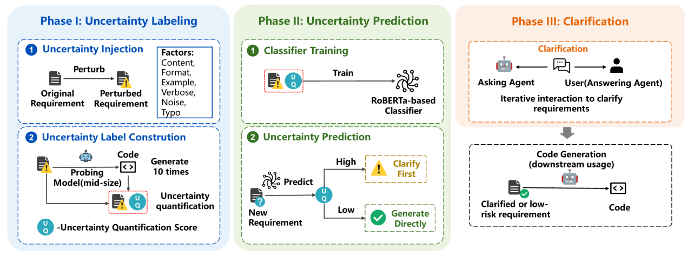
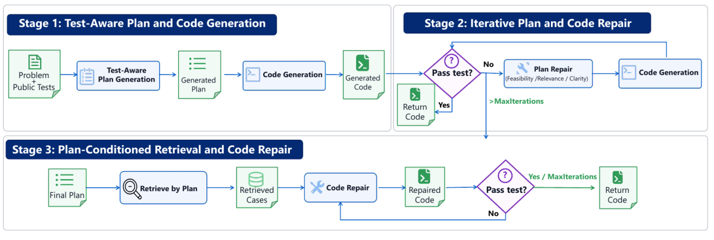
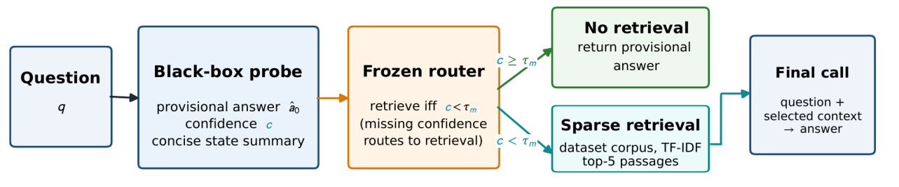
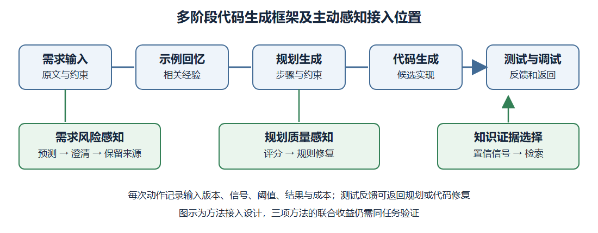
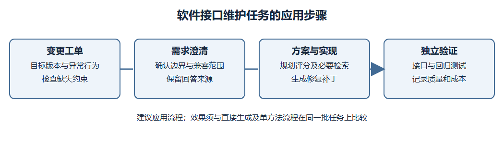

# 智能软件决策多元不确定性主动感知方法研究报告

项目编号：

项目名称：智能软件决策不确定性在线感知与质量风险预测技术

牵头责任单位：

承研单位：北京航空航天大学

项目负责人：

协议编号：

研究周期：

编制日期：

## 摘要

本项目围绕大模型代码生成中的需求理解、任务规划与信息获取，研究如何在决策过程中主动识别信息不足，并选择澄清、修复或检索等动作，以提高代码生成质量和稳定性。报告分别介绍生成前需求不确定性预测与选择性澄清、生成中规划质量感知与分阶段优化、黑盒置信信号向检索决策传播三种方法。需求端方法将离线多次生成的结构和功能波动转为监督标签，训练轻量文本分类器，在生成前选择值得澄清的需求；规划端方法以可见测试约束规则，并结合三维评分、规则修复和规则引导的案例检索改善代码实现；传播方法以结构化探测取得自报置信度，通过预先冻结的阈值控制外部证据获取。各方法均按研究动机、预先研究、研究方法和实验验证展开，区分信号有效性、干预收益与计算成本。现有实验支持需求澄清和规则优化在所测代码任务上的作用，以及置信信号在问答检索资源分配中的价值；三者在同一软件任务上的联合收益仍需专门验证。

关键词：主动感知；需求不确定性；选择性澄清；规则质量；分阶段修复；不确定性传播

## 编制依据

本报告依据《智能软件决策不确定性在线感知与质量风险预测技术》项目合同中“智能软件决策多元不确定性主动感知”研究内容及相应阶段研究报告要求编制。合同将不确定性的模块间传播机制和多层级感知机制列为研究内容。本报告在代码生成入口、规划与执行反馈、知识获取决策三个位置讨论可观察信号怎样被取得、传递和用于选择动作；不确定性的来源分类、指标定义及规则条件见《决策不确定性及其来源的分析-分类-量化方法研究报告》。

本报告针对的实际问题是：当代码生成结果可能因需求缺口、错误规划或知识不足而退化时，系统应在什么时点取得哪种证据，何时请求澄清、修复规划或补充检索。一个信号能否区分风险、按信号行动是否改善结果，以及新增步骤花费多少资源，需要分别验证。现有需求与规划实验直接针对代码任务，置信信号传播实验针对知识问答；本报告不把不同实验的结果拼接成已经完成的端到端代码生成效果。

## 1 研究目的与问题定位

### 1.1 从多阶段代码生成到不确定性主动感知

MapCoder 是典型的多智能体协同代码生成框架。其将相关编程示例的回忆、求解规划、代码生成和测试驱动调试组织为多个智能体协作的过程[1]。它说明代码质量不仅取决于最后一次生成，还受任务理解、规则选择与反馈使用影响。由此，本项目将研究对象扩展到代码生成前后的连续决策：需求是否充分、规则是否可靠、知识是否足够，以及执行反馈应当用于修改哪个对象。

![图 1 MapCoder 多智能体代码生成与动态遍历流程（引自文献[1]）](media/图1_MapCoder多智能体代码生成流程.png){width=5.83333in}

这一过程存在多元不确定性。需求缺少边界条件时，模型可能采用不同解释，也可能稳定采用错误解释；规则遗漏算法步骤时，后续代码可能继承缺陷；面对陌生接口或知识性问题时，模型需要判断是否获取外部证据。如果只在最终代码失败后增加生成次数，既难以解释问题来源，也可能把预算投入错误的环节。

本项目把主动感知定义为：在明确的决策时点取得可用的不确定性或质量信号，据此选择有针对性的信息获取或修改动作，并评价其对后续结果的影响。研究目的包括识别生成前的需求风险、建立可评价和可修复的中间规则，以及使一个模块产生的信号能够指导另一模块行动。这些目的将需求、规则与传播研究统一到代码生成可靠性问题上，同时保留各自不同的观察对象。

本项目不同方法的实验对象并不完全相同。需求端和规划端实验直接采用代码任务；推理—检索传播实验采用通用知识问答，验证黑盒信号如何参与证据获取。后者可以为软件文档和接口知识查询提供方法启发，但其问答效果不能直接视为代码正确率提升。

### 1.2 研究问题与信息边界

本项目关注四个相互关联的问题：能否在生成前识别值得补充的信息；能否通过规则质量检查定位可修复的中间缺陷；局部信号能否指导下游模块进行有效选择；这些动作的质量收益与资源消耗如何权衡。信号相关性、评分一致性和策略效果分别回答不同问题，实验需要同时记录，而不能用其中一项代替全部结论。

每次决策只能使用当时允许取得的信息。在线需求分类不调用当前任务的隐藏测试；规则评分和修复使用可见测试；问答路由不读取参考答案。离线监督和最终评价可以使用研究设置规定的测试或标准答案，但应与实际在线输入分开记录。澄清中补充的信息也应有来源，不能把评估答案伪装成真实用户提供的条件。

应用中保留任务版本、观察时点、信号、阈值、所选动作、结果和成本即可支持过程复核。现有实验分别评价了各方法，尚未在同一批软件任务上完成联合验证；第五章据此限定可直接使用的部分和需要迁移评估的部分。

### 1.3 三项研究概览

表 1概括三项方法的感知对象、信号取得时点、主动动作与主要评价方式。

| **方法** | **感知对象与信号** | **取得信号的时点** | **主动动作** | **主要评价** |
|:---|:--:|:--:|:--:|:--:|
| 生成前需求预测与选择性澄清 | 需求文本；由离线生成波动监督的分类分数 | 在线代码生成前 | 针对缺失约束提问，保留原需求并追加确认信息 | 分类性能、澄清后的 pass@1、项目测试结果 |
| 规则质量感知与分阶段优化 | 可行性、相关性、清晰度；公开测试反馈 | 规则生成后及每次公开测试后 | 修复规则、重新生成、按最终规则检索并修复代码 | 隐藏测试正确性、任务内方差、调用与运行成本 |
| 黑盒置信信号驱动检索 | 临时答案、自报置信度、简短状态 | 探测后、检索前 | 根据阈值直接回答或检索后再回答 | 问答 F1、检索量、token 和分配收益 |

表 1 三项主动感知方法的对象、动作与评价

第一种方法将较昂贵的重复生成放在离线阶段，在线直接从需求文本预测；第二种方法利用可检查的规则和公开执行反馈调整生成过程；第三种方法将局部置信信号传给检索模块，研究是否值得补充证据。它们分别改变输入条件、中间方案和证据获取决策。

三种信号即使都取值于 $\lbrack 0,1\rbrack$，也没有共同的概率含义。需求分类分数预测的是由特定探测模型定义的高不确定性类别，规则评分描述方案质量，自报置信度描述模型表达出的确定程度。因此，本项目分别解释信号和校准阈值，不把它们直接平均成统一错误概率。

### 1.4 相关研究与方法定位

需求质量是智能软件决策的输入基础。自然语言便于表达业务意图，却可能同时包含省略、模糊程度词、指代不明和相互冲突的限制。需求工程研究将这些问题视为沟通和规格形成中的重要困难，强调结合语境、术语表和约束关系识别候选解释。Berry 等系统讨论了软件规格中的语言歧义来源[10]；Ezzini 等针对指代歧义比较多种自动处理方案，表明歧义识别需要联系句内和跨句上下文[11]。这类研究为本项目划分需求来源提供基础，但面向人的歧义标签并不必然等同于给定代码模型的行为风险。一个省略条件可能被经验丰富的模型正确补全，也可能被另一模型解释为不同功能，因此需要把需求属性与下游实现联系起来评价。

在大模型代码生成中，需求澄清将上述分析转为交互动作。CodeClarQA 构造了自然语言描述、代码与澄清问答之间的联系，研究欠规格输入可以通过哪些问题得到补充[2]。ClarifyGPT 将多份代码的一致性检查与针对性提问结合，使澄清过程关注可能影响实现的内容[3]。SpecFix 进一步利用程序分布、测试与修复思想处理有歧义的题目描述[12]。这些方法共同说明，澄清应围绕实现所需的确定信息展开。它们也留下一个实际问题：如果发现风险前已经生成、测试甚至修复了多份程序，输入端判断本身就可能消耗较多预算。本项目将重复生成移到离线阶段，研究由需求文本直接预测是否需要澄清，以便在复杂生成流程启动前完成选择[7]。

需求表达与模型反应之间还存在提示敏感性。TextAttack 提供可组合的文本扰动与对抗测试方法，为分析字符、词语和句子层面的变化提供工具[13]；面向代码模型的自然语言变体研究进一步说明，相同高层任务的不同说法可能影响生成表现[14]。格式变化、示例移除、冗长描述和无关内容并不具有相同作用机制。前者可能改变模型注意的位置，后者可能改变可利用的任务信息，而拼写变化也可能由模型自动纠正。本项目因此同时观察平均质量、结构分散和测试波动，不预先把所有文本变化都判定为高不确定性。这一处理有助于区分“描述发生变化”和“变化确实影响决策”两个层次。

轻量需求预测与预训练文本表示研究相衔接。BERT 通过双向上下文预训练提供通用语言表征，RoBERTa 改进训练设置以增强文本理解能力[15-16]。这类编码器适合在有限标注数据上接入分类头，计算开销通常小于反复调用生成式模型。本项目用生成行为构造监督，再以编码器学习需求文本到风险类别的映射。与直接让大模型回答“这条需求是否清晰”相比，监督目标更明确地联系代码生成结果；但其标签仍受探测模型、测试集和解码配置影响。预测器需要在目标使用条件下验证，而不能被当作脱离模型和场景的通用需求质量裁判。

计划与规划规则研究关注输入确定后如何组织求解。自规划方法先把任务分解为简洁的步骤，再由实现阶段逐步编码，说明显式中间方案能够影响生成质量[4]。MapCoder 通过示例回忆、规划、编码与调试等角色组织竞争性编程求解[1]；DebateCoder 利用测试驱动的智能体讨论改进代码，LPW 则研究规划驱动的迭代编程流程[28-29]。这些方法对“如何生成和使用计划”已有探索，但仍需回答哪些计划内容更值得检查、错误首次出现在哪里，以及什么时候应停止改变方案。本项目将可行性、需求相关性和清晰度分开评价，并以公开测试反馈连接规则修复和实现修复[8]。

自动反馈与程序修复提供了另一类相关思路。Self-Refine 让同一模型反复生成反馈并修改输出；Reflexion 将任务反馈形成语言化经验，供后续尝试使用[33-34]。其共同点是保留失败信息并改变下一轮行为。对于软件任务，反馈可以来自执行测试、编译器或静态检查，相比仅凭模型自我评论具有更明确的外部依据。本项目关注反馈作用对象的选择：算法步骤或约束理解错误时修复规划规则，规则基本稳定后再利用案例修复代码。分阶段组织使修改范围更清楚，也便于统计不同阶段的收益和开销。

代码质量评价同时涉及功能正确性和输出分散程度。HumanEval、MBPP、APPS、CodeContests 与 LiveCodeBench 分别覆盖不同形式和难度的编程任务[22-27]；更严格的测试研究指出，测试覆盖会影响对代码正确性的判断[24]。CodeBLEU 综合代码的词法、语法和数据流特征，提供结构比较工具[5]。然而，结构不同的代码可能功能等价，结构相似的代码也可能共同失败。本项目用代码差异和通过率方差分别描述形式与行为，并把平均通过率作为独立质量指标。这样的组织能够解释“稳定失败”和“多样而正确”，避免单一分数掩盖问题。

不确定性估计研究强调信号含义和可靠性。神经网络校准研究区分预测置信度与实际正确频率，说明一个高分预测不一定具有同样高的真实可靠性[35]。语义不确定性研究进一步指出，自然语言的不同表述可能具有相同含义，因此不能简单按表面字符串计数[36]；黑盒生成研究则探索在无法读取内部概率时，如何利用多个输出的语义分散估计可信程度[37]。这些工作启发本项目区分“候选之间的分散”和“某个答案的置信度”。二者可以共同用于决策，但输入和统计对象不同，不能直接互换。

模型自我认知为主动感知提供低成本信号。已有工作研究模型是否知道自己可能回答错误，以及如何通过提示取得校准程度更好的置信评分[38-39]。自报置信度无需读取内部状态，适于不同服务接口，但会受提示、训练方式和任务分布影响。本项目将它用于判断是否需要检索，而不是直接把分数作为最终质量保证[9]。评价重点因此从“置信度看起来是否合理”转为“它是否把资源分给更需要补充证据的问题”。排序能力、绝对校准和行动收益需要分别检验。

检索增强生成把外部知识引入语言模型处理过程，为降低参数知识局限提供了基本方法[40]。IRCoT 使检索与多步推理交替进行，利用已经形成的中间信息指导后续查找[6]；Self-RAG 通过反思标记学习按需检索及评价生成；Adaptive-RAG 根据问题复杂性选择不同检索策略[41-42]。这些方法展示了检索时机、查询内容和控制方式的不同设计空间。本项目采用较简洁的黑盒阈值路由，考察一个可观测信号是否已经具有资源分配价值。该方法降低了对模型内部信息和额外策略训练的依赖，但也需要承担探测调用本身的成本。

软件知识检索具有独特的上下文约束。RepoCoder 通过迭代检索和生成支持仓库级补全，检索式提示选择研究则关注如何为代码任务匹配合适示例[30-31]。检索对象可能是相似问题、现有实现、接口定义或历史经验，名称相似并不保证求解方法相同。本项目在代码修复阶段将最终规划规则作为查询，以算法步骤和约束关系组织案例匹配；在知识问答中则保持原始问题查询，单独研究是否检索。两种检索承担不同职责，不能把案例检索结果与事实证据直接混合解释。

多智能体与软件全过程研究进一步扩大了主动感知的应用范围。AutoGen 提供可配置的多智能体对话与工具协作机制，MetaGPT 借鉴标准化工作流程组织角色分工和中间结果核对[46-47]；DevBench 相关研究将评估扩展到软件开发生命周期中的多类产物[32]。随着环节增多，输入误解、交接遗漏和重复反馈可能沿流程累积。本文三项工作分别在需求入口、中间方案和外部证据获取处设置可观察的决策依据，为后续多智能体协作和多阶段控制提供研究基础。现有实验分别验证局部方法，完整流程中的联合收益还需要在同任务、可比较预算和一致信息边界下评价。

### 1.5 合同内容及指标规则的双向追踪

表 2 从本报告的方法步骤反查合同研究内容和《分析-分类-量化》报告的条目。反向阅读时，也可从某个指标或规则定位其被哪个方法使用及如何评价。对应关系说明方法间的接口，不表示所有条目都已完成单独消融或联合验证。

| 本报告的方法与位置 | 对应合同研究内容 | 《分析-分类-量化》报告中的来源、指标或规则 | 本报告的使用和证据边界 |
|:--|:--|:--|:--|
| 第 2 章需求预测与选择性澄清 | 多层级不确定性感知机制；以需求输入为观察位置 | 需求缺失、歧义与表达差异；P-I01—P-I03、P-I08 为离线行为量；P-R01—P-R06 给出复核条件 | 在线分类器只读取需求文本；澄清效果由后续代码质量评价，不把离线 UQ 当作在线输入 |
| 第 3 章规划质量感知与分阶段优化 | 多层级不确定性感知机制；规划到实现的局部传递 | 规划推理与表达缺陷；S-I01—S-I04，S-R01—S-R06 | 规划评分、公开测试及修复预算分别记录；阶段累积收益不能归于单条规则 |
| 第 4 章置信信号驱动检索 | 模块间信号传播与知识获取决策 | 知识不足和外部证据缺口属于来源框架；当前指标库、规则库未为该机制设置独立编号 | 置信信号由推理步骤传给检索步骤；现有证据来自问答，需另评估软件知识任务 |
| 第 5 章组合应用 | 分级感知与跨模块协同 | 需求、规划、知识三个位置的来源及适用条目 | 给出接入位置和记录接口；同任务联合收益尚待验证 |

表 2 合同研究内容与分类、指标、规则及主动感知方法的双向追踪

## 2 生成前需求不确定性预测与选择性澄清

### 2.1 研究动机

相同代码生成器面对不同需求时，结果稳定性可能明显不同。需求缺少关键约束会增加实现选择空间，但格式、噪声和表述长度也可能影响模型处理。逐条人工判断不适合大规模任务，逐条先生成多份代码再判断又会消耗较高成本，并使感知发生在生成之后。

本项目需求端研究把“需要反复生成才能观察的波动”转化为“读取需求即可取得的预测”，并只对值得补充信息的需求进行澄清。方法既要关注预测性能，也要检查所选择的澄清是否改善实际代码质量。由于监督来自某一探测模型，目标类别表示模型条件下的生成不确定性，而不是所有开发者都会一致认定的歧义标签。

**从需求属性到生成行为的研究对象。** 本项目关注的需求不确定性，是输入侧的信息缺失、歧义或隐含约束在给定代码模型下引起不稳定或低质量实现的可能性[7]。这一定义同时包含需求内容与模型响应两个方面。只列出含糊词能够发现部分语言问题，却不能覆盖模型默认补全带来的影响；只观察一次失败又不能区分输入不足与模型实现能力不足。因此，研究以同一需求下的重复生成作为行为参照，再寻找可在生成前使用的文本信号。

**生成前感知的两个困难。** 第一个困难是监督来源。真实需求通常没有“它将导致多大生成波动”的现成标签，人工标注者也难以预测不同模型的行为。第二个困难是观察时点。代码、执行结果和修复轨迹只有在后续阶段才出现，不能直接作为首次生成前的输入。方法需要在离线阶段利用这些昂贵信息学习规律，在在线阶段只读取可见需求。离线监督与在线使用的分离，是本项工作区别于事后质量检查的关键。

**选择性澄清的目标。** 澄清不是越多越好。每个问题都需要用户或回答代理提供信息，过宽的问题可能增加交互负担，无依据回答还可能把原有正确条件改错。一个实用系统需要同时决定哪些任务值得问、问题应针对什么，以及何时停止。本文先通过分类选择任务，再围绕实现相关缺口提问，使交互预算与预期收益相联系。分类器产生的是待澄清任务集合，最终效果仍由澄清后的代码质量检验。

对于多智能体代码生成，这种前置选择尤其有意义。若需求歧义直到经历示例回忆、规划、代码生成和多轮调试之后才暴露，后续多个角色可能已经围绕同一错误理解投入计算。将需求处理放在入口，有机会减少错误条件被反复传递的情况。不过，入口处理无法解决所有模型推理和环境问题，研究并不把澄清作为代替代码测试的机制。

### 2.2 预先研究

本项目在 HumanEval-ET 和 LiveCodeBench 上设置六类扰动：内容改写对功能细节、边界或任务描述进行抽象；格式转换调整表达组织；示例移除减少示例信息；冗长改写扩展描述而保持功能要求；噪声注入添加无关内容；拼写扰动改变字符。每个原始或扰动需求由 DeepSeek-V4-Flash 生成五个候选，在固定测试条件下计算平均通过率和生成波动。

设候选代码为 $c_{1},\ldots,c_{K}$，测试通过率为 $t_{1},\ldots,t_{K}$，则：

$$
APR = \frac{1}{K}\sum_{i}^{}t_{i},
$$

式（2-1）

$$
D = \frac{2}{K(K - 1)}\sum_{i < j}^{}\left( 1 - CodeBLEU(c_{i},c_{j}) \right),
$$

式（2-2）

$$
S = min\left( 1,\frac{K^{- 1}\sum_{i}^{}(t_{i} - APR)^{2}}{0.25} \right),\quad\quad UQ = \frac{D + S}{2}.
$$

式（2-3）

APR 衡量质量，D 衡量结构分散，S 衡量功能波动。配对变化采用原始 APR 减扰动 APR，以及扰动 UQ 减原始 UQ。内容改写在两个数据集上均造成较明显的质量退化和 UQ 增加；无关噪声不必然增加 UQ，拼写变化较小，其他扰动则存在数据集差异。这些结果支持直接观察模型行为，而不是按扰动名称预先赋予固定风险等级。

本项目还比较探测模型的敏感性，结果见表 3。

| **数据集**   |       **探测模型**        | **APR** | **UQ** |
|:-------------|:-------------------------:|:-------:|:------:|
| HumanEval-ET |       DeepSeek-V3.2       |  0.844  | 0.057  |
| HumanEval-ET | Qwen2.5-7B-Coder-Instruct |  0.807  | 0.154  |
| MBPP-ET      |       DeepSeek-V3.2       |  0.527  | 0.148  |
| MBPP-ET      | Qwen2.5-7B-Coder-Instruct |  0.493  | 0.255  |

表 3 不同探测模型的平均通过率与生成不确定性

较强模型可能在更多输入条件下保持稳定，掩盖用于区分需求的波动。本项目因此选择 Qwen2.5-7B-Coder-Instruct 作为离线探测模型。这是为获得有区分度监督信号作出的选择，不表示其代码生成质量高于较强模型。

**扰动设计与可解释对照。** 预先研究使用受控扰动建立同一基础任务的比较，而不是把不同难度题目的分数差异归因于需求质量。原需求和变体共享高层功能目标，并在相同测试及生成配置下观察。六类操作在信息影响上有所不同，具体见表 4[7]。

| **扰动类型** |         **主要操作**         |     **需要核对的变化**     |
|:-------------|:----------------------------:|:--------------------------:|
| 内容改写     |   抽象功能、边界或细节描述   |   是否减少决定实现的条件   |
| 格式转换     |   改为会话式段落等表达形式   |  功能约束是否仍被完整保留  |
| 示例移除     |       删除输入输出示例       |  示例是否承担额外约束说明  |
| 冗长改写     | 增加解释性文字并保持功能要求 | 关键条件是否被额外叙述遮蔽 |
| 无关噪声     |   加入不构成任务约束的内容   |    模型是否误用无关信息    |
| 拼写扰动     |    使用字符级变化改变文本    | 模型能否恢复词义及原有条件 |

表 4 六类需求扰动及其信息变化

**结构信号与功能信号的互补。** 两份程序可能使用不同变量名或控制结构，却在测试上具有相同表现；也可能只在一个边界分支上不同，却造成明显的功能差异。因此，结构分散不能代替执行评价，执行波动也不能呈现所有求解路径差异。CodeBLEU 提供候选代码的结构比较，逐候选测试通过比例则把部分成功保留下来。综合分数给予二者相同权重，便于观察两个方向，而不是把某一个分量宣称为完整的不确定性。

归一化分母来自有界变量的方差上界。测试通过比例位于 [0,1]，其方差不超过 0.25；更紧的上界还与均值有关[18]。例如，三个通过比例为 0、0.5、1 时，平均值为 0.5，总体方差为 1/6，归一化功能波动约为 0.6667。若三对代码相似度分别为 0.8、0.6、0.7，结构差异为 0.3，综合分数约为 0.4833。这个计算例说明分数的构成，不是实验新增样本。

**如何理解扰动结果。** 内容改写造成较大影响，说明被弱化的任务细节可能对实现具有决定作用；噪声没有一致地增大 UQ，则说明表面质量下降不一定扩大模型的输出分散。某些噪声甚至可能使模型更稳定地选择一个解释。因而，低 UQ 必须与平均通过率一起解读：平均通过率高且波动低意味着当前测试下表现较稳定，平均通过率低且波动低则意味着稳定失败。两种情况不能共用“需求已经清晰”的结论。

探测模型对需求的敏感性也是监督设计的一部分。较强模型可能凭借经验补全缺失信息，从而压低不同需求之间的分数差异；能力过弱的模型又可能对大多数任务都产生失败，使标签主要反映模型不足。本项目选择中等规模探测模型，是在基本求解能力与变化敏感性之间取得可用的行为信号。模型能力对标签的影响仍存在，因此分类器需要与目标生成场景共同评价[17]。

### 2.3 研究方法

{width=5.83333in}

**离线构造监督。** 对每个需求使用探测模型生成十份代码，计算 UQ；在 UQ 分布上拟合两个分量的高斯混合模型，用 EM 估计参数，将均值较高的分量记为高不确定性分量。需求标签定义为：

$$
y(r) = \mathbf{1}\left\lbrack P_{GMM}(z = high \mid UQ(r)) \geq 0.5 \right\rbrack.
$$

式（2-4）

这里的概率用于构造标签，重复生成与执行都发生在离线阶段。标签与探测模型、解码和测试条件有关，不能解释为用户需求存在歧义的客观概率。

**训练生成前预测器。** 用 RoBERTa 编码需求文本，接轻量二分类头，得到 $p_{\theta}(y = 1 \mid r)$。在线只需输入文本，按验证集选定的阈值 $\tau$ 判断是否澄清：

$$
\widehat{y}(r) = \mathbf{1}\lbrack p_{\theta}(y = 1 \mid r) \geq \tau\rbrack.
$$

式（2-5）

混合模型的 0.5 后验阈值与在线分类阈值是两个不同设置。本项目根据高不确定性识别目标在验证集选择后者，而不假设模型输出已经校准、直接固定为 0.5。预测本身不调用代码生成模型；实验记录的单需求分类时间约为 10 ms，零生成式 API token 开销不意味着零本地计算成本。

**面向实现的信息获取。** 对预测为高不确定性的需求，由提问智能体关注边界情况、输入输出类型、异常处理、性能要求和缺失上下文。回答智能体模拟用户，根据原始需求提供最小且直接的回答；实验使用同一大模型承担相应角色。对话设定轮次上限，若已没有可操作的新信息则提前结束。应用时应按交互预算配置轮数。

**保留来源的需求整合。** 最终输入保留原始需求主体，并追加编号后的已确认信息，而不直接用重写文本覆盖原需求。这样可以区分原有要求与后续补充，便于检查语义漂移。实际使用中，无法从原文确认的事实需要由真实用户或授权资料提供；实验模拟回答的条件不能当作已经验证的真实用户交互效果。

**离线标签的统计构造。** 连续 UQ 不能直接作为“是否澄清”的离散决策，因此采用两个高斯分量拟合分数分布。混合模型为低、高两类行为提供数据驱动的划分，而不依赖人工指定一个跨数据集通用的分数界限。设两分量权重为 π₀、π₁，均值为 μ₀、μ₁，标准差为 σ₀、σ₁，模型表达为：

$p(UQ)\  = \ \pi ₀\ N(UQ;\ \mu ₀,\ \sigma ₀²)\  + \ \pi ₁\ N(UQ;\ \mu ₁,\ \sigma ₁²)$

EM 交替估计分量归属与分布参数，将均值较大的分量解释为高不确定性分量[19-20]。后验概率是“给定观测分数属于哪个统计分量”的概率；在线分类器则预测“给定需求文本属于哪个标签”的概率。两个数值来自不同输入，不能直接当成同一置信度。

**代理分类器的输入输出。** 编码器接收自然语言需求及研究设置允许的文本上下文，将其映射为向量，再通过二分类头输出高不确定性分数。监督样本由需求文本与离线标签组成，训练阶段不要求分类器重新生成代码。阈值选择在验证集完成，重点考虑高不确定性需求的识别目标。由于类别比例和误判成本并不对称，固定使用 0.5 未必得到合适的分类结果；阈值优化研究同样说明最优判定界限与评价目标有关[21]。

离线过程需要 K 次候选生成、测试和成对代码比较，其成本随采样数增长；在线预测则不包含这些步骤。论文报告的约 10 ms 是特定实现中的分类推理时间，不能扩展为包括真实用户回应或后续代码生成的总时延。将两类成本分开，有助于判断一次性训练投入能否在大量在线需求上摊薄，也避免把没有生成式 API token 误写为没有任何计算开销。

**提问与回答的角色边界。** 提问智能体根据当前需求寻找会改变实现的缺口，问题应具体到输入类型、边界行为、异常处理、性能限制或缺失背景。回答智能体只根据原始需求中可支持的意图给出最小回答。这样设计是为了模拟用户掌握任务意图的条件，而不是让回答者直接提供参考实现。真实开发中若原文也不包含答案，就需要由需求提出者或授权资料补足，不能把模型猜测包装为确认事实。

**整合与停止。** 每一轮回答都应能够追溯到问题和依据，原始需求保持为主体，新增内容依次附在后面。与整体重写相比，这种结构更容易检查新增约束是否覆盖、冲突或偏离原文。没有新增可操作信息时可以提前停止，达到交互预算时也应结束并保留尚未解决的问题。对话轮数、实际问题数量和回答长度应分别记录，因为相同轮数并不一定具有相同交互成本。

这三步构成明确的职责划分：离线探测建立行为监督，分类器完成在线选择，澄清流程获取任务信息。任何一步都可能产生误差。分类漏检会使值得澄清的任务直接进入生成，误报则增加交互；回答不准确可能抵消正确选择带来的收益。因此，实验既评价分类能力，也评价最终代码结果，而不只报告分类器与标签的一致程度。

### 2.4 实验验证

实验采用 HumanEval-ET 164 题、MBPP-ET 974 题，以及 LiveCodeBench release_v6 中适合函数签名形式的 444 题；后者从 1,055 题筛选得到。本项目按 6:2:2 划分数据并合并训练数据训练分类器，使用 DeepSeek-V4-Flash 和 GPT-5.4-mini，比较直接生成、MapCoder 与 DebateCoder 三类生成流程。不同研究问题采用不同评估子集，以下分别保留各表的统计口径。

**澄清对代码生成的作用。** 完整干预评估集包含 HumanEval-ET 40 题、LiveCodeBench 136 题、MBPP-ET 198 题，其中实际澄清分别为 6、77、81 题。表 5为这些完整评估集的 pass@1，箭头表示加入需求处理前后；并非整个原始数据集上的结果。

| **生成流程** |  **数据集**   | **DeepSeek-V4-Flash** | **GPT-5.4-mini** |
|:-------------|:-------------:|:---------------------:|:----------------:|
| 直接生成     | HumanEval-ET  |     67.5% → 67.5%     |  52.5% → 55.0%   |
| 直接生成     | LiveCodeBench |     50.7% → 61.0%     |  65.4% → 68.4%   |
| 直接生成     |    MBPP-ET    |     47.5% → 53.0%     |  47.5% → 54.0%   |
| MapCoder     | HumanEval-ET  |     85.0% → 90.0%     |  67.5% → 72.5%   |
| MapCoder     | LiveCodeBench |     79.4% → 86.0%     |  85.3% → 87.5%   |
| MapCoder     |    MBPP-ET    |     74.2% → 74.7%     |  63.6% → 66.7%   |
| DebateCoder  | HumanEval-ET  |     92.5% → 92.5%     |  80.0% → 80.0%   |
| DebateCoder  | LiveCodeBench |     81.6% → 86.0%     |  78.7% → 82.4%   |
| DebateCoder  |    MBPP-ET    |     46.0% → 49.0%     |  47.0% → 55.6%   |

表 5 完整干预评估集上的需求澄清前后 pass@1

结果说明需求处理可与不同生成流程组合，但增益依赖基准、模型与原流程。HumanEval-ET 仅澄清六题，其子集比例容易受少量样本影响。直接生成的五次重复实验还在十二种统计设置中的十种观察到 pass@1 方差降低；这里统计的是多次运行的集合级 pass@1，不是单题多份代码测试通过率的方差。

**选择信号的作用。** 在澄清子集中按 UQ 分位数分组，MBPP-ET 的高分组通常获得较大收益；LiveCodeBench 并非所有设置都呈单调关系。例如直接生成的中分组从 56.9% 提升至 80.4%，高分组从 54.9% 提升至 70.6%，低分组从 71.2% 降至 67.3%，这些值为两种模型的平均结果。因此，UQ 可作为选择依据，但高分不保证收益最大，低分也不能直接解释为没有需求问题。

**生成前分类能力。** 分类评估集与上述干预集不同，结果见表 6：

| **数据集** | **分类样本数／高不确定性数** | **Macro Precision** | **Macro Recall** | **Macro F1** | **Weighted F1** |
|:---|:--:|:--:|:--:|:--:|:--:|
| HumanEval-ET | 60／9 | 0.509 | 0.507 | 0.505 | 0.765 |
| LiveCodeBench | 204／82 | 0.576 | 0.577 | 0.559 | 0.560 |
| MBPP-ET | 297／82 | 0.556 | 0.567 | 0.553 | 0.620 |

表 6 生成前需求不确定性分类性能

分类器在后两个较大评估集上的 Macro F1 和 Weighted F1 高于实验中比较的提示式基线；HumanEval-ET 上少样本 DeepSeek 的 Macro F1 为 0.650，高于分类器的 0.505，不能概括为所有基准均最优。分类能力还存在明显改进空间，类别不平衡也要求同时查看宏平均和加权指标。

**项目级应用。** 本项目在 PythonDevBench 的十个项目上将需求处理接入项目生成流程，重复五次。全部测试通过的项目平均数量由 3.00 增至 3.80，平均测试通过比例由 0.588 增至 0.684。前者单位是“十个项目中的平均项目数”，后者提高 9.6 个百分点。结果支持小规模项目应用的潜力；模拟用户、有限项目规模及模型条件标签，仍限制其向真实复杂需求直接外推。

**评估问题与统计对象。** 四个研究问题依次检验需求处理能否改善函数级代码生成、UQ 是否具有选择价值、轻量预测能否替代提示式判断，以及方法能否迁移到项目级任务。HumanEval-ET 侧重较小规模的严格函数测试，MBPP-ET 覆盖常见 Python 编程构造，LiveCodeBench 使用具有时间标记的编程题，三者的数据来源和难度不同[22-25]。完整评估集和实际澄清子集应同时报告，前者体现系统总体收益，后者解释干预发生处的变化。

**实际澄清任务的结果。** 表 7补充与前述完整评估集对应的澄清子集。箭头为干预前后 pass@1，HumanEval-ET、LiveCodeBench、MBPP-ET 的子集规模分别为 6、77、81 题[7]。

| **生成流程** |  **数据集**   | **DeepSeek-V4-Flash** | **GPT-5.4-mini** |
|:-------------|:-------------:|:---------------------:|:----------------:|
| 直接生成     | HumanEval-ET  |     83.3% → 83.3%     |  66.7% → 83.3%   |
| 直接生成     | LiveCodeBench |     51.9% → 70.1%     |  70.1% → 75.3%   |
| 直接生成     |    MBPP-ET    |     51.9% → 65.4%     |  46.9% → 63.0%   |
| MapCoder     | HumanEval-ET  |    66.7% → 100.0%     |  66.7% → 100.0%  |
| MapCoder     | LiveCodeBench |     80.5% → 92.2%     |  87.0% → 90.9%   |
| MapCoder     |    MBPP-ET    |     81.5% → 82.7%     |  69.1% → 76.5%   |
| DebateCoder  | HumanEval-ET  |    100.0% → 100.0%    | 100.0% → 100.0%  |
| DebateCoder  | LiveCodeBench |     80.5% → 88.3%     |  84.4% → 90.9%   |
| DebateCoder  |    MBPP-ET    |     49.4% → 56.8%     |  45.7% → 66.7%   |

表 7 实际澄清子集上的代码生成 pass@1

两种统计口径之间不能简单替换。若只看被选择的任务，可能突出局部收益，却看不到未干预任务在整体系统中的占比；若只看完整集合，小范围但明显的改善又可能被摊薄。以 HumanEval-ET 的 MapCoder 为例，六题子集由 66.7% 增至 100.0%，并不表示整个原始基准提升了同样比例。报告同时保留样本规模和完整集合结果，能够避免这种误读。

**UQ 分组结果的细化。** 分组使用离线观测的 UQ，并在实际澄清样本内部按分位数划分，目的是尽量分离分类误差与分数本身的作用。表 8列出两种模型平均后的对照，增益单位为百分点。

| **数据集**    |  **流程**   | **低 UQ 组增益** | **中 UQ 组增益** | **高 UQ 组增益** |
|:--------------|:-----------:|:----------------:|:----------------:|:----------------:|
| MBPP-ET       |  直接生成   |       7.4        |       9.3        |       27.8       |
| MBPP-ET       | DebateCoder |       3.7        |       9.3        |       29.6       |
| MBPP-ET       |  MapCoder   |       0.0        |       5.6        |       7.4        |
| LiveCodeBench |  直接生成   |       -3.8       |       23.5       |       15.7       |
| LiveCodeBench | DebateCoder |       5.8        |       13.7       |       2.0        |
| LiveCodeBench |  MapCoder   |       1.9        |       13.7       |       7.8        |

表 8 不同 UQ 分位组的澄清增益

增益沿用论文基于未舍入结果计算的报告值。MBPP-ET 的高分组表现出较大的改进空间，LiveCodeBench 则存在中组收益更高和低组退化，说明任务分布、原生成器和问题内容都会影响澄清价值。分位数组别不是可直接部署的固定 UQ 阈值，实际入口仍需要验证集上确定的分类界限。

**分类结果与项目级外推。** 宏平均指标给高、低两类相同权重，加权指标按类别样本数汇总。在类别不平衡时，两者差距有助于识别模型是否主要照顾多数类。HumanEval-ET 仅有九个高不确定性分类样本，单个预测即可明显影响宏平均结果；不能据此概括所有领域的效果。项目级实验覆盖十个较小 Python 项目，平均 2.2 个文件、276 行代码，并重复运行五次[7,32]。它为跨文件场景提供初步支持，但尚不足以代表大型仓库或长期维护任务。

**有效性与可迁移性。** 受控变体有利于比较，却不等同于自然形成的全部真实需求缺陷；模拟回答有利于重复实验，却没有覆盖用户不知道答案、回答矛盾或拒绝交互的情况。标签来自特定探测模型，也可能随模型能力和测试覆盖改变。应用时应先检验目标领域的需求分布和回答来源，再评价分类漏检、交互成本与代码收益。论文的结果支持生成前选择性干预的可行性，并为上述迁移问题提供了可复用的实验结构。

## 3 规划规则质量感知与分阶段代码优化

### 3.1 研究动机

在需求给定之后，规则为算法选择、任务分解和边界处理提供中间表达。已有流程通常把规则作为代码生成提示的一部分，但难以回答怎样的规则更有效，失败后应继续修改代码还是先调整规则。过于冗长的规则可能掩盖关键约束，表述清楚的规则也可能逻辑错误。

本项目规划端研究三个问题：不同规划提示是否改善质量与稳定性，规则的哪些维度与后续实现有关，以及能否把这些认识组织成可执行的修复流程。为此，将规则视为可检查、可修订和可用于检索的决策对象，通过可见测试和分阶段反馈逐步定位错误。

**规划规则作为中间决策对象。** 本章的规划规则指针对当前任务形成的求解计划，包括算法选择、处理顺序、边界条件和输出构造。它对应原研究中的 plan，不等同于对所有任务通用的固定业务规则[8]。将其显式保存后，能够检查需求与实现之间的转换：题目规定了哪些行为，规则如何安排这些行为，代码又如何落实规则。若缺少这一中间对象，最终测试失败时往往只能直接修改代码，难以区分方案与实现层面的原因。

**复杂提示与有效计划之间的关系。** 规划文本增加并不必然改善求解。额外解释可能帮助模型明确步骤，也可能造成重复、矛盾或对关键约束的遮蔽。对于已有可见测试的函数任务，一份简洁、围绕可观察输入输出行为形成的规则，可能比长篇自我解释更有帮助。因此，预先研究把提示形式和测试信息拆开比较，避免把所有改进都归因于“先思考”这一笼统动作。

**修复对象需要随阶段变化。** 首次失败可能暴露算法选错、约束遗漏或步骤顺序不当，此时只修代码局部容易重复同一错误。经过多轮规则修订后，剩余问题又可能转为变量处理、实现细节或边界分支，继续大幅改写规则会增加求解路径漂移。分阶段方法据此先允许规则与代码共同变化，再固定最后规则，在参考案例支持下集中修复实现。阶段切换既是预算安排，也是对错误对象的显式区分。

本项目不要求规则评价完全替代执行。语言评判器能够指出可行性或表达缺口，却可能遗漏真实运行问题；公开测试能够提供具体失败，却只能覆盖已给出的行为。二者结合的目的，是使规则修改有依据、代码修改有反馈，并在有限次数内返回可评价的结果。最终隐藏测试仍用于独立衡量是否真正完成任务。

### 3.2 预先研究

**规则形式与生成表现。** 本项目使用 DeepSeek-V4-Flash，在 HumanEval-ET 和 MBPP-ET 上比较五种设置，每任务每设置生成五次。比较结果见表 9。

| **数据集** | **设置** | **Pass@1** | **平均测试通过率** | **平均任务内方差** |
|:---|:--:|:--:|:--:|:--:|
| HumanEval-ET | 无规则 | 79.76% | 91.66% | 0.023 |
| HumanEval-ET | 自规划 | 80.37% | 95.52% | 0.003 |
| HumanEval-ET | 结合可见测试的规则 | 82.32% | 96.14% | 0.002 |
| HumanEval-ET | 在自规划中加入可见测试 | 81.46% | 95.89% | 0.0025 |
| HumanEval-ET | 移除测试的同类规则提示 | 79.88% | 94.71% | 0.0037 |
| MBPP-ET | 无规则 | 50.43% | 64.02% | 0.023 |
| MBPP-ET | 自规划 | 51.29% | 65.22% | 0.004 |
| MBPP-ET | 结合可见测试的规则 | 60.76% | 77.42% | 0.003 |
| MBPP-ET | 在自规划中加入可见测试 | 56.84% | 72.36% | 0.0034 |
| MBPP-ET | 移除测试的同类规则提示 | 50.72% | 64.58% | 0.0052 |

表 9 不同规划设置下的代码质量与生成波动

Pass@1 衡量一次生成完全通过测试的比例，平均测试通过率保留部分通过的信息，方差描述同任务候选之间的波动。结果支持简洁且利用可见测试的规则；额外加入更多规划说明并不保证进一步改善。表中方差按原实验汇总值保留，现有记录未明确分母约定。

**规则质量维度。** 本项目将规则质量分为可行性、需求相关性和清晰度。可行性检查算法能否落实约束并满足可见测试；相关性检查是否覆盖任务目标；清晰度检查步骤和操作是否明确。三个维度分别评分，而不只依赖一个总体印象。

研究从生成方差非零且至少有一次完全成功的任务中取得 202 题，选择每题表现最好和最差的规则，共 404 份；表现并列时随机选择。各维度与下游测试通过率的 Pearson／Spearman 相关分别为：可行性 0.293／0.158、相关性 0.198／0.101、清晰度 0.102／0.079。可行性的关联更强，但三个分数都不是已校准的成功概率。

人工复核按基准分层抽取 100 题、200 份规则，由三名独立 Python 标注者评价。标注者不查看模型分数、代码结果及最好／最差身份。三个维度的人机 CCC 为 0.898、0.866、0.839，MAE 为 0.052、0.044、0.034。这支持评分标准的可解释性；样本的条件筛选仍意味着不能把相关性直接外推到所有任务。

**五种提示设置形成的比较。** 无计划设置直接生成实现；自规划设置先形成求解步骤；结合可见测试的设置要求计划围绕测试行为形成；另外两个对照分别向自规划提示加入测试、从同类简洁计划提示中移除测试。它们共同考察“是否规划”“使用什么提示”和“是否可见测试”三个因素。每题每种设置均采样五次，使均值和任务内波动来自相同的重复次数[8]。

HumanEval-ET 上，无计划与结合可见测试的计划相比，平均测试通过率从 91.66% 增至 96.14%，差值为 4.48 个百分点；MBPP-ET 上相应差值为 13.40 个百分点。任务内方差也同时下降。这一组合结果比单独报告平均正确率更有解释力：规则既可能提高表现，也可能让同一任务的多个生成更接近。相反，如果仅看到方差下降而均值下降，就不能认定求解过程得到改善。

在自规划中加入可见测试后，MBPP-ET 的平均通过率达到 72.36%，低于简洁测试约束计划的 77.42%；移除测试后，相关设置降至 64.58%。这些比较表明，测试信息与规则组织形式共同影响效果，不能把收益完全归于文本长度、阶段数量或单独加入一个提示词。研究由此选择简洁、测试约束的规划方式作为后续流程起点。

**三维标准的具体含义。** 可行性要求计划包含完成任务所需的算法逻辑，检查步骤是否能够处理约束及边界；相关性关注是否覆盖真正的目标，防止求解了相似但不同的问题；清晰度关注操作是否可落实，避免条件、指代和先后关系不明确。三者可能给出不同结论。例如，先排序再去重的规则十分清晰，但若任务要求保持原始顺序，相关性和可行性仍会存在缺口。

**相关分析的样本构成。** 研究只选择结果有波动且至少一次完全成功的任务，因此同题最好与最差规则具有可比较的结果差异。该设计适合研究有效与无效规则之间的特点，却排除了总是成功和总是失败的任务。相关系数应在这一条件下解释。它说明某个维度与后续通过率共同变化，不直接证明评分提高会因果性地带来相同幅度的正确率提高。各维度的相关性见表 10。

| **维度** | **Pearson** | **Spearman** |   **主要检查对象**   |
|:---------|:-----------:|:------------:|:--------------------:|
| 可行性   |    0.293    |    0.158     | 算法逻辑、约束和边界 |
| 相关性   |    0.198    |    0.101     |  目标与功能范围覆盖  |
| 清晰度   |    0.102    |    0.079     | 步骤顺序与操作明确性 |

表 10 规划质量各维度与下游测试通过率的相关性

**人工复核与测量可靠性。** 三位标注者先通过独立示例理解标准，再在不知道模型评分和执行结果的情况下评价计划。人工参考值使用三人均值，ICC(A,3) 评估这一均值的绝对一致性；CCC 比较人机评分是否接近同一数值，Spearman 评价排序，MAE 评价平均绝对偏差[50-51]。这些指标分别覆盖不同方面，不能仅选取一个较高值宣称所有评分均可靠。各项一致性与误差指标见表 11。

| **维度** | **ICC(A,3)** | **人机 CCC** | **人机 Spearman** | **MAE** |
|:---------|:------------:|:------------:|:-----------------:|:-------:|
| 可行性   |    0.909     |    0.898     |       0.903       |  0.052  |
| 相关性   |    0.863     |    0.866     |       0.863       |  0.044  |
| 清晰度   |    0.853     |    0.839     |       0.836       |  0.034  |

表 11 规划质量评分的人工一致性与人机一致性

论文按任务进行 bootstrap，并让同题两份计划共同进入重采样，以保留样本依赖。可行性 CCC 的 95% 区间为 [0.866,0.922]，相关性为 [0.818,0.901]，清晰度为 [0.785,0.881]。结果支持在所评样本上使用大模型评分近似人工判断。清晰度的绝对误差最小，但它与代码通过率的相关性较弱，说明“容易评得一致”和“更能解释功能结果”是不同问题。

### 3.3 研究方法

{width=5.83333in}

**初始规则与代码生成。** 输入任务及公开可见测试，生成简洁的求解规则，再生成实现并运行公开测试。规则中应明确关键算法、输入输出与边界处理。只要公开测试全部通过，立即返回当前实现，随后在离线评估中使用隐藏测试。

**依据三维标准修复规则。** 初始实现失败时，在规则修复预算内结合失败反馈修订规则，并重新生成代码。可行性检查优先关注错误逻辑和约束缺口，同时检查是否偏离目标、操作是否不清楚。三维标准的评分输入分别为：

$$
s_{f} = J_{f}(q,P,T_{vis}),\quad\quad s_{r} = J_{r}(q,P),\quad\quad s_{c} = J_{c}(q,P).
$$

式（3-1）

可行性使用可见测试，另外两维使用任务与规则。评分用于定位规则缺陷；控制流程是否继续由公开测试反馈和预算决定，不要求把未经验证的评分阈值当成唯一停止条件。本项目设置最多五次规则修复，每次随后重新生成并测试代码。

**最终规则引导检索与代码修复。** 若规则修复预算耗尽仍未通过公开测试，以最终规则为唯一查询，在规则索引的参考案例池中检索并重排案例。随后固定最终规则和案例集合，最多执行六次代码修复；每轮只更新代码和失败反馈。这样，规则修复阶段处理方案问题，代码修复阶段利用相对稳定的方案与参考案例处理实现问题。

案例池来自 SWIFTCODER 的 9,451 条记录，去除与 APPS 重合的 21 条后保留 9,430 条，其规则由 DeepSeek-V4-Flash 生成。去重范围仅覆盖这一具体重合检查，不能据此推断所有训练污染风险已被排除。

**预算与返回约定。** 整个流程最多包含一次初始代码生成、五次规则修复后的重新生成和六次代码修复，即十二次代码版本生成机会。它不等于十二次大模型调用，因为规则生成、评价或修复也可能需要调用。任一阶段公开测试通过即停止；全部预算耗尽则返回最后版本。隐藏测试不参与阶段选择、修复或中间版本筛选。

**初始规则的输入约束。** 第一阶段只要求给出解题所需的具体自然语言步骤，避免无关解释和过度展开的伪代码。任务与可见测试共同限定计划：测试提供可观察行为，需求提供一般化要求。规划模型应解释如何从输入得到输出，编码模型再据此形成实现。公开测试不是完整规格，因此不能把测试中的少量示例硬编码成算法，也不能读取隐藏评估结果补写规则。

**规则修复提示的组成。** 第二阶段接收题目、失败实现和公开测试，并要求修订后的规则回应可行性、相关性和清晰度。尤其需要说明新的步骤如何满足当前测试中暴露的行为。失败代码提供模型实际采用的实现，测试反馈提供发生偏差的位置，三维标准则帮助把具体错误转化为方案层面的检查。每次修复都生成新的规则和代码，而不是只给原代码添加一段解释[8]。

以区间合并为例，如果规则未说明闭区间端点相接是否需要合并，公开示例可能暴露条件判断错误。规则修复应先核对题目中的端点语义，再明确比较条件；如果语义本身未给定，应回到需求确认，而不是根据一个失败样例猜测一般规则。这个例子说明阶段之间的信息依赖，不属于新增实验结果。

**为什么固定最终规则。** 进入第三阶段意味着已经使用完当前规则修复预算，但并不意味着规则经过形式化证明。固定它的作用是限制下一阶段的变化范围，使代码修复围绕一个确定方案进行。如果每一轮同时改计划、改检索案例和改代码，最终提升难以归因，失败轨迹也更难比较。固定最终规则和案例后，新的变量主要是代码及当前执行反馈，便于判断实现修补是否有效。

**为什么用规则检索案例。** 题目文本可能强调故事背景、对象名称或输入格式，而规则更直接地表达排序、动态规划、图遍历或状态维护等求解过程。两个背景不同的问题可能共享算法结构，因此最终规则有机会检索到与当前解决路径更匹配的参考。已有代码检索与示例选择研究为案例复用提供基础[30-31]；本项目进一步比较按题目检索和按规则检索。论文只规定计划索引、相似检索和重排关系，没有给出可通用套用的检索器参数，应用时需明确实际实现。

**代码修复阶段的状态。** 每轮输入包括原任务、公开测试、最终规则、选定案例、当前失败代码及最新失败信息。案例提供可参考的实现方式，原任务仍决定当前输出必须满足什么。参考代码不能不加区分地复制，因为输入约束、边界和复杂度要求可能不同。执行后若仍失败，则以新版本和新反馈继续；若公开测试全部通过，则立即停止。这种状态更新防止下一轮仍围绕过时的错误描述修复。

**公平预算与实际开销。** 实验对可生成代码的总次数设定上限，使完整流程与采用十二次尝试的比较方法具有相同的代码尝试预算。模型调用次数却可能不同，因为一次代码尝试之前还可能发生规划、评判或检索提示组织。故实验分别报告代码尝试预算、实际调用数、token 和运行时间。预算未耗尽即通过测试可以节约后续计算，预算耗尽则返回最后版本，不能借助隐藏测试挑选历史中最好的代码。

### 3.4 实验验证

**整体效果。** 本项目在 MBPP-ET 500 题、APPS 139 题、CodeContests 150 题及 LiveCodeBench 140 题，共 929 个任务上，与 MapCoder、DebateCoder、LPW 比较。表 12为 pass@1；模型名称沿用实验时的网关标识，平均列为四个数据集宏平均。

表 12 分阶段代码生成方法与基线的 pass@1 比较

| 模型 | 方法 | MBPP-ET | APPS | Code Contests | LiveCode Bench | 平均 |
| --- | --- | --- | --- | --- | --- | --- |
| GPT-5.4-mini | MapCoder | 69.6% | 63.3% | 34.0% | 78.6% | 61.4% |
| GPT-5.4-mini | DebateCoder | 66.8% | 64.7% | 32.0% | 75.7% | 59.8% |
| GPT-5.4-mini | LPW | 70.2% | 64.0% | 36.0% | 72.9% | 60.8% |
| GPT-5.4-mini | 本项目方法 | 73.4% | 70.5% | 40.0% | 79.3% | 65.8% |
| GPT-5.6-luna | MapCoder | 74.0% | 62.6% | 35.3% | 82.1% | 63.5% |
| GPT-5.6-luna | DebateCoder | 75.2% | 69.8% | 38.0% | 80.7% | 65.9% |
| GPT-5.6-luna | LPW | 73.2% | 77.7% | 55.3% | 81.4% | 71.9% |
| GPT-5.6-luna | 本项目方法 | 75.4% | 86.3% | 60.0% | 85.7% | 76.9% |

两种模型上相对最强基线宏平均分别提高 4.4 和 5.0 个百分点。结果支持完整流程在所测任务上的有效性，不意味着任一单独评分维度都有相同收益。

**阶段作用。** 在 GPT-5.4-mini 上，初始规则与实现的宏平均为 56.8%，加入规则修复后为 62.7%，再加入检索与代码修复后为 65.8%。两阶段分别增加 5.9 和 3.1 个百分点。这项累积比较同时改变了可用预算，说明增加阶段后的整体收益，不能作为严格等计算条件下的单因素因果结论。

**检索查询的作用。** 题目查询与最终规则查询的宏平均分别为 63.6% 和 65.8%。在 929 个配对任务中，41 个任务仅规则查询成功，19 个仅题目查询成功，精确 McNemar 检验 p=0.006。该实验较直接地支持把最终规则作为检索表达。规则查询在部分数据集上的 token 和调用次数增加，因此不能概括为所有成本指标同时下降。

**效率与适用条件。** 本项目分别统计 token、模型调用次数和运行时间。在 GPT-5.4-mini 下，本项目方法在四个基准上的调用次数和运行时间均低于所比较基线，但 LiveCodeBench 的 token 为 5,190，略高于 DebateCoder 的 5,021；GPT-5.6-luna 下三个成本指标在四个基准上均为所比较方法中最低。这些结果依赖具体模型、执行配置和任务分布。公开测试覆盖不足时，流程仍可能提前返回隐藏测试失败的代码；因此需要把“公开测试通过”作为停止条件，把隐藏测试正确性作为独立效果指标。

**基准覆盖与对照配置。** 四个评估子集覆盖基础函数实现与更复杂的竞赛求解，共 929 题。比较方法保留其原有流程：MapCoder 采用多智能体规划与调试，DebateCoder 使用四轮测试驱动讨论，LPW 使用十二次迭代[1,28-29]。本项目采用一次初始生成、五次规则修复和六次代码修复的分配。这里控制的是代码尝试机会，而不是让所有方法的提示长度或内部调用结构完全相同。

**完整方法结果的细读。** GPT-5.4-mini 上的最大数据集差异出现在 APPS，本项目 70.5% 高于最强比较结果 64.7%，提高 5.8 个百分点；GPT-5.6-luna 上 APPS 从最强比较结果 77.7% 提升至 86.3%，增加 8.6 个百分点。两种模型的平均优势并非由所有数据集上相同幅度的变化组成。MBPP-ET 在第二种模型上相对最强基线仅提高 0.2 个百分点，因此应同时保留单基准和宏平均结果。

**阶段累积结果。** 表 13展开 GPT-5.4-mini 的阶段比较，数值为 pass@1[8]。

表 13 GPT-5.4-mini 的阶段累积效果

| 配置 | MBPP-ET | APPS | Code Contests | LiveCode Bench | 宏平均 |
| --- | --- | --- | --- | --- | --- |
| 初始规则与实现 | 66.4% | 53.2% | 34.0% | 73.6% | 56.8% |
| 加入规则修复 | 70.2% | 64.7% | 38.0% | 77.9% | 62.7% |
| 加入检索与代码修复 | 73.4% | 70.5% | 40.0% | 79.3% | 65.8% |

规则修复在四个数据集上分别增加 3.8、11.5、4.0、4.3 个百分点；检索与代码修复进一步增加 3.2、5.8、2.0、1.4 个百分点。后一个阶段在各基准均提供额外收益，但平均增量小于前一阶段。完整流程相对只执行初始阶段的宏平均提高 9.0 个百分点。该结果支持两类修复的互补作用，同时应看到阶段增加意味着获得了更多计算机会。

**检索表达的配对比较。** 两个版本保持后续修复提示和设置一致，分别按题目描述或最终规划规则建立检索表达。其质量结果见表 14：

| **检索查询** | **MBPP-ET** | **APPS** | **CodeContests** | **LiveCodeBench** |
|:-------------|:-----------:|:--------:|:----------------:|:-----------------:|
| 题目描述     |    70.8%    |  67.6%   |      37.3%       |       78.6%       |
| 最终规划规则 |    73.4%    |  70.5%   |      40.0%       |       79.3%       |

表 14 题目查询与最终规划规则查询的效果比较

配对任务的分歧比均值更直接地反映选择变化：计划查询独有成功 41 题，题目查询独有成功 19 题，净增加 22 题。相同任务下的精确 McNemar 检验为 p=0.006。这里比较的是特定参考池和检索实现，仍需要在其他领域案例库中检验。参考池中去除与评估任务重合的条目，也是避免把记忆或答案复用误判为方法收益的重要条件。

**资源使用的完整记录。** 本项目方法在两种模型、四个基准上的平均成本见表 15。token 为模型输入输出消耗，时间单位为秒[8]。

| **模型**     |   **基准**    | **token** | **调用次数** | **运行时间** |
|:-------------|:-------------:|:---------:|:------------:|:------------:|
| GPT-5.4-mini |    MBPP-ET    |   2019    |     3.40     |    14.41     |
| GPT-5.4-mini |     APPS      |   10627   |     6.09     |    49.99     |
| GPT-5.4-mini | CodeContests  |   15054   |     7.97     |    57.73     |
| GPT-5.4-mini | LiveCodeBench |   5190    |     4.23     |    22.78     |
| GPT-5.6-luna |    MBPP-ET    |   1269    |     2.17     |    18.13     |
| GPT-5.6-luna |     APPS      |   5822    |     2.65     |    86.21     |
| GPT-5.6-luna | CodeContests  |   7525    |     2.93     |    134.72    |
| GPT-5.6-luna | LiveCodeBench |   3479    |     2.58     |    40.61     |

表 15 分阶段方法的 token 用量、调用次数与运行时间

较少调用不一定对应更短跨模型时延，例如第二种模型可能在更少调用中使用更多单次处理时间。因此应在相同模型和运行条件下比较效率。相对题目查询，最终规则查询在 MBPP-ET 和 LiveCodeBench 上的 token 与调用数略增，却仍取得更短总运行时间；不同成本维度不能互相替代。

**结果解释与限制。** 三维评分在人类判断上的一致性、评分与代码结果的关联、完整流程的效果分别处于不同层面。实验支持将规则作为中间检查和检索对象，但没有证明某个评分阈值能够普遍预测失败，也没有覆盖所有语言和仓库规模。公开测试偏少时，流程可能因为测试通过提前结束；参考库缺少相关案例时，第三阶段的增益也可能改变。后续应用应保留这些边界，按目标任务复核质量与预算，而不直接移植平均提升幅度。

## 4 黑盒置信信号驱动的推理—检索传播

### 4.1 研究动机

代码生成中的接口查询、依赖使用和领域知识处理，都可能涉及模型是否拥有足够信息的问题。始终检索会增加上下文和成本，也可能引入干扰；完全不检索则难以处理参数知识不足的任务。一个可行方向是让模型先表达局部确定程度，再由下游模块据此决定是否获取证据。

本项目在知识问答任务中研究这一问题。方法不依赖模型内部 logits 或隐藏状态，而是通过黑盒接口取得结构化的置信信号。研究重点是：自报置信度是否包含对检索收益有用的信息，以及把信号交给检索模块后，能否改善证据分配。对软件任务的启发在于模块间的决策信息传递，现有问答实验尚不能直接证明代码生成效果。

**从自我判断到外部行动。** 模型能够输出一个答案，并不意味着已有足够依据完成任务。对知识密集问题，潜在困难可能来自事实缺失、信息过期、多个实体混淆或需要组合不同证据。若推理模块已经察觉不确定，却未把这一信息传给检索模块，系统仍可能按固定流程处理所有问题。本项工作研究如何把一个局部信号变成可执行的下游选择[9]。

始终检索和完全不检索是两个简单策略。前者能够提供额外上下文，却会消耗资源并引入不相关片段；后者节省外部获取成本，却依赖模型已有知识。自适应方法的潜在价值来自检索效果在不同问题上不一致：有些问题明显受益，有些几乎不变，还有些因干扰而退化。若能够优先选择受益问题，就有机会改善质量与资源分配之间的关系。

**黑盒条件下的可用信息。** 商业模型或统一网关未必提供可用的逐 token 概率、内部表示或中间层状态。即使可以取得这些量，不同模型的接口含义也未必一致。自报置信度提供一个跨接口较容易采集的数值，但它受语言提示和模型表达习惯影响。研究因此不预设其绝对数值可靠，而是在控制检索环境的条件下检验其排序能力与行动价值。

**传播的具体范围。** 本章的传播不是让多个智能体共享完整隐藏推理，也不是建立所有阶段之间的因果模型。它是把探测阶段输出的置信信号交给路由规则，使检索模块决定执行或跳过一次外部证据获取。这个较小的机制便于明确输入、动作和评价条件，也为更复杂的软件流程提供一个可检验的起点。

### 4.2 预先研究

本项目先检查两种关系：置信度能否排序当前回答质量，以及不确定性是否与检索带来的增益有关。这一信号诊断为后续路由方法提供前提分析。二者相关但不等价，因为一个模型没有把握的问题也可能无法通过当前检索库解决。

设模型自报置信度为 $c_{0}$，不确定性为 $u_{0} = 1 - c_{0}$；同一问题检索后的 F1 与不检索 F1 之差为 $\Delta F1$。在 8,837 个具有有效置信度的样本上，$u_{0}$ 与检索增益的 Spearman 相关为 0.154，95% 置信区间为 [0.131,0.177]；将“检索有益”作为二元目标时，AUROC 为 0.628，AUPRC 为 0.447，正例比例为 0.354。这表明信号具有一定排序能力，但区分能力并不强。

三个模型族的置信度与最终回答 F1 的 Spearman 相关约为 0.276、0.300、0.309；五分箱校准误差分别为 0.487、0.528、0.426。因此，自报置信度不能直接解释为正确概率。研究采用按模型在验证集选阈值的方式使用这一信号，而不是假定同一数值在所有模型上具有同样含义。

**区分回答质量与干预收益。** 高置信度可能与较好的当前答案相关，但这并不直接说明低置信度问题更适合检索。模型可能对一道超出语料范围的问题没有把握，检索后仍得不到所需证据；也可能对错误记忆高度自信，而外部资料恰好能纠正它。因此，预先分析分别构造答案质量关系和检索收益关系，避免用其中一项代替另一项。

对于同一个问题—模型配对，不检索和始终检索分别得到质量 Q_N 与 Q_A。检索收益定义为 Δ_ret = Q_A − Q_N。正值表示当前检索环境能够改善结果，负值表示检索分支更差。以不确定性 u = 1 − c₀ 预测 Δ_ret \> 0，评价的是行动选择的潜力；以 c₀ 预测答案正确，评价的则是模型自我报告与当前质量的联系。分模型族的信号分析结果见表 16。

| **模型族** | **置信度与 F1 的相关** | **五分箱校准误差** | **不确定性与检索收益的相关** | **有益检索 AUROC** |
|:---|:--:|:--:|:--:|:--:|
| OpenAI | 0.276 | 0.487 | 0.158 | 0.633 |
| Gemini | 0.300 | 0.528 | 0.126 | 0.606 |
| Claude | 0.309 | 0.426 | 0.168 | 0.588 |

表 16 黑盒置信信号的相关性、校准误差与检索收益预测

表中两个相关均为 Spearman 系数，校准误差越低越好，AUROC 则反映对“检索有益”这一二元事件的排序能力[9]。三个模型都具有正向相关，但 AUROC 距离理想区分仍较远。这说明信号可以参与资源选择，却不能保证对每个问题都作出正确决定。

**校准与排序并非同一性质。** 设一组置信度为 0.9 的回答实际只有约一半正确，这组分数的绝对解释会明显失真；但如果 0.9 组仍优于 0.6 组，分数依然可能具有排序价值。校准研究针对前一种问题，自适应选择则可以利用后一种信息[35,38-39]。本项目以验证集阈值控制路由，正是利用有限的排序信号，而不是把置信度当成真实成功概率。

论文还在排除失败静态策略配对后复核信号关系，得到相关约 0.150、AUROC 0.629、AUPRC 0.448，与保留失败时的主要结论接近[9]。这项分析检查结果是否主要由接口或解析失败驱动，但不能代替对不同问题类型和知识覆盖的进一步检查。对于实际部署，哪些错误能够通过当前证据库纠正，仍是决定路由收益的重要条件。

**与多样本不确定性的联系。** 第一项工作通过多次代码生成观察分散，本章则通过一次结构化探测取得置信度。二者成本和统计对象不同。多样本方法可能提供更稳定的行为参照，却需要重复调用；单次自报方法容易采集，却对提示和模型表达习惯敏感。选择哪种信号应取决于决策时点和可接受成本，而不是仅比较其是否都归一化为 [0,1]。

### 4.3 研究方法

{width=5.83333in}

**结构化黑盒探测。** 对问题 $q$ 先进行一次探测，要求返回临时答案 $a_{0}$、置信度 $c_{0} \in \lbrack 0,1\rbrack$、建议动作 $d_{0}$ 和不超过两句话的状态摘要 $m_{0}$。摘要是面向接口的简短说明，不要求获取模型隐藏推理。实际路由只使用置信度；建议动作保留为记录，不代替阈值规则。

**将置信信号传给检索决策。** 设模型对应阈值为 $\tau_{m}$：

$$
R(q) = \mathbf{1}\lbrack c_{0}(q) < \tau_{m}\rbrack.
$$

式（4-1）

当 $R = 0$ 时，直接返回探测得到的临时答案；当 $R = 1$ 时，以原始问题为查询，检索固定语料库中的五个片段，再调用模型形成最终答案。置信度缺失或无法解析时保守地进入检索分支。该流程只有一次路由和至多一次检索后的回答，不是多轮检索，也不训练复杂的策略网络。

**阈值选择与知识环境。** 阈值在独立验证数据上按回答 F1 选择，并在正式测试前冻结。实验使用的网关模型标识及阈值为：OpenAI 的 gpt-5.5 为 1.0，Gemini 的 gemini-3.5-flash 为 1.0，Claude 的 claude-sonnet-5 为 0.9。这些是实验网关标识，不据此推断底层模型版本。即使两个模型阈值相同，实际检索比例也可能不同。

检索使用从各基准处理后的开发集、测试集上下文构建的固定本地语料，按标题和段落去重，以 TF-IDF 单词及双词特征检索前五条。该设置控制知识环境，便于比较路由，不等价于生产环境中的实时开放网络检索。问题参考答案只用于评价。

**从信号到动作的解释。** 若把检索的预期收益记为 $\mathbb{E}\lbrack\Delta Q \mid q\rbrack$、成本记为 $C$，合理决策应考虑收益是否超过 $\lambda C$。本项目用置信度阈值近似这一选择，尚未证明自报置信度已经等于收益或成本的最优估计。所谓传播，具体表现为推理模块输出的一个可观测数值被检索模块消费，并改变其行动。

**探测状态的结构。** 探测结果由临时答案、置信度、建议动作和简短状态组成。临时答案使“不检索”分支已有可返回的内容，置信度为路由提供数值输入，建议动作和状态便于分析模型如何描述问题。为了明确哪一个信号影响决策，实际实现只用置信度与阈值比较；即使建议动作写为检索，也不绕过数值规则。由此可以在后续分析中区分模型的自然语言建议和真正执行的系统动作。

结构化输出还需要解析约定。置信度必须存在且可解释为 [0,1] 内的数值，缺失或无法解析时进入检索分支。路由异常与最终回答质量是两个不同记录：一次探测字段缺失可以触发后续补救，但若最终策略调用失败或输出仍不合法，质量评价按失败约定处理。不能悄悄丢弃这些任务，否则会使总结果偏向容易完成的请求。

**阈值与执行配置。** 每个模型的阈值在验证阶段选定，正式测试开始后固定提示、阈值、检索深度和路由参数。论文记录的设置见表 17[9]。

| **模型族** | **网关模型标识** | **阈值** |         **采样和输出设置**         |
|:-----------|:----------------:|:--------:|:----------------------------------:|
| OpenAI     |     gpt-5.5      |   1.0    | 网关默认温度，最多 4000 输出 token |
| Gemini     | gemini-3.5-flash |   1.0    |    温度 0，最多 2000 输出 token    |
| Claude     | claude-sonnet-5  |   0.9    |    温度 0，最多 2000 输出 token    |

表 17 置信度路由的模型阈值与执行配置

路由条件采用严格小于：c₀ \< τ 时检索，等于阈值时返回临时答案。因而阈值为 1.0 也不必然等同于始终检索，模型仍可能输出恰好为 1 的置信度。论文在接口支持时请求随机种子 1337，但跨服务的逐位确定性并未得到保证。记录网关别名和实际请求配置，是解释可复现范围的一部分。

**固定检索环境。** 本地语料由各基准开发集和测试集的标题—段落对去重形成，所有策略共享相同预处理、排序函数和检索深度。TF-IDF 使用英文停用词处理以及一元、二元词特征。检索以原始问题为查询，最多返回五条片段。这里固定查询形式，是为了把主要比较集中于“是否检索”，避免把查询改写效果混入路由收益。各基准的语料规模与问题数量见表 18。

表 18 检索评估基准的语料规模与问题数量

| 基准 | 本地去重文档数 | 本次问题数 |
| --- | --- | --- |
| Natural Questions | 17687 | 500 |
| HotpotQA | 9823 | 500 |
| 2Wiki MultihopQA | 6299 | 500 |
| SQuAD | 14369 | 500 |
| TriviaQA | 14696 | 500 |
| MuSiQue | 11475 | 500 |

这些基准分别提供真实问题、阅读理解或多跳证据组合等研究对象[43-45,53-55]。受控语料使策略之间的差异更容易解释，但它并不模拟开放网络中频繁变化、难以定位和可能缺失的知识。迁移到软件知识库时，需要另行确定库版本、访问范围、更新频率以及检索返回不足的行为。

**两个执行分支。** 高于或等于阈值时，探测答案直接成为最终答案，不再增加一次改写调用；低于阈值或信号不可用时，加入检索片段进行第二次回答。于是，选择性策略需要一次或两次生成调用，而两个静态基线通常各需一次。返回片段数衡量外部证据需求，总 token 则包含探测和后续回答。两者分别记录，才能判断节省发生在哪个环节。

**同路由数量的对照与理想上界。** 为研究选择哪些问题的价值，论文按稳定 SHA-256 顺序选择与该策略相同数量的问题检索，再拼接对应静态策略结果，形成随机分配对照。另一个事后上界对每道题选择两种静态结果中更好的一个。两种对照都使用已观察结果，不新增模型调用；后者依赖最终答案质量，是不可部署的分析参照。它们帮助解释剩余改进空间，但不代表与真实控制器具有完全相同的执行成本。

### 4.4 实验验证

**数据与对照。** 实验包含 NQ、HotpotQA、2WikiMultihopQA、SQuAD、TriviaQA 和 MuSiQue，每个基准 500 个问题，共 3,000 题；配合三个模型，形成 9,000 个问题—模型配对。对每个配对运行不检索、始终检索和置信度路由，共 27,000 条主要策略记录。不检索和始终检索通常各有一次回答调用，置信度路由具有探测调用，检索分支还增加一次回答调用。策略的平均质量与资源消耗见表 19。

| **策略**   | **平均 F1** | **平均 token** | **平均检索片段数** |
|:-----------|:-----------:|:--------------:|:------------------:|
| 不检索     |    0.401    |     529.1      |         0          |
| 始终检索   |    0.467    |    1,201.5     |       4.966        |
| 置信度路由 |    0.483    |    1,539.8     |       3.952        |

表 19 三种检索策略的平均质量与资源消耗

相对始终检索，置信度路由平均 F1 增加 0.016，检索片段减少约 20.4%，但 token 增加约 28.2%。实验显示检索分配和回答质量有所改善，端到端 token 用量则上升。原因之一是路由本身需要额外探测，减少检索次数不必然抵消探测开销。

**相同路由数量下的分配价值。** 本项目另构造事后随机分配对照：在每个数据集—模型单元内选择与置信度路由完全相同数量的问题进行检索，但按稳定哈希选择问题。该对照的平均 F1 为 0.459，置信度路由为 0.483，且后者在十八个单元中的十七个较高。这一结果支持信号具有“选择哪些问题”的价值。对照复用静态策略输出，没有独立执行相同的探测与回答调用链，所以并非严格等调用路径的随机路由实验。

**模型差异与统计证据。** 正式运行的平均检索比例分别为 OpenAI 98.5%、Gemini 62.8%、Claude 75.9%。前者接近始终检索，说明阈值的作用取决于置信度分布，不能只比较阈值大小。在联合 Holm 校正的 54 项配对检验中，置信度路由与始终检索只有三个单元达到显著差异，其中两个支持置信度路由，一个支持始终检索。平均增益不应扩展成所有数据集和模型均有显著优势。

**失败处理与适用范围。** 152 条 API 失败和 232 条结构化解析失败保留在分母中，答案质量按零处理；只在成功记录上分析时，主要策略排序仍保持一致。实验提供了黑盒信号参与检索决策的机制证据，但语料是固定基准上下文、路由是单次阈值，效果不能直接外推到动态软件文档、复杂工具链或真实生产调用成本。

**评价网格与数据覆盖。** 六个基准各取 500 题，与三个模型及三种主要策略形成 27000 条计划执行记录。每一个问题—模型配对都有三种策略结果，适合进行配对比较。主要质量指标为归一化 token 级 F1，资源指标为返回片段数和全部调用的输入输出 token；错误记录仍留在分母中。这样的完整网格避免把某一种策略失败的任务从对照中移除。

**分数据集和模型的结果。** 表 20展开主要策略的 F1。不检索记为 N，始终检索记为 A，置信度路由记为 S；最后一列为 S 实际进入检索分支的比例[9]。

| **基准** | **模型族** | **F1 N** | **F1 A** | **F1 S** | **检索比例** |
|:---------|:----------:|:--------:|:--------:|:--------:|:------------:|
| NQ       |   OpenAI   |  0.261   |  0.296   |  0.330   |    98.8%     |
| NQ       |   Gemini   |  0.319   |  0.415   |  0.368   |    45.4%     |
| NQ       |   Claude   |  0.193   |  0.252   |  0.256   |    62.0%     |
| HotpotQA |   OpenAI   |  0.575   |  0.636   |  0.648   |    99.8%     |
| HotpotQA |   Gemini   |  0.549   |  0.589   |  0.600   |    58.4%     |
| HotpotQA |   Claude   |  0.320   |  0.443   |  0.459   |    82.4%     |
| 2Wiki    |   OpenAI   |  0.622   |  0.651   |  0.666   |    100.0%    |
| 2Wiki    |   Gemini   |  0.530   |  0.505   |  0.552   |    84.8%     |
| 2Wiki    |   Claude   |  0.320   |  0.377   |  0.415   |    94.8%     |
| SQuAD    |   OpenAI   |  0.288   |  0.446   |  0.463   |    99.8%     |
| SQuAD    |   Gemini   |  0.219   |  0.458   |  0.441   |    84.2%     |
| SQuAD    |   Claude   |  0.171   |  0.333   |  0.356   |    92.4%     |
| TriviaQA |   OpenAI   |  0.744   |  0.746   |  0.763   |    95.8%     |
| TriviaQA |   Gemini   |  0.756   |  0.742   |  0.765   |    19.0%     |
| TriviaQA |   Claude   |  0.606   |  0.599   |  0.635   |    32.2%     |
| MuSiQue  |   OpenAI   |  0.351   |  0.416   |  0.417   |    96.8%     |
| MuSiQue  |   Gemini   |  0.256   |  0.292   |  0.330   |    84.8%     |
| MuSiQue  |   Claude   |  0.129   |  0.212   |  0.228   |    91.8%     |

表 20 不同基准与模型族下的检索策略效果

路由在十八个单元中的十六个数值上高于始终检索，但 Gemini 的 NQ 与 SQuAD 例外。TriviaQA 上 Gemini 只对 19.0% 的问题检索，仍获得 0.765 的 F1，高于两个静态策略；OpenAI 在多数数据集几乎全部检索，选择空间则较小。这些结果说明同一策略在不同模型上的实际行为差异很大，平均值需要结合检索比例解释。

**随机分配与上界的结果。** 相同路由数量的随机对照平均 F1 为 0.459，置信度路由为 0.483，事后选择最佳静态结果的上界为 0.523。与随机对照相比，十七个单元出现改善，唯一例外为 MuSiQue 的 OpenAI，差异约为 -0.001。较大的改善包括 MuSiQue 的 Gemini、2Wiki 的 Claude 和 Gemini、HotpotQA 的 Gemini。它们既有非平凡的选择比例，也有足够的题目级收益差异。上界与当前策略仍相差 0.040，表明检索收益预测还有改进空间。

**阈值敏感性。** 论文用已经取得的静态结果进行离线阈值扫描，取值为 0、0.3、0.5、0.7、0.9、1.0。每个可解析的探测根据候选阈值选择对应静态结果，再计入探测 token。这个过程不重新运行完整策略，因此属于诊断分析。阈值为 1.0 时，三个模型的代理检索比例分别约为 99.2%、62.6%、99.9%，与同一数值阈值下行为并不一致的认识相符。正式运行应使用验证阶段冻结的配置，不能在测试结果上反复调阈值后只报告最佳数字。

**统计显著性与多重比较。** 每个数据集—模型单元比较三对主要策略，共 54 项双侧配对 Wilcoxon 检验，再联合进行 Holm 校正[49]。始终检索和置信度路由相对不检索，各在十一项单元比较中显著较好；路由相对始终检索，仅三项通过校正，其中两项支持路由，一项支持始终检索。统计结论因而比“十六个单元数值较高”更有限，也更能体现重复比较带来的不确定性。

**失败与成本的解释。** API 和解析失败主要在部分数据集集中，MuSiQue 的成功覆盖约为 94.4%，其中包含 119 条 API 失败和 135 条解析失败。只保留成功记录时，三种策略平均 F1 分别为 0.409、0.472、0.488，排序及约 0.016 的主要差异保持一致。该分析说明结果不完全由失败处理决定，但正式评价仍应保留失败，才能反映实际系统可用性。

本项工作的主要收益是把有限的检索分给更有价值的问题。探测使总 token 上升，因此适用场景取决于质量收益、外部证据成本与生成成本的相对大小。若检索很昂贵或有访问限制，减少证据请求可能具有意义；若探测成本较高而检索很便宜，完整流程的经济性则可能较弱。对软件工程迁移，应把回答正确性、可执行结果、总延迟和费用共同评价。

## 5 方法的组合应用

**代码生成底层框架与接入点。** 本章以“需求输入—示例回忆—规划生成—代码生成—测试与调试”的多阶段代码生成过程作为接入框架，沿用第 1 章所述 MapCoder 的主要角色和信息流。需求处理位于首次示例回忆与规划之前，保留原文及用户确认的补充约束；规划质量检查位于规划产出之后、代码生成之前，公开测试失败后再决定修复规划还是修复代码；知识证据选择是遇到接口或领域知识问题时可调用的辅助步骤，不自动替换代码生成器。图 5 标出三项方法的接入位置。

{width=6.2in}

模块之间至少传递任务版本、原始需求、已确认约束、规划版本、代码版本、可见测试反馈和外部证据来源；各信号另记产生时点、阈值版本与被消费的动作。需求分类分数不能代替规划评分，问答场景中取得的置信阈值也不能直接用于代码任务。图示说明组合设计及接口，而非已经验证的统一系统；同任务联合效果需通过独立实验检查。

### 5.1 面向需求输入的应用

需求预测适合放在代码生成入口：读取需求后输出高不确定性判断，将需要补充的任务转入澄清，再把原需求和确认信息一起交给生成器。分类器对后续生成流程的改动较小，本项目已在直接生成和多智能体流程中验证这种接入方式，并开展小规模项目实验。

例如，需求要求“输出唯一记录”，但未说明是去重还是保留仅出现一次的记录。系统可先识别风险，再询问具体含义和重复判定字段；用户确认后，将回答作为附加约束保留。此例用于说明应用过程，不计入前述实验样本。原文无法支持的条件应由用户或授权上下文提供，分类器低分也不能替代需求完整性检查。

迁移到新领域时，优先检查探测标签和目标生成器是否仍匹配，并按目标数据调整阈值。直接沿用原模型分数作为通用需求质量尺度，可能遗漏新接口、新领域术语或复杂多文件需求中的信息缺口。

### 5.2 面向规划与测试反馈的应用

对已有公开测试的任务，可先生成测试约束下的规则，在实现前检查算法、目标覆盖和清晰度，执行后按预算进行规则修复和代码修复。可行性较低时，评分理由能帮助定位边界与逻辑；公开测试失败时，分阶段流程进一步决定改变规则还是保留规则并修复实现。

例如，需求已经明确“保持原始顺序并去重”，规则却提出先排序。相关性检查应指出顺序约束被破坏，可行性检查结合可见示例确认问题。修复规则后再生成代码，避免持续修改一个由错误方案支配的实现。若规则已经稳定而代码仍存在索引或类型错误，则进入参考案例辅助的代码修复。

应用中要明确测试的可见性，保存规则、代码与失败反馈的对应版本，并分别统计公开测试停止率和最终隐藏测试正确率。这样可以解释一次修复到底改变了哪个决策对象，也能识别公开测试覆盖不足导致的提前停止。

### 5.3 面向软件知识获取的应用

置信度路由可作为软件接口、依赖用法或领域知识查询的候选机制：模型先产生临时回答和置信信号，信号不足时查询固定版本的授权文档，再依据检索证据回答。这里的适用前提是检索库包含相关信息，并且探测、检索及回答成本已经被记录。

例如，生成代码需要确认某库在特定版本下的异常类型，临时回答置信度低于目标模型阈值时，可查询该版本文档。返回证据再用于修订规则或实现。这个软件场景是对第四章机制的应用设计；现有实验对象是问答任务，因此仍需以接口选择是否正确、代码测试结果和实际调用成本评价迁移效果。

不能仅凭检索次数减少宣布成本降低。若探测调用较昂贵，路由的总 token 或延迟可能上升；若模型对大多数问题都给出极端置信值，同一阈值也可能几乎没有选择作用。应用时应保留不检索、始终检索及相同执行路径的随机路由对照，以判断新增信号是否有实际价值。

### 5.4 三种方法的衔接与应用评价

三种方法可以按决策对象衔接：需求入口先判断是否补充约束；明确需求后生成并检查规则；遇到需要外部依据的知识问题时，再由专门的查询步骤决定是否检索；代码执行后按公开反馈进入相应修复阶段。需求澄清、规则修改和知识检索分别保存结果，避免下游无法识别哪些条件来自原始需求、用户补充或文档证据。各应用位置、直接产物与检查重点见表 21。

| **应用位置** | **使用的方法** | **直接产物** | **应重点检查的结果** |
|:---|:--:|:--:|:--:|
| 代码生成前 | 需求预测与选择性澄清 | 原需求及有来源的补充条件 | 分类漏检、回答依据、代码质量变化 |
| 规则生成及执行反馈后 | 规则感知与分阶段优化 | 规则版本、代码版本及修复动作 | 公开与隐藏测试结果、任务内方差、预算使用 |
| 需要外部知识时 | 置信信号驱动检索 | 临时答案、路由结果、证据与最终回答 | 证据相关性、答案或接口正确性、总成本 |
| 完整流程评价 | 按上述位置组合 | 同任务的完整决策记录 | 相对单方法的增量收益及新增开销 |

表 21 三种方法在软件生成流程中的组合应用

组合效果应在同一批任务上分别比较直接生成、仅需求处理、仅规则优化及二者组合；加入知识路由时，还应采用相同文档版本和明确的成本统计。需求、规则和知识信号的单独有效性，不保证叠加后一定获得收益：澄清可能已经解决后续规则缺口，重复检查会增加开销；检索也可能引入与任务不相关的信息。

现有实验为各环节提供了不同强度和范围的依据。本项目可以据此组织可解释的主动感知流程，但联合应用应以实际任务上的质量、稳定性与成本结果评价，保留每一步所使用的信息及动作理由。

## 6 研究成果的应用前景

三项方法可以向其他软件工程任务迁移，核心是分别识别输入信息缺口、中间方案缺陷和外部证据需求。迁移对象应具有可记录的决策过程与可评价的输出，且需要重新确定信号、阈值和反馈来源。以下讨论方法层面的应用前景，现有代码生成和问答实验尚未直接验证这些场景的实际收益。

### 6.1 需求工程与软件维护

在需求分析、变更评审和缺陷单处理场景中，可先从自然语言文本预测哪些条目需要进一步确认，再围绕复现条件、兼容范围、性能要求和预期行为发起澄清。对于维护任务，输入不仅包括一句需求，还包括已有接口和历史约束；因此需要把“缺少信息”与“和现有系统冲突”分别处理。可优先采用人工可复核的建议形式，评价问题是否减少返工和误实现。

规划规则评价也可用于补丁设计、重构方案和数据库迁移方案检查。可行性对应步骤是否能够执行，相关性对应是否解决报告的问题，清晰度对应是否能被实现者和评审者一致理解。测试与静态分析结果为修复提供反馈，检索则可以补充历史补丁和接口文档。评价应同时关注缺陷修复率、回归风险和评审成本，避免只奖励通过原有少量测试的补丁。

以“某软件库升级后异常类型发生变化，需修复调用方处理逻辑”的工单为例，输入应包含目标版本、异常行为、现有接口约束及可见回归测试。需求阶段先确认兼容范围和未说明的边界；规划阶段检查异常捕获顺序、返回语义与旧版本兼容性；若目标版本的接口事实不在现有上下文中，再检索该版本的授权文档；实现后运行独立接口测试和回归测试。图 6 展示这些检查的先后关系。该流程是拟开展的应用案例，尚无相应工单集上的效果数值。

{width=6.2in}

### 6.2 多智能体协同与多阶段流程控制

多智能体开发中，需求分析、设计、编码、测试和评审角色之间存在信息交接。AutoGen 和 MetaGPT 等工作提供了协作与流程组织基础[46-47]；本项目的感知方法可用于标记交接时尚未确定的条件、检查中间方案，以及决定是否需要额外专家或工具。上游输出除了产物，还可附带信息来源、未解决问题和质量依据，使下游能够判断应继续执行、要求澄清还是返回修改。

在持续集成、自动发布和故障处置等多阶段流程中，可把阶段检查组织为“继续、补充证据、局部修复、回退或人工接管”的决策。规则评分用于检查方案，实际工具反馈用于判断执行结果，预算与截止时间约束重复尝试。阶段控制需要关注跨阶段依赖：一个缺失条件可能被多个智能体共同继承，而重复调用同类模型不一定提供独立证据。适合优先开展离线回放和影子运行，评价误触发、漏检、恢复时间及新增开销。

### 6.3 飞机控制与航空软件辅助保障

在航空软件中，方法的近期应用更适合需求完整性检查、控制逻辑说明评审、故障分析和验证用例选择。需求澄清可帮助检查模式切换条件、异常输入和时序约束；规划规则评价可用于核对处理顺序及目标覆盖；检索可辅助查找经授权的设计依据和维护资料。这些产物需要由领域工程师和既有验证流程复核，不能以语言模型评分代替控制律分析或适航证据。

对自主飞行和无人机研究，运行时保障提供了相关的架构思路。NASA 的工作将高级控制器、运行监控与可信回退控制器分开，并通过形式化模型分析切换条件及时间要求[48]。本项目的信号传播方法可以启发监控信息的组织与证据获取，但控制切换应由经过验证的状态约束和时序条件支配。现有问答实验不构成飞行安全证明，迁移研究应围绕可验证的辅助功能展开，并逐步评价其可靠性与人机协作效果。

### 6.4 应用推进的共同条件

不同领域可以共享“观察信号—选择动作—记录反馈”的结构，但不能直接共享同一个阈值或质量定义。首先需要确定哪些信息在决策时可见，哪些问题可以由用户、工具或资料回答；其次建立与领域目标一致的效果指标；最后比较新增感知步骤带来的收益与成本。对于高后果任务，还需要明确独立监控、人工责任和失效后的回退路径。

应用推进可从离线分析和辅助建议开始，再进入有监督的流程控制。每次扩大范围，都应保留版本、来源、决策与执行记录，检查信号在分布变化后是否仍有效。这样能够把论文中已经观察到的局部机制逐步转化为目标领域可评价的能力，而不把单一基准上的结果直接扩展为系统级保证。

**下一阶段拟重点验证的应用案例。** 优先选择 6.1 节的软件接口维护任务，建立带明确版本、原始工单、授权接口文档及独立回归测试的案例集。对同一批工单比较直接生成、仅需求处理、仅规划优化、两者组合四种路径；涉及缺失接口知识的任务，再在相同文档库条件下单独比较不检索、始终检索和按信号检索。记录每条路径的需求补充来源、规划和代码版本、公开及独立测试结果、模型调用与检索成本，分析哪些问题在入口被解决、哪些问题需要规划修复，以及新增步骤是否带来净收益。这是后续验证安排，结果须在完成案例收集与实验后报告。

## 7 小结

本报告围绕智能软件决策中的输入、中间方案和外部知识三类对象，介绍了生成前需求预测与选择性澄清、规划规则质量感知与分阶段优化、黑盒置信信号驱动检索三项研究。共同思路是在适当时点获得可观察信号，并让信号参与具体动作选择，再用独立结果和成本评价其作用。

需求端研究通过受控扰动和重复生成建立行为监督，使用轻量分类器在生成前选择需要澄清的任务，并保留原始需求与补充信息的关系。实验在多种代码生成流程和小规模项目上观察到收益，也显示分类性能、澄清收益和样本分布之间存在差异。生成波动能够提供选择依据，但不能覆盖稳定误解等全部输入问题。

规划端研究将规则的可行性、相关性和清晰度分别评价，并以公开测试反馈组织规则修复与代码修复。计划质量分析、人工一致性检查、阶段累积实验和检索查询对照共同支持把中间方案作为可检查对象。结果同时说明，评分、测试正确性和调用成本应分开解释，公开测试通过也不能替代隐藏或独立验证。

传播研究表明，黑盒自报置信度虽然绝对校准不足，仍可能帮助选择更值得检索的问题。在所测问答条件下，策略取得更高平均 F1 和更少返回片段，但总 token 增加，且不同数据集与模型的统计优势不一致。其主要价值是决策信息在模块间被明确使用，而不是自动带来所有成本下降。

三项工作为其他软件工程任务、多智能体协作和多阶段流程控制提供了可迁移的研究方法。航空软件中的辅助应用尤其需要与领域约束、独立验证和回退机制结合。后续重点是同任务联合评估、真实用户澄清、跨领域信号校准，以及在一致信息和预算条件下检验新增步骤的实际收益。

## 参考文献

[1] Islam M A, Ali M E, Parvez M R. MapCoder: Multi-Agent Code Generation for Competitive Problem Solving. Proceedings of the 62nd Annual Meeting of the Association for Computational Linguistics, 2024: 4912-4944.

[2] Li H S, Mesgar M, Martins A, Gurevych I. Python Code Generation by Asking Clarification Questions. Proceedings of the 61st Annual Meeting of the Association for Computational Linguistics, 2023: 14287-14306.

[3] Mu F, Shi L, Wang S, et al. ClarifyGPT: A Framework for Enhancing LLM-Based Code Generation via Requirements Clarification. Proceedings of the ACM on Software Engineering, 2024, 1(FSE): Article 103, 2332-2354.

[4] Jiang X, Dong Y, Wang L, et al. Self-Planning Code Generation with Large Language Models. ACM Transactions on Software Engineering and Methodology, 2024, 33(7): 1-30.

[5] Ren S, Guo D, Lu S, et al. CodeBLEU: a Method for Automatic Evaluation of Code Synthesis. arXiv preprint, 2020, arXiv:2009.10297.

[6] Trivedi H, Balasubramanian N, Khot T, Sabharwal A. Interleaving Retrieval with Chain-of-Thought Reasoning for Knowledge-Intensive Multi-Step Questions. Proceedings of ACL, 2023: 10014-10037.

[7] Anonymous. Towards Pre-generation Requirement Uncertainty Assessment for Code Generation. 论文稿.

[8] Anonymous. What Makes a Good Plan for Effective Code Generation? 论文稿.

[9] Anonymous. Beyond Self-Knowledge: Propagating Uncertainty Across Reasoning and Retrieval in LLMs. 论文稿.

[10] Berry D M, Kamsties E, Krieger M M. From Contract Drafting to Software Specification: Linguistic Sources of Ambiguity — A Handbook. University of Waterloo, Technical Report, 2003.

[11] Ezzini S, Abualhaija S, Arora C, Sabetzadeh M. Automated Handling of Anaphoric Ambiguity in Requirements: A Multi-Solution Study. Proceedings of the 44th International Conference on Software Engineering, 2022: 187-199.

[12] Jia H, Morris R, Ye H, Sarro F, Mechtaev S. Automated Repair of Ambiguous Problem Descriptions for LLM-Based Code Generation. Proceedings of the 40th IEEE/ACM International Conference on Automated Software Engineering, 2025: 367-379.

[13] Morris J X, Lifland E, Yoo J Y, et al. TextAttack: A Framework for Adversarial Attacks, Data Augmentation, and Adversarial Training in NLP. Proceedings of EMNLP: System Demonstrations, 2020: 119-126.

[14] Chen J, Li Z, Hu X, Xia X. NLPerturbator: Studying the Robustness of Code LLMs to Natural Language Variations. ACM Transactions on Software Engineering and Methodology, 2026, 35(4): 1-20.

[15] Devlin J, Chang M W, Lee K, Toutanova K. BERT: Pre-training of Deep Bidirectional Transformers for Language Understanding. Proceedings of NAACL-HLT, 2019: 4171-4186.

[16] Liu Y, Ott M, Goyal N, et al. RoBERTa: A Robustly Optimized BERT Pretraining Approach. arXiv preprint, 2019, arXiv:1907.11692.

[17] Hui B, Yang J, Cui Z, et al. Qwen2.5-Coder Technical Report. arXiv preprint, 2024, arXiv:2409.12186.

[18] Bhatia R, Davis C. A Better Bound on the Variance. The American Mathematical Monthly, 2000, 107(4): 353-357.

[19] Dempster A P, Laird N M, Rubin D B. Maximum Likelihood from Incomplete Data via the EM Algorithm. Journal of the Royal Statistical Society: Series B, 1977, 39(1): 1-22.

[20] Bishop C M. Pattern Recognition and Machine Learning. New York: Springer, 2006.

[21] Lipton Z C, Elkan C, Naryanaswamy B. Optimal Thresholding of Classifiers to Maximize F1 Measure. Machine Learning and Knowledge Discovery in Databases, ECML PKDD, 2014: 225-239.

[22] Chen M, Tworek J, Jun H, et al. Evaluating Large Language Models Trained on Code. arXiv preprint, 2021, arXiv:2107.03374.

[23] Austin J, Odena A, Nye M, et al. Program Synthesis with Large Language Models. arXiv preprint, 2021, arXiv:2108.07732.

[24] Liu J, Xia C S, Wang Y, Zhang L. Is Your Code Generated by ChatGPT Really Correct? Rigorous Evaluation of Large Language Models for Code Generation. Advances in Neural Information Processing Systems, 2023, 36: 21558-21572.

[25] Jain N, Han K, Gu A, et al. LiveCodeBench: Holistic and Contamination Free Evaluation of Large Language Models for Code. arXiv preprint, 2024, arXiv:2403.07974.

[26] Hendrycks D, Basart S, Kadavath S, et al. Measuring Coding Challenge Competence with APPS. Advances in Neural Information Processing Systems: Datasets and Benchmarks, 2021.

[27] Li Y, Choi D, Chung J, et al. Competition-Level Code Generation with AlphaCode. Science, 2022, 378(6624): 1092-1097.

[28] Chen J, Du K, Dai X, et al. DebateCoder: Towards Collective Intelligence of LLMs via Test Case-Driven LLM Debate for Code Generation. Proceedings of the 63rd Annual Meeting of the Association for Computational Linguistics, 2025: 12055-12065.

[29] Lei C, Chang Y, Lipovetzky N, Ehinger K A. Planning-Driven Programming: A Large Language Model Programming Workflow. Proceedings of the 63rd Annual Meeting of the Association for Computational Linguistics, 2025: 12647-12684.

[30] Zhang F, Chen B, Zhang Y, et al. RepoCoder: Repository-Level Code Completion Through Iterative Retrieval and Generation. Proceedings of the 2023 Conference on Empirical Methods in Natural Language Processing, 2023: 2471-2484.

[31] Nashid N, Sintaha M, Mesbah A. Retrieval-Based Prompt Selection for Code-Related Few-Shot Learning. Proceedings of the 45th International Conference on Software Engineering, 2023: 2450-2462.

[32] Li B, Wu W, Tang Z, et al. Prompting Large Language Models to Tackle the Full Software Development Lifecycle: A Case Study. Proceedings of the 31st International Conference on Computational Linguistics, 2025: 7511-7531.

[33] Shinn N, Cassano F, Berman E, et al. Reflexion: Language Agents with Verbal Reinforcement Learning. Advances in Neural Information Processing Systems, 2023.

[34] Madaan A, Tandon N, Gupta P, et al. Self-Refine: Iterative Refinement with Self-Feedback. Advances in Neural Information Processing Systems, 2023.

[35] Guo C, Pleiss G, Sun Y, Weinberger K Q. On Calibration of Modern Neural Networks. Proceedings of the 34th International Conference on Machine Learning, PMLR, 2017, 70: 1321-1330.

[36] Kuhn L, Gal Y, Farquhar S. Semantic Uncertainty: Linguistic Invariances for Uncertainty Estimation in Natural Language Generation. International Conference on Learning Representations, 2023.

[37] Lin Z, Trivedi S, Sun J. Generating with Confidence: Uncertainty Quantification for Black-Box Large Language Models. Transactions on Machine Learning Research, 2024.

[38] Kadavath S, Conerly T, Askell A, et al. Language Models (Mostly) Know What They Know. arXiv preprint, 2022, arXiv:2207.05221.

[39] Tian K, Mitchell E, Zhou A, et al. Just Ask for Calibration: Strategies for Eliciting Calibrated Confidence Scores from Language Models Fine-Tuned with Human Feedback. Proceedings of EMNLP, 2023: 5433-5442.

[40] Lewis P, Perez E, Piktus A, et al. Retrieval-Augmented Generation for Knowledge-Intensive NLP Tasks. Advances in Neural Information Processing Systems, 2020, 33: 9459-9474.

[41] Asai A, Wu Z, Wang Y, Sil A, Hajishirzi H. Self-RAG: Learning to Retrieve, Generate, and Critique through Self-Reflection. International Conference on Learning Representations, 2024.

[42] Jeong S, Baek J, Cho S, Hwang S J, Park J C. Adaptive-RAG: Learning to Adapt Retrieval-Augmented Large Language Models through Question Complexity. Proceedings of NAACL-HLT, 2024: 7036-7050.

[43] Kwiatkowski T, Palomaki J, Redfield O, et al. Natural Questions: A Benchmark for Question Answering Research. Transactions of the Association for Computational Linguistics, 2019, 7: 453-466.

[44] Yang Z, Qi P, Zhang S, et al. HotpotQA: A Dataset for Diverse, Explainable Multi-Hop Question Answering. Proceedings of the 2018 Conference on Empirical Methods in Natural Language Processing, 2018: 2369-2380.

[45] Trivedi H, Balasubramanian N, Khot T, Sabharwal A. MuSiQue: Multihop Questions via Single-Hop Question Composition. Transactions of the Association for Computational Linguistics, 2022, 10: 539-554.

[46] Wu Q, Bansal G, Zhang J, et al. AutoGen: Enabling Next-Gen LLM Applications via Multi-Agent Conversation. arXiv preprint, 2023, arXiv:2308.08155.

[47] Hong S, Zhuge M, Chen J, et al. MetaGPT: Meta Programming for a Multi-Agent Collaborative Framework. International Conference on Learning Representations, 2024.

[48] Slagel J T, White L M, Dutle A, Muñoz C A, Crespo N. A Verification Framework for Runtime Assurance of Autonomous UAS. Proceedings of the 43rd Digital Avionics Systems Conference, 2024.

[49] Holm S. A Simple Sequentially Rejective Multiple Test Procedure. Scandinavian Journal of Statistics, 1979, 6(2): 65-70.

[50] Lin L I. A Concordance Correlation Coefficient to Evaluate Reproducibility. Biometrics, 1989, 45(1): 255-268.

[51] McGraw K O, Wong S P. Forming Inferences About Some Intraclass Correlation Coefficients. Psychological Methods, 1996, 1(1): 30-46.

[52] Rajpurkar P, Zhang J, Lopyrev K, Liang P. SQuAD: 100,000+ Questions for Machine Comprehension of Text. Proceedings of the 2016 Conference on Empirical Methods in Natural Language Processing, 2016: 2383-2392.

[53] Joshi M, Choi E, Weld D S, Zettlemoyer L. TriviaQA: A Large Scale Distantly Supervised Challenge Dataset for Reading Comprehension. Proceedings of ACL, 2017: 1601-1611.

[54] Ho X, Nguyen A K D, Sugawara S, Aizawa A. Constructing a Multi-Hop QA Dataset for Comprehensive Evaluation of Reasoning Steps. Proceedings of the 28th International Conference on Computational Linguistics, 2020: 6609-6625.
